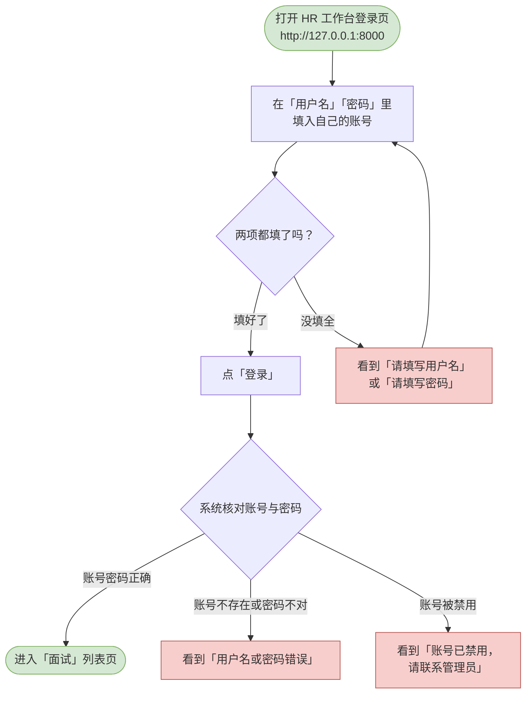
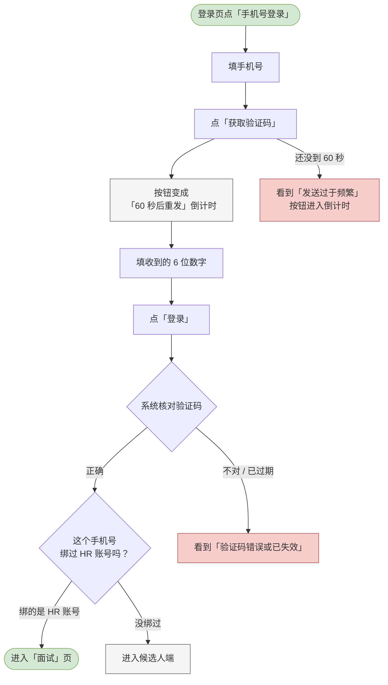

# 01 登录与账号

这一章你会学会做什么：走进 HR 工作台、干净地退出来，以及登录不进去时先看哪里。

> 还没把系统跑起来？看仓库根目录的 [如何打开项目.md](../../如何打开项目.md)，照它双击一个文件即可。

---

<a id="hr-login"></a>

## 登录系统（HR 端）

HR 和面试官共用一套账号。这一屏就是你每天上班打开的那个门。

**什么时候用 / 前提**：系统已经在运行（见上面的链接），并且管理员已经给你开好了账号。

**怎么做**：

1. 用浏览器打开 <http://127.0.0.1:8000>。如果系统还没起来，先看 [如何打开项目.md](../../如何打开项目.md)。
2. 页面左边是产品流程介绍，右边就是登录卡片。卡片顶部有「**密码登录**」和「**手机号登录**」两个切换按钮 —— 默认是密码登录。在「用户名」里填你的账号，在「密码」里填密码。
3. 点「登录」。
4. 登录成功后，你会直接落在「面试」页 —— 这是 HR 工作台的默认首页，也就是「今天该我做什么」那一屏。

> 页面上写着「演示账号：admin / admin12345」，第一次接触可以直接用它进去看。左侧导航底部会显示当前登录的人是谁，以及角色是「管理员」还是「HR」。
>
> 不想记密码的话看下一节：管理员给你的账号绑过手机号之后，你就可以用手机验证码登录。

**流程图**：



> 可编辑的流程图源文件：[diagrams/hr-login.drawio](diagrams/hr-login.drawio)

**你会看到**：成功时 —— 直接进入「面试」页；失败时 —— 两项没填全会看到「请填写用户名」或「请填写密码」；账号不存在或密码不对会看到「用户名或密码错误」；账号被停用会看到「账号已禁用，请联系管理员」。

---

<a id="hr-phone-login"></a>

## 用手机验证码登录（HR 端）

不用记密码 —— 把手机收到的 6 位数字填进去就能进。

**什么时候用 / 前提**：管理员已经在「用户管理」里把你的账号**绑过手机号**（见 [02 用户管理](02-用户管理.md)）。没绑过的话这个方式用不了，请回去用密码登录。

**怎么做**：

1. 打开登录页，点卡片顶部的「**手机号登录**」。
2. 在「手机号」里填你的手机号 —— 11 位，不用带 `+86`，中间的空格和横线也认。
3. 点「获取验证码」。
4. 把收到的 6 位数字填进去，点「登录」。

**流程图**：



**你会看到**：

- 成功时 —— 和密码登录一样进入「面试」页。
- 验证码不对或已过期 —— 提示「验证码错误或已失效」。**填错了、超时了、用过了，提示都是这一句**，这是有意的（区分开会变成「这个验证码状态」的探测接口）。
- 手机号格式不对 —— 「请填写 11 位手机号」。
- 点得太频繁 —— 「发送过于频繁」之类，按钮进入倒计时。
- 账号被停用 —— 「账号已禁用，请联系管理员」。

**两个要留意的行为**：

> ⚠️ **别拿一个没绑过的手机号在 HR 页面登录**。那种号码会被系统**自动建成一个候选人账号**（不是 HR），你会被送进候选人端。这是为了让候选人不用注册就能用，但在 HR 页面撞上会很困惑。
>
> ℹ️ **同一个手机号有多个账号是不可能的** —— 一个号只能绑一个账号。所以「用手机号登录会进哪一端」完全由管理员绑给了谁决定。

---

<a id="hr-logout"></a>

## 退出登录（HR 端）

把当前这个账号从浏览器里退出来。

**什么时候用 / 前提**：你已经登录了 HR 端，准备换人用或者离开电脑。

**怎么做**：

1. 看左侧导航条的最底下，那里写着当前账号的名字和角色。
2. 点它下面的「退出登录」。
3. 页面直接回到登录页。

> HR 工作台和候选人端各记各的登录状态。你在 HR 这边退出，不会影响同一个浏览器里开着的候选人端。

**流程图**：

```mermaid
flowchart TD
  classDef clsOk fill:#d5e8d4,stroke:#82b366;
  classDef clsBad fill:#f8cecc,stroke:#b85450;
  classDef clsNote fill:#f5f5f5,stroke:#666666;
  s([在左侧导航底部<br/>确认当前登录的账号])
  click[点「退出登录」]
  cleared[本端的登录状态被清除，<br/>回到登录页]
  note0[候选人端若也登录着，<br/>互不影响]
  s --> click
  click --> cleared
  cleared --> note0
  class s clsOk
  class note0 clsNote
```

> 可编辑的流程图源文件：[diagrams/hr-logout.drawio](diagrams/hr-logout.drawio)

**你会看到**：页面回到登录页，左侧导航和内容都消失。这一步没有二次确认，点了就退出。
