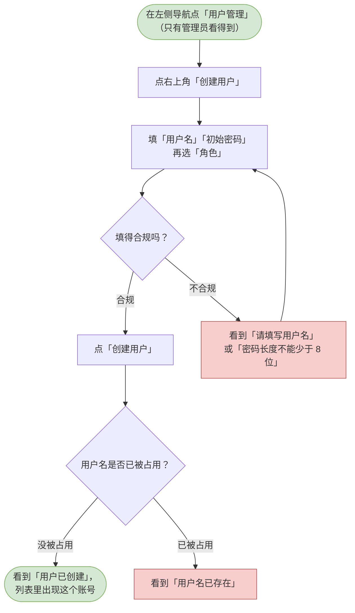
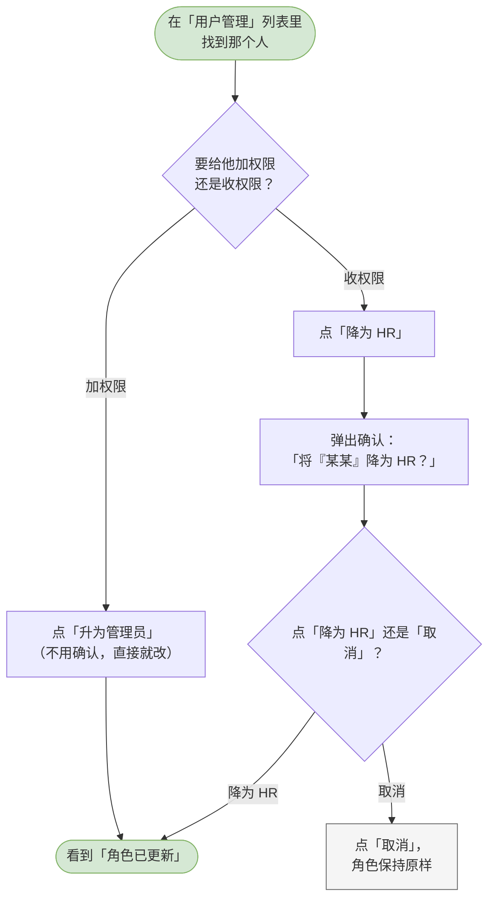
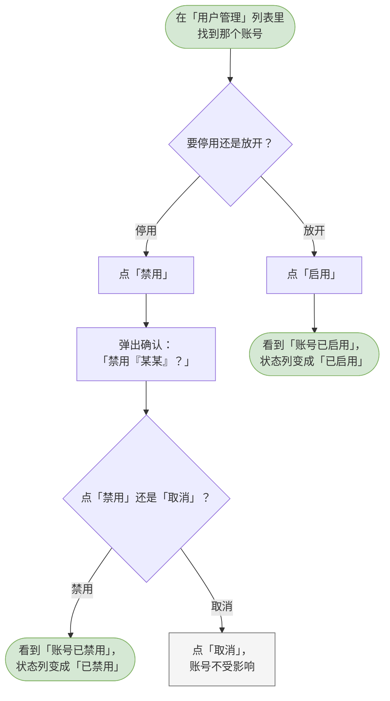

# 02 用户管理

这一章你会学会做什么：给同事开账号、调整谁能看到多少数据、以及把不再使用的账号停掉。

> 「用户管理」这一项只有管理员看得到。如果你登录后左侧导航里没有它，说明你的角色是 HR。

---

## 创建用户（指定角色 admin / hr）

给一位同事开一个 HR 工作台的账号，并决定他是普通 HR 还是管理员。

**什么时候用 / 前提**：你在用管理员账号登录。需要新同事也能进来做事。

**怎么做**：

1. 在左侧导航点「用户管理」。
2. 点页面右上角的「创建用户」。
3. 在「用户名」里填一个名字（最长 50 个字）。
4. 在「初始密码」里填一个 8–128 位的密码。页面上写着「创建后请让本人尽快修改」，记得提醒对方。
5. 在「角色」下拉里二选一：
   - 选「HR（只能看到自己创建的数据）」—— 对方只能看到自己建的岗位、题目和面试；
   - 选「管理员（可看全部数据、管理用户）」—— 对方能看到所有人建的数据，也能进这一页。
6. 点「创建用户」。

**流程图**：

> 可编辑的流程图源文件：[diagrams/hr-create-user.drawio](diagrams/hr-create-user.drawio)

**你会看到**：成功时 —— 弹窗关掉并提示「用户已创建」，列表里立刻多出这一行；失败时 —— 没填用户名看到「请填写用户名」，密码短于 8 位看到「密码长度不能少于 8 位」，名字被占用看到「用户名已存在」。

---

## 修改用户角色

在「普通 HR」和「管理员」之间切换某个人的权限。

**什么时候用 / 前提**：你在用管理员账号登录。有人的职责变了，需要加权限或收权限。

**怎么做**：

1. 在「用户管理」列表里找到那个人。
2. 看「角色」那一列，决定往哪边改：
   - 要给回权限 —— 点「升为管理员」，点了就生效，不会再问一遍；
   - 要收权限 —— 点「降为 HR」，这时会弹出一个确认框，标题是「将『某某』降为 HR？」，正文提醒你：降级后对方将只能看到自己创建的数据，左侧「用户管理」入口也会消失，随时可以再升回来。
3. 在确认框里点「降为 HR」。

> 你自己那一行，两个按钮都是灰的 —— 不能改自己的角色，免得把系统里最后一位管理员弄没了。

**流程图**：

> 可编辑的流程图源文件：[diagrams/hr-change-user-role.drawio](diagrams/hr-change-user-role.drawio)

**你会看到**：成功时 —— 提示「角色已更新」，列表里的角色标签当场变化；点「取消」则什么都不变。值得注意的是：对方下一次刷新页面就会按新角色看到数据，不需要等任何东西。

---

## 禁用 / 启用账号

把某个账号关掉，让对方登不进来；需要时再打开。

**什么时候用 / 前提**：你在用管理员账号登录。有人已经离职或暂时不该再进系统。

**怎么做**：

1. 在「用户管理」列表里找到那个账号。
2. 看「状态」那一列：
   - 现在是「已启用」，你要停掉它 —— 点「禁用」。这时会弹出确认框，标题是「禁用『某某』？」，正文提醒你：禁用后对方会立即被登出（已签发的登录状态同时失效），在重新启用前无法登录。
   - 现在是「已禁用」，你要放开它 —— 点「启用」。启用是给回权限，不会再多问一遍。
3. 如果要禁用，在确认框里点「禁用」。

> 你自己那一行不能禁用自己，按钮是灰的。

**流程图**：

> 可编辑的流程图源文件：[diagrams/hr-disable-user.drawio](diagrams/hr-disable-user.drawio)

**你会看到**：成功时 —— 提示「账号已禁用」或「账号已启用」，状态标签当场变色；对方再想登录会看到「账号已禁用，请联系管理员」。
