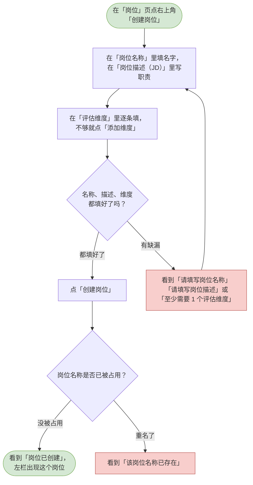
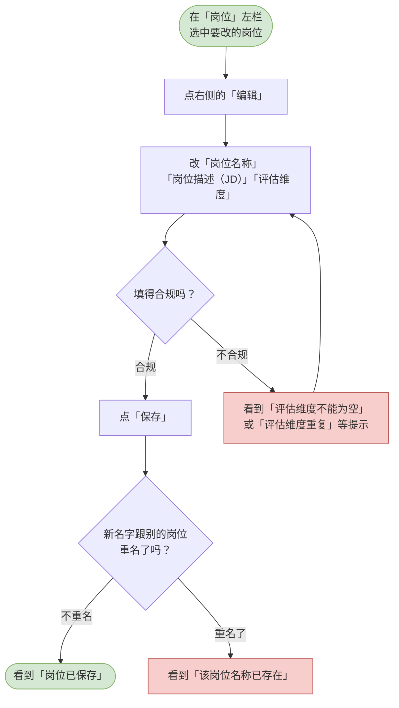
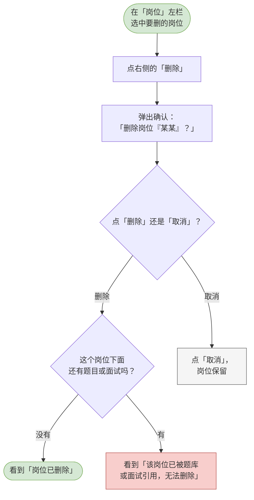

# 03 岗位管理

这一章你会学会做什么：把「我们要招什么」写清楚 —— 建岗位、改岗位、删岗位。岗位决定了 AI 出题的方向，也决定了评估报告按哪些维度打分。

> 先建岗位，再建题库和面试。题目要挂在岗位上，面试也要选岗位，所以这是所有事情的起点。

---

## 新增岗位（写 JD 与评估维度）

新开一个招聘岗位，把职责写进去，并定好按哪几个方面考察候选人。

**什么时候用 / 前提**：你已经在 HR 工作台里。要开始一个新的招聘方向。

**怎么做**：

1. 在左侧导航点「岗位」。
2. 点页面右上角的「创建岗位」。
3. 在「岗位名称」里填名字，比如「Java 开发工程师」。
4. 在「岗位描述（JD）」里写这个岗位要做什么。文本框里的提示是「写清职责、要求与团队情况。AI 依据这段文字出题，写得越具体，题目越贴合。」—— 写得具体一点是值得的。
5. 在「评估维度」里逐条填写。默认已经给了「沟通能力」和「专业能力」两条，可以直接改。
   - 要加一条就点「添加维度」，最多 10 条；
   - 要删一条就点那一行的「×」；
   - 单条最多 50 个字，且不能有两条重名的。
   > 页面下方写着：「这些维度决定了 AI 出题的方向，也是评估报告里雷达图的轴。」
6. 点「创建岗位」。

**流程图**：

> 可编辑的流程图源文件：[diagrams/hr-create-position.drawio](diagrams/hr-create-position.drawio)

**你会看到**：成功时 —— 弹窗关掉并提示「岗位已创建」，左栏立刻出现这个岗位，右侧显示它的 JD 与维度；失败时 —— 缺什么看到什么提示，重名会看到「该岗位名称已存在」。

---

## 编辑岗位

改一个已有岗位的名字、职责描述或考察维度。

**什么时候用 / 前提**：岗位的职责变了，或者当初定的考察维度不理想。

**怎么做**：

1. 在「岗位」页左栏选中要改的岗位。
2. 点右侧的「编辑」。
3. 按需改「岗位名称」「岗位描述（JD）」「评估维度」。加维度点「添加维度」，删维度点那一行的「×」。
4. 点「保存」。

> 「评估维度」这一栏是整体替换的：你保存时看到的这几条，就是保存后的全部，不是往原来的清单上再加。

**流程图**：

> 可编辑的流程图源文件：[diagrams/hr-edit-position.drawio](diagrams/hr-edit-position.drawio)

**你会看到**：成功时 —— 提示「岗位已保存」，右侧内容按你改的更新；失败时 —— 维度留空或重名会看到对应提示，名字撞车会看到「该岗位名称已存在」。

---

## 删除岗位

把一个不再需要的岗位从列表里去掉。

**什么时候用 / 前提**：这个岗位确实不再用了，且它下面已经没有题目或面试。

**怎么做**：

1. 在「岗位」页左栏选中要删的岗位。
2. 点右侧的「删除」。
3. 弹出确认框，标题是「删除岗位『某某』？」，正文写着「如果这个岗位下已经有题目或面试，删除会被拒绝。」
4. 在确认框里点「删除」。

**流程图**：

> 可编辑的流程图源文件：[diagrams/hr-delete-position.drawio](diagrams/hr-delete-position.drawio)

**你会看到**：成功时 —— 提示「岗位已删除」，左栏少了这一条；失败时 —— 如果这个岗位下还有题目或面试，会看到「该岗位已被题库或面试引用，无法删除」。这不是出错，是系统在拦你：先把那些题目和面试处理掉，再回来删。
