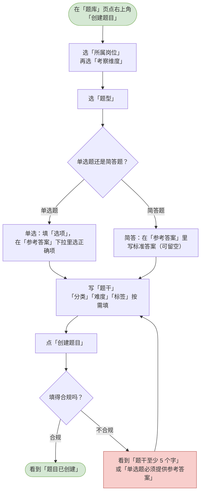
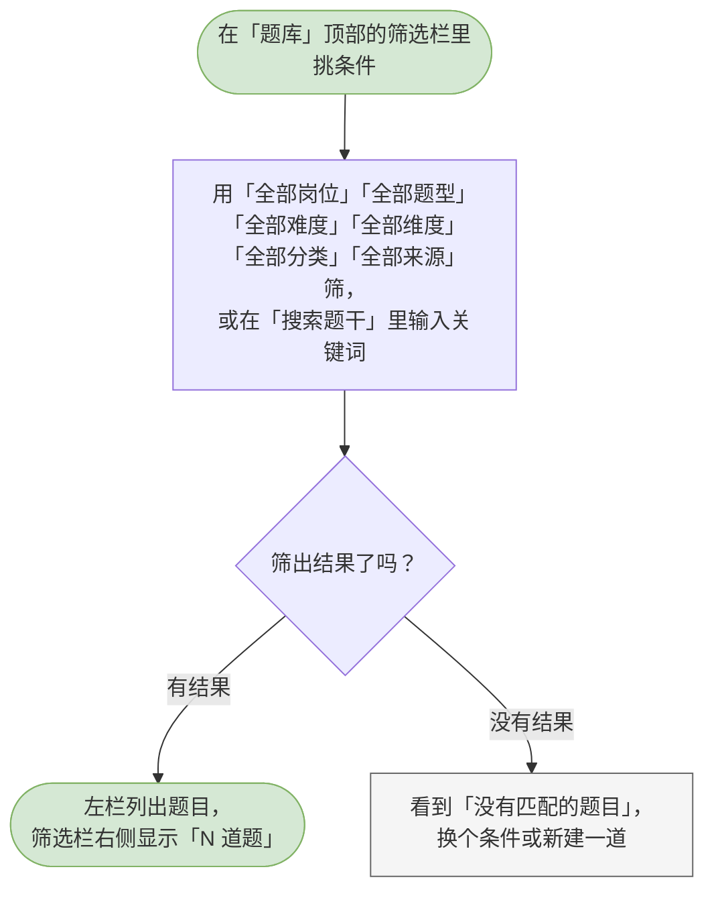
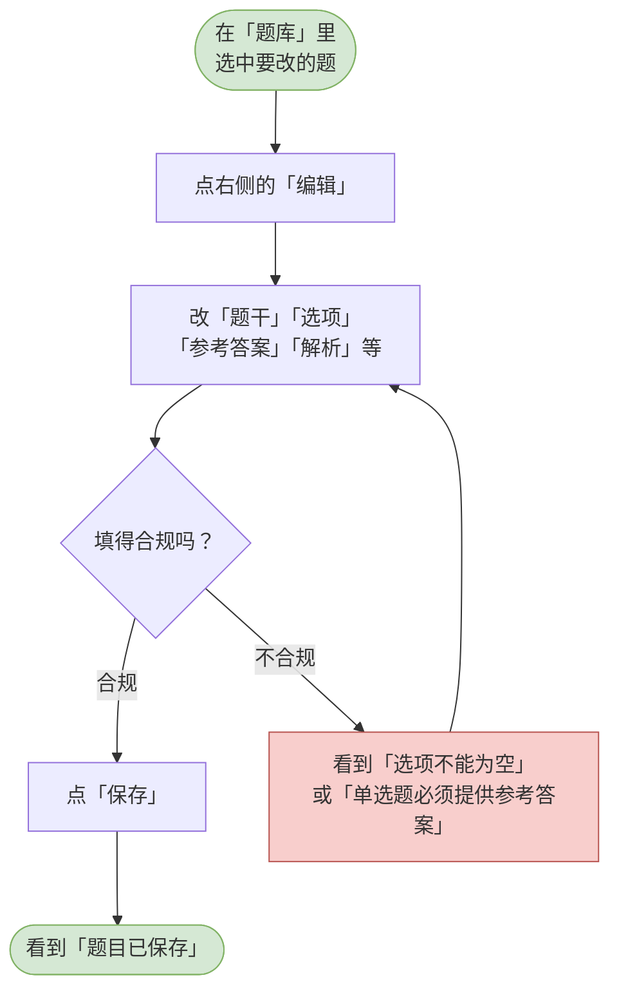
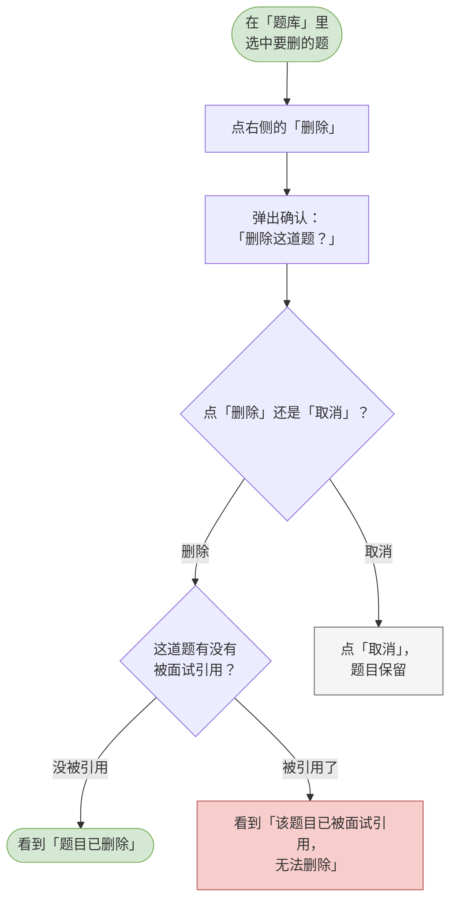

# 04 题库管理

这一章你会学会做什么：往题库里添题、让 AI 起草参考答案、按条件快速找到某一类题，以及改题和删题。

> 「题库」页是左选右读的：左边是题目清单，右边是选中那道题的全文（题干、选项、参考答案、解析）。
> 手工维护的题会优先被抽中；AI 在创建面试时补充的题也会自动收录到这里。

---

<a id="hr-create-question"></a>

## 新增题目（选择题型：单选 / 简答）

往题库里加一道新题。

**什么时候用 / 前提**：你至少已经建过一个岗位。题目必须挂在岗位上，所以没有岗位时「创建题目」按钮是灰的，鼠标停上去写着「请先创建岗位」。

**怎么做**：

1. 在左侧导航点「题库」，再点页面右上角的「创建题目」。
2. 在「所属岗位」里选这道题属于哪个岗位。「考察维度」会跟着变成这个岗位的维度清单，从里面挑一个。
3. 在「题型」里二选一：点「单选题」或点「简答题」。选哪个，下面的表单就跟着换样子。
4. 按题型填写：
   - 选了「单选题」：在「选项」里逐条填内容，需要更多就点「添加选项」（至少 2 个、最多 10 个）。填完再在「参考答案」下拉里挑出正确的那一项 —— 判分时就按它比对。
   - 选了「简答题」：在「参考答案」里写下标准答案。这里可以留空，留空表示还没有标准答案，之后再让 AI 起草。
5. 在「题干」里写题目（5–2000 字）。文本框的提示是「写具体一点。好的面试题通常指向一个真实场景，而不是让人背诵定义。」
6. 按需填「解析」（写清这道题在考什么、可追问哪些方向）、「分类」（默认是「通用」）、「难度」（易 / 中 / 难）、「标签」（用顿号或逗号分隔，最多 10 个、每个不超过 20 字）。
7. 点「创建题目」。

**流程图**：



> 可编辑的流程图源文件：[diagrams/hr-create-question.drawio](diagrams/hr-create-question.drawio)

**你会看到**：成功时 —— 提示「题目已创建」，左栏立刻多出这一条；失败时 —— 题干太短看到「题干至少 5 个字」，单选题没挑正确项看到「单选题必须提供参考答案」，选项为空或重复也会给出对应提示。

---

<a id="hr-ai-reference-answer"></a>

## 让 AI 生成参考答案与解析

不用自己写答案，让 AI 起草一份，你再改。

**什么时候用 / 前提**：这道题已经保存过了。题目必须先存在，AI 才有东西可参考。在新建题目的弹窗里，这个按钮是灰的，鼠标停上去写着「先保存这道题，才能用 AI 生成参考答案」。

**怎么做**：

1. 在「题库」里选中一道题。
2. 点右侧的「AI 生成参考答案」。
3. 如果这道题已经有参考答案，会先弹一个确认框，标题是「重新生成参考答案？」，正文写着「生成会覆盖这道题现有的参考答案与解析，且不可撤销。」—— 点「重新生成」继续。
4. 等一会儿，按钮会变成「生成中…」。
5. 生成完成后，参考答案和解析直接落到这道题上。不满意可以点「编辑」继续手工修改。

> 单选的答案必须是选项之一。如果 AI 给了一个不在选项里的答案，系统会拒绝写回并告诉你「AI 生成的答案不在选项中，请手工确认」，原答案保持不变。

**流程图**：

```mermaid
flowchart TD
  classDef clsOk fill:#d5e8d4,stroke:#82b366;
  classDef clsBad fill:#f8cecc,stroke:#b85450;
  classDef clsNote fill:#f5f5f5,stroke:#666666;
  s([在「题库」里<br/>选中一道题])
  click[点右侧的<br/>「AI 生成参考答案」]
  has{这道题已经有<br/>参考答案了吗？}
  dlg[弹出确认：<br/>「重新生成参考答案？」]
  confirm{点「重新生成」还是「取消」？}
  gen[按钮变成「生成中…」，稍等]
  ok([看到「参考答案已更新」<br/>（在弹窗里是「已生成，可直接修改后保存」）])
  fail[看到「AI 生成的答案不在选项中，<br/>请手工确认」等提示，<br/>原来的答案没被覆盖]
  cancel[点「取消」，<br/>答案保持原样]
  s --> click
  click --> has
  has -->|已有答案| dlg
  has -->|还没有答案| gen
  dlg --> confirm
  confirm -->|取消| cancel
  confirm -->|重新生成| gen
  gen -->|生成成功| ok
  gen -->|AI 给的答案不合规| fail
  class s clsOk
  class ok clsOk
  class fail clsBad
  class cancel clsNote
```

> 可编辑的流程图源文件：[diagrams/hr-ai-reference-answer.drawio](diagrams/hr-ai-reference-answer.drawio)

**你会看到**：成功时 —— 在右侧案卷里提示「参考答案已更新」，在题目弹窗里提示「已生成，可直接修改后保存」；失败时 —— 提示「AI 生成的答案不在选项中，请手工确认」，此时答案没有被改掉。

---

<a id="hr-search-question"></a>

## 查询与筛选题目

题库大了以后，快速把某一类题捞出来。

**什么时候用 / 前提**：题库里已经有题。

**怎么做**：

1. 在「题库」页顶部的筛选栏里挑条件。可以同时用几个：
   - 「全部岗位」—— 按岗位筛；
   - 「全部题型」—— 单选 / 简答；
   - 「全部难度」—— 易 / 中 / 难；
   - 「全部维度」—— 按考察维度筛；
   - 「全部分类」—— 按分类筛；
   - 「全部来源」—— 「手工」是自己录的，「AI」是 AI 生成的；
   - 「搜索题干」—— 直接按题干里的字找。
2. 每改一项，左栏立刻重算，筛选栏右侧的分母也会跟着变，例如「12 道题」。
3. 在左栏点一条，右侧就显示它的全文。

**流程图**：



> 可编辑的流程图源文件：[diagrams/hr-search-question.drawio](diagrams/hr-search-question.drawio)

**你会看到**：有结果时 —— 左栏列出匹配的题目，右侧显示「N 道题」；一条都没匹配上时 —— 左栏写着「没有匹配的题目」，搜索框还在，方便你换个词。

---

<a id="hr-edit-question"></a>

## 编辑题目

改一道已有题目的内容。

**什么时候用 / 前提**：题目措辞不理想、答案要修正、难度标错了。

**怎么做**：

1. 在「题库」里选中要改的题。
2. 点右侧的「编辑」。
3. 按需改「题干」「选项」「参考答案」「解析」「分类」「难度」「标签」，也可以改「题型」—— 换个题型，表单会跟着换样子。
4. 点「保存」。

**流程图**：



> 可编辑的流程图源文件：[diagrams/hr-edit-question.drawio](diagrams/hr-edit-question.drawio)

**你会看到**：成功时 —— 提示「题目已保存」，右侧内容当场更新；失败时 —— 选项留空、答案没挑、标签超限等都会在对应位置给出提示。

> 改了题目要注意一件事：已经建好的面试用的是**当时**的题干。改题库不会改到已经出过的那场面试里去。

---

<a id="hr-delete-question"></a>

## 删除题目

把一道不再需要的题从题库里去掉。

**什么时候用 / 前提**：这道题确实不要了，且它没有被任何面试引用。

**怎么做**：

1. 在「题库」里选中要删的题。
2. 点右侧的「删除」。
3. 弹出确认框，标题是「删除这道题？」，正文写着「如果它已经被某场面试引用，删除会被拒绝。」
4. 在确认框里点「删除」。

**流程图**：



> 可编辑的流程图源文件：[diagrams/hr-delete-question.drawio](diagrams/hr-delete-question.drawio)

**你会看到**：成功时 —— 提示「题目已删除」，左栏少了这一条；失败时 —— 如果这道题已经被某场面试用到，会看到「该题目已被面试引用，无法删除」。这是在保护历史记录：那场面试要靠这道题才能解释清楚当时考了什么。
