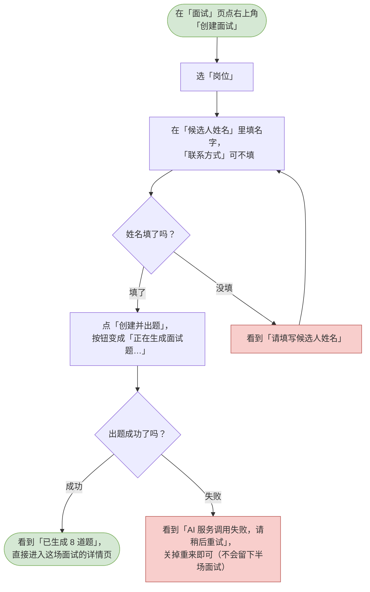
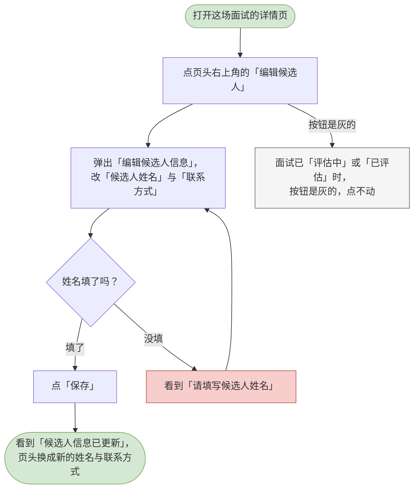
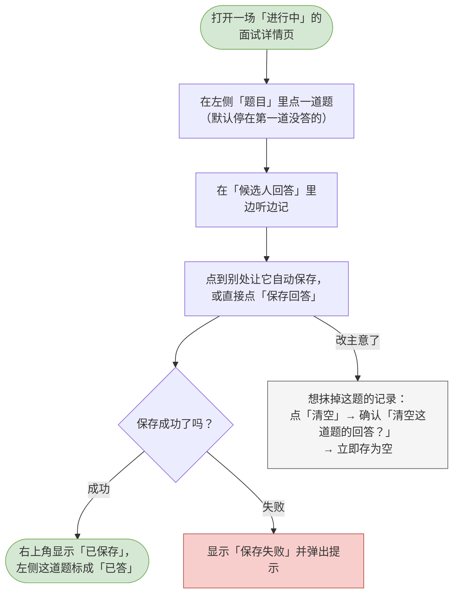
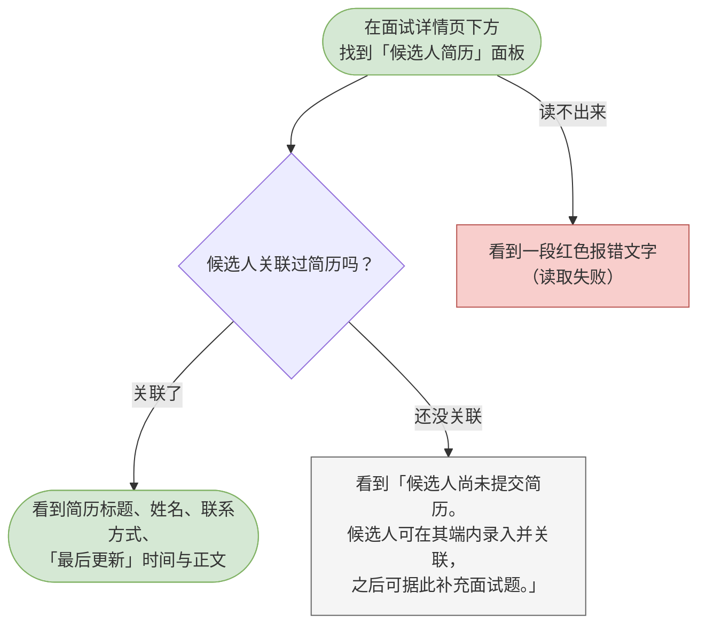

# 05 面试管理

这一章你会学会做什么：从建一场面试开始，一路做到记录回答、发邀请码给候选人、看候选人简历、按简历补题，最后把面试收口。这是 HR 每天打开系统真正要干活的地方。

> 面试详情页分左右两半：左边是题目清单（每题标着「待答 / 已答」，鼠标停上去能看到完整题干），右边是当前这道题的录入框。
> 面试自己的进度只有四步，显示在页面上方那一条「进度轨」上：进行中 → 已完成 → 评估中 → 已评估。这一章的所有动作，都会让这条轨往前走或往回退。

---

<a id="hr-create-interview"></a>

## 创建面试（自动出题）

建一场面试，并让系统当场把题目出好。

**什么时候用 / 前提**：你已经建过岗位。没有岗位时「创建并出题」按钮是灰的，弹窗里会写着「还没有岗位。先到「岗位」页创建一个，再回来建面试。」

**怎么做**：

1. 在左侧导航点「面试」，再点页面右上角的「创建面试」。
2. 在「岗位」里选这场面试属于哪个岗位。下面写着「AI 会按这个岗位的 JD 和评估维度出题。」
3. 在「候选人姓名」里填名字。
4. 「联系方式」可以不填，填的话写邮箱或手机号。
5. 点「创建并出题」。按钮会变成「正在生成面试题…」，这是正常的 —— 出题要花几秒。
6. 出题成功后，页面直接跳到这场面试的详情页，可以马上开始记录。

> 弹窗底部写着出题规则：「创建后会立刻出题：题库抽 5 道、AI 按 JD 补 3 道，共 8 道，通常需要几秒。」
> 如果 AI 那一刻不可用，整场创建会整体作废，不会留下半场面试，你可以直接关掉重来。

**流程图**：



> 可编辑的流程图源文件：[diagrams/hr-create-interview.drawio](diagrams/hr-create-interview.drawio)

**你会看到**：成功时 —— 提示「已生成 8 道题」，并直接进入这场面试的详情页；失败时 —— 没填姓名看到「请填写候选人姓名」；出题本身失败会看到「AI 服务调用失败，请稍后重试」。

---

<a id="hr-edit-candidate"></a>

## 编辑候选人信息

改这场面试里候选人的名字或联系方式。

**什么时候用 / 前提**：这场面试还没走到「评估中」或「已评估」时都能改。走到这两步之后，页头那个「编辑候选人」按钮会变灰，点不动了 —— 鼠标停上去会写着「评估中或已评估的面试不可修改候选人信息」。

**怎么做**：

1. 打开这场面试的详情页。
2. 点页头右上角的「编辑候选人」。
3. 弹出「编辑候选人信息」，里面有两个框：「候选人姓名」和「联系方式」。
4. 改「候选人姓名」（这一项必填，留空保存不了）；「联系方式」留空就等于清空。
5. 点「保存」。

> 这里只改候选人的名字和联系方式，不动面试的进度 —— 面试走到哪一步，还是靠「标记完成」「回退到进行中」那些按钮。

**流程图**：



> 可编辑的流程图源文件：[diagrams/hr-edit-candidate.drawio](diagrams/hr-edit-candidate.drawio)

**你会看到**：成功时 —— 提示「候选人信息已更新」，页头的名字与联系方式换成新的；失败时 —— 姓名空着会看到「请填写候选人姓名」；面试已经「评估中」或「已评估」时，按钮是灰的，鼠标停上去写着「评估中或已评估的面试不可修改候选人信息」。

---

<a id="hr-record-answer"></a>

## 录入 / 修改候选人回答

一边面试一边把候选人的回答记下来。这是这一页用得最多的动作。

**什么时候用 / 前提**：面试的进度是「进行中」。进度走到「已完成」之后就锁住了，要改得先回退（见本章最后一节）。

**怎么做**：

1. 打开这场面试的详情页。系统默认停在第一道还没记回答的题上。
2. 在左侧「题目」清单里点你想记录的那一道。
3. 在「候选人回答」里写。文本框的提示是「边听边记。留空表示候选人未作答，评估时按 0 分处理。」
4. 把光标点到别处，它会自动保存。也可以直接点「保存回答」。
5. 记完一题，点左下角的「下一题」接着记。

> 想抹掉某一题的记录，点「清空」。它会弹一个确认框「清空这道题的回答？」，正文提醒你：清空后会立即保存为空，等同于候选人未作答（评估按 0 分计），原来的内容无法恢复。
> 每条题目的右上角有一个小字提示：没保存时写「未修改」，保存时写「保存中…」，存好了写「已保存」，出问题写「保存失败」。

**流程图**：



> 可编辑的流程图源文件：[diagrams/hr-record-answer.drawio](diagrams/hr-record-answer.drawio)

**你会看到**：成功时 —— 右上角小字变成「已保存」，左侧那一题的标记从「待答」变成「已答」，顶上的「N / M」也跟着走；失败时 —— 小字变成「保存失败」并弹出提示，你写的内容还在，可以再试一次。

> 换个题、按浏览器后退、甚至直接关掉标签页，系统都会先把当前输入框里还没存的内容存下来，不会白写。

---

<a id="hr-create-invitation"></a>

## 生成作答邀请码

发一张邀请码给候选人，让对方自己上网答题。

**什么时候用 / 前提**：面试的进度是「进行中」。已完成的面试发邀请已经没有意义，按钮会是灰的。

**怎么做**：

1. 打开这场面试的详情页。
2. 滚到页面下方，找到「作答邀请」面板。
3. 点面板上的「生成邀请码」。
4. 生成好的码会出现在下面的列表里，状态是「待接受」，同一行还写着「创建于 …」和「有效期至 …」。
5. 点那一行的「复制」，把它发给候选人（邮件、聊天都行）。

> 一张码 7 天内有效，且只能用一次。候选人拿到之后，在候选人端「凭邀请码激活」那页填进去，这场面试就会出现在他的「我的面试」里。

**流程图**：

```mermaid
flowchart TD
  classDef clsOk fill:#d5e8d4,stroke:#82b366;
  classDef clsBad fill:#f8cecc,stroke:#b85450;
  classDef clsNote fill:#f5f5f5,stroke:#666666;
  s([打开一场「进行中」的<br/>面试详情页])
  scroll[滚到页面下方的<br/>「作答邀请」面板]
  click[点「生成邀请码」]
  done{生成成功了吗？}
  ok([看到「邀请码已生成，<br/>复制后发给候选人」])
  fail[看到「当前状态下不可生成邀请，<br/>请先将面试置为进行中」]
  copy[点「复制」把码发给候选人，<br/>看到「邀请码已复制」]
  s --> scroll
  scroll --> click
  click --> done
  done -->|成功| ok
  done -->|失败| fail
  ok --> copy
  class s clsOk
  class ok clsOk
  class fail clsBad
```

> 可编辑的流程图源文件：[diagrams/hr-create-invitation.drawio](diagrams/hr-create-invitation.drawio)

**你会看到**：成功时 —— 提示「邀请码已生成，复制后发给候选人」，列表里多出一张「待接受」的码；点「复制」提示「邀请码已复制」（浏览器不给复制权限时会提示「复制失败，请手工选中邀请码复制」）；失败时 —— 进度不对会看到「当前状态下不可生成邀请，请先将面试置为进行中」。

---

<a id="hr-manage-invitation"></a>

## 查看与撤销邀请码

看清每张码现在什么状况，需要时把它作废。

**什么时候用 / 前提**：你已经给这场面试发过至少一张邀请码。

**怎么做**：

1. 打开面试详情页，滚到「作答邀请」面板。
2. 每张码都显示着编号、状态和两个时间。状态一共四种：
   - 「待接受」—— 还没人用，可以复制；
   - 「已接受」—— 候选人已经激活了，同一行还会写着对方的账号名；
   - 「已撤销」—— 你已经把它作废了；
   - 「已过期」—— 过了 7 天有效期。
3. 要作废一张，点它右边的「撤销」。
4. 弹出确认框「撤销这张邀请码？」。如果这张已经被接受过，正文会提醒你：撤销会立刻切断他在候选人端对本场面试的访问 —— 这是收回访问权的唯一手段。
5. 在确认框里点「撤销」。

**流程图**：

```mermaid
flowchart TD
  classDef clsOk fill:#d5e8d4,stroke:#82b366;
  classDef clsBad fill:#f8cecc,stroke:#b85450;
  classDef clsNote fill:#f5f5f5,stroke:#666666;
  s([在面试详情页下方的<br/>「作答邀请」面板])
  list[看到每张码的编号与状态：<br/>待接受 / 已接受 / 已撤销 / 已过期]
  pick{要处理哪一张？}
  click[点那张码右边的「撤销」]
  dlg[弹出确认：<br/>「撤销这张邀请码？」]
  confirm{点「撤销」还是「取消」？}
  ok([看到「邀请已撤销」，<br/>状态变成「已撤销」])
  cancel[点「取消」，<br/>这张码不变]
  s --> list
  list --> pick
  pick -->|撤销| click
  click --> dlg
  dlg --> confirm
  confirm -->|撤销| ok
  confirm -->|取消| cancel
  class s clsOk
  class ok clsOk
  class cancel clsNote
```

> 可编辑的流程图源文件：[diagrams/hr-manage-invitation.drawio](diagrams/hr-manage-invitation.drawio)

**你会看到**：成功时 —— 提示「邀请已撤销」，状态标签当场变成「已撤销」；「复制」按钮只在「待接受」的码上出现，因为已撤销或已过期的码发出去也用不了。

---

<a id="hr-view-resume"></a>

## 查看候选人关联的简历

看候选人自己录进来的那份简历，据此决定这场面试还要问什么。

**什么时候用 / 前提**：候选人在他自己的端里录了简历，并且把这份简历关联到了这一场面试。简历只由候选人自己录，他没关联到你这场面试之前，你是看不到的。

**怎么做**：

1. 打开面试详情页，滚到下方的「候选人简历」面板。
2. 如果已经关联了，面板上会直接显示：简历标题、候选人的姓名与联系方式，以及「最后更新 …」的时间。
3. 时间那一行是给你判断手上这份是不是最新的：候选人改过简历之后，要重新点一次「按简历补题」才会用上新内容。
4. 如果还没关联，面板上会写着「候选人尚未提交简历。候选人可在其端内录入并关联，之后可据此补充面试题。」

**流程图**：



> 可编辑的流程图源文件：[diagrams/hr-view-resume.drawio](diagrams/hr-view-resume.drawio)

**你会看到**：关联了 —— 下面直接是简历全文；还没关联 —— 面板标题右侧写着「尚未关联」，下面是一句说明。这两种样子差别很明显，不用猜。

---

<a id="hr-match-questions"></a>

## 按简历补题

让 AI 读候选人的简历，从题库里再挑几道跟他的经历相关的题补进这场面试。

**什么时候用 / 前提**：这场面试是「进行中」，并且候选人已经把简历关联到了这一场。两个条件缺一个，按钮都是灰的 —— 鼠标停上去会告诉你缺的是哪一个。

**怎么做**：

1. 在面试详情页的「候选人简历」面板上，找到「按简历补题」按钮。
2. 点它。按钮会变成「匹配中…」，稍等一下。
3. 出结果后页面会刷新，新补的题出现在左侧题目清单的最后，并且带着一句「为什么选这道题：…」。

> 补题是往这场面试里**加**题，不是换题。想再加几道就再点一次，系统会接着挑下一批，不会把已经在这场的题重复添一遍。
> 新补的题，来源标签显示成「简历匹配」。

**流程图**：

```mermaid
flowchart TD
  classDef clsOk fill:#d5e8d4,stroke:#82b366;
  classDef clsBad fill:#f8cecc,stroke:#b85450;
  classDef clsNote fill:#f5f5f5,stroke:#666666;
  s([在面试详情页的<br/>「候选人简历」面板上])
  d1{这场面试关联简历了吗？}
  noresume[「按简历补题」是灰的，<br/>鼠标停上去看到「该面试尚未关联简历」]
  d2{面试是「进行中」吗？}
  notongoing[按钮灰着，<br/>提示「当前状态不可补题」]
  click[点「按简历补题」]
  click2[按钮变成「匹配中…」，稍等]
  done{匹配到新题了吗？}
  ok([看到「本次新增 N 题，本场共 M 题」])
  none[看到「未匹配到新的题目」]
  fail[看到「题库中没有可补充的题目」<br/>等提示]
  s --> d1
  d1 -->|关联了| d2
  d1 -->|还没关联| noresume
  d2 -->|进行中| click
  d2 -->|不是进行中| notongoing
  click --> click2
  click2 --> done
  done -->|匹配到了| ok
  done -->|没有更相关的题| none
  done -->|失败了| fail
  class s clsOk
  class noresume clsNote
  class notongoing clsNote
  class ok clsOk
  class none clsNote
  class fail clsBad
```

> 可编辑的流程图源文件：[diagrams/hr-match-questions.drawio](diagrams/hr-match-questions.drawio)

**你会看到**：补上了 —— 提示「本次新增 N 题，本场共 M 题」，新题带着匹配理由出现在清单里；没有更相关的 —— 提示「未匹配到新的题目」，这不是出错，是一场正常的「没找到」；按钮灰着 —— 鼠标停上去会告诉你原因，是「该面试尚未关联简历」还是「当前状态不可补题」。

---

<a id="hr-complete-interview"></a>

## 标记面试完成

这场面试问完了，把它收口，准备进入评估。

**什么时候用 / 前提**：面试的进度是「进行中」。

**怎么做**：

1. 打开这场面试的详情页。
2. 确认题目都记得差不多了。没记完也可以往下走 —— 页面上提醒过你：没记回答的题，评估时按 0 分算。
3. 点页头右上角的「标记完成」。

> 「标记完成」只是把这场面试收口，评估还没有开始。收口之后，这一页上那条「候选人回答」输入框会变成只读，要再改就得先回退。

**流程图**：

```mermaid
flowchart TD
  classDef clsOk fill:#d5e8d4,stroke:#82b366;
  classDef clsBad fill:#f8cecc,stroke:#b85450;
  classDef clsNote fill:#f5f5f5,stroke:#666666;
  s([打开一场「进行中」的<br/>面试详情页])
  warn[题目还没记完也没关系 ——<br/>没记回答的题，评估时按 0 分算]
  click[点页头右上角的「标记完成」]
  done{成功了吗？}
  ok([看到「已标记完成」，<br/>进度走到「已完成」])
  fail[看到「不允许从「进行中」迁移到<br/>「已完成」」时，说明状态已被改过，<br/>刷新页面看看]
  s --> warn
  warn --> click
  click --> done
  done -->|成功| ok
  done -->|失败| fail
  class s clsOk
  class warn clsNote
  class ok clsOk
  class fail clsBad
```

> 可编辑的流程图源文件：[diagrams/hr-complete-interview.drawio](diagrams/hr-complete-interview.drawio)

**你会看到**：成功时 —— 提示「已标记完成」，页头上方的进度轨走到「已完成」，右上的按钮组换成「回退到进行中」和「去评估」。

---

<a id="hr-rollback-interview"></a>

## 回退到进行中

把一场已经收口的面试退回到「进行中」，好继续补记或修改回答。

**什么时候用 / 前提**：面试的进度是「已完成」或「已评估」。进度停在「评估中」时不能回退 —— 得等评估跑完。

**怎么做**：

1. 打开这场面试的详情页。
2. 点页头右上角的「回退到进行中」。
3. 进度退回「进行中」，回答那一栏重新可写。

> 如果这场面试已经评估过、已经有了报告，回退并修改回答之后，需要重新点一次「重新评估」，报告才会跟着变。

**流程图**：

```mermaid
flowchart TD
  classDef clsOk fill:#d5e8d4,stroke:#82b366;
  classDef clsBad fill:#f8cecc,stroke:#b85450;
  classDef clsNote fill:#f5f5f5,stroke:#666666;
  s([打开一场「已完成」<br/>或「已评估」的面试])
  click[点页头右上角的<br/>「回退到进行中」]
  done{成功了吗？}
  ok([看到「已回退到进行中」，<br/>可以继续改回答了])
  fail[看到「不允许从「评估中」迁移到<br/>「进行中」」—— 评估中不能回退，<br/>等评估结束再来]
  s --> click
  click --> done
  done -->|成功| ok
  done -->|失败| fail
  class s clsOk
  class ok clsOk
  class fail clsBad
```

> 可编辑的流程图源文件：[diagrams/hr-rollback-interview.drawio](diagrams/hr-rollback-interview.drawio)

**你会看到**：成功时 —— 提示「已回退到进行中」，进度轨退回一步，回答重新可写；失败时 —— 会看到一条像「不允许从「评估中」迁移到「进行中」」这样的提示，照它说的等评估结束就行。
