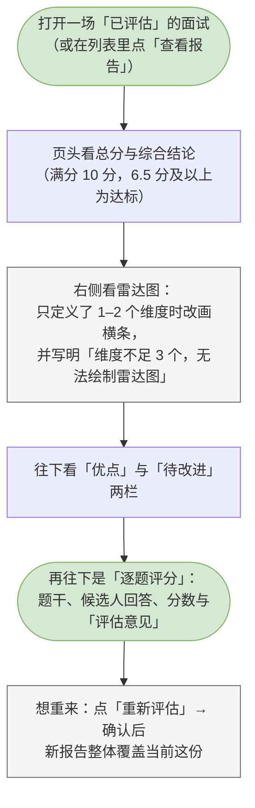
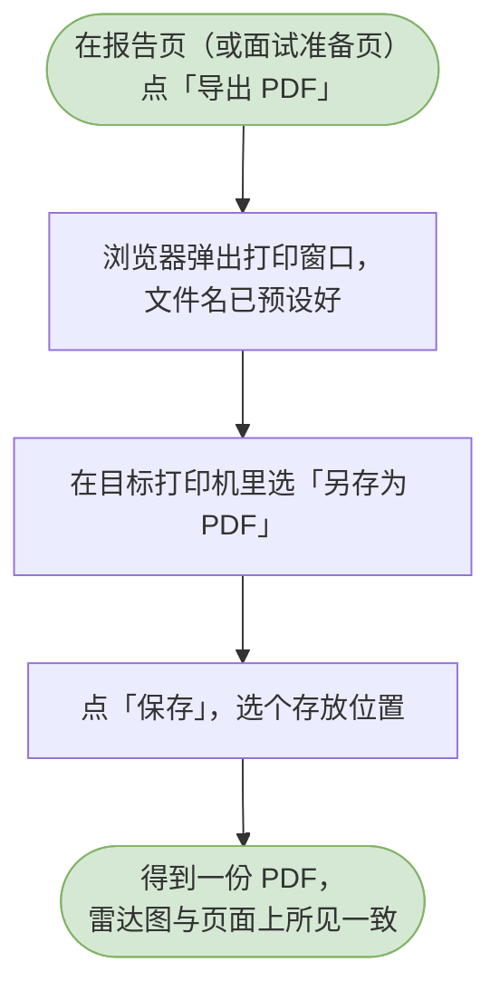

# 06 评估与报告

这一章你会学会做什么：让系统给这场面试打分、读懂那份报告，以及把报告导成 Word 或 PDF 交出去。

> 评估是一次性的整体动作：从「已完成」开始，逐题出分、按维度汇总，最后给出一份报告。报告本身不可编辑 —— 想改，唯一的办法是改完回答再重新评估一遍。

---

<a id="hr-run-evaluation"></a>

## 开始评估（看实时进度）

让系统读一遍已经记下来的回答，逐题打分。

**什么时候用 / 前提**：面试的进度是「已完成」。进度还在「进行中」时，这一页会告诉你「评估读的是已经记录下来的回答。请先把面试标记为完成，再回到这里开始评估。」并在页头给你一个「去评估」带路。

**怎么做**：

1. 打开一场「已完成」的面试，进到评估这一页（面试列表里那一行的按钮写着「去评估」）。
2. 页面开头写着「尚未评估」，并列出三步：逐题评分、多维评分、汇总报告。每条下面有一句说明这一步在做什么。
3. 如果有题没记回答，页面上会先提醒你「本场有 N 道题没有记录回答，评估时按 0 分计入。」
4. 点「开始评估」。按钮会变成「正在提交…」。
5. 接下来不用动手，页面自己会往前走：
   - 先显示「正在逐题评分…」和「已出分 / 总题数」的计数，分数一条条落进下面的「逐题评分」里；
   - 然后显示「正在生成多维评分…」；
   - 最后显示「正在汇总报告…」。
6. 跑完之后页面变成「已评估」，总分、综合结论、雷达图和逐题评分就都齐了。

> 跑到一半网络断了也不要紧。页面会提示「评估流已断开。评估任务可能仍在后台继续，重新加载即可接上进度。」—— 任务本身没有失败，重新加载会接上它。

**流程图**：

```mermaid
flowchart TD
  classDef clsOk fill:#d5e8d4,stroke:#82b366;
  classDef clsBad fill:#f8cecc,stroke:#b85450;
  classDef clsNote fill:#f5f5f5,stroke:#666666;
  s([打开一场「已完成」的面试，<br/>进到评估这一页])
  click[点「开始评估」<br/>（按钮变成「正在提交…」）]
  missing[页面上可能提示<br/>「本场有 N 道题没有记录回答，<br/>评估时按 0 分计入。」]
  stream[页面实时显示「正在逐题评分…」<br/>与「N / M」的进度，<br/>分数一条条落下来]
  done{评估跑完了吗？}
  ok([页面变成「已评估」，<br/>出现总分、综合结论、雷达图<br/>与逐题评分])
  fail[看到「评估流已断开。评估任务可能仍在<br/>后台继续，重新加载即可接上进度。」]
  s --> click
  click --> missing
  missing --> stream
  stream --> done
  done -->|跑完了| ok
  done -->|断了| fail
  class s clsOk
  class missing clsNote
  class ok clsOk
  class fail clsBad
```

> 可编辑的流程图源文件：[diagrams/hr-run-evaluation.drawio](diagrams/hr-run-evaluation.drawio)

**你会看到**：成功时 —— 页面从「尚未评估」变成完整的报告；失败时 —— 看到「评估流已断开。评估任务可能仍在后台继续，重新加载即可接上进度。」，照着重新加载就好。

---

<a id="hr-view-report"></a>

## 查看评估报告（含雷达图）

把这份报告从上到下读一遍。

**什么时候用 / 前提**：这场面试已经评估完。在面试列表里，那一行的按钮写着「查看报告」。

**怎么做**：

1. 打开这场面试的评估页。
2. 先看页头左侧：最上面是总分，旁边写着「满分 10 分，6.5 分及以上为达标」；下面是综合结论。
3. 再往下是「优点」和「待改进」两栏。这两栏后面就是能直接抄进评审结论的话。
4. 看页头右侧的雷达图。图下面有图例，每个维度一行，写着维度名、分数和一句为什么。
   > 如果这个岗位只定了 1–2 个考察维度，围不成面积，页面会改画成横条，并写明「维度不足 3 个，无法绘制雷达图 —— 按维度列出得分。」
5. 最后往下翻到「逐题评分」。每一题给出：题号、考察维度、分数、题干、候选人回答原文和「评估意见」。没作答的题会显示「本题未作答」。
6. 想从头重来一遍，点页头的「重新评估」。它会先弹确认框，提醒你新报告会整体覆盖当前这一份 —— 逐题评分、多维评分与结论都不会保留。评估本身不可编辑，重评是唯一的修改方式。

**流程图**：



> 可编辑的流程图源文件：[diagrams/hr-view-report.drawio](diagrams/hr-view-report.drawio)

**你会看到**：一页从上到下的完整报告。如果状态说已评估、但报告一时读不出来，页面会如实写「报告读取失败」并给你一个「重新加载」，不会假装有报告。

---

<a id="hr-export-docx"></a>

## 导出 Word（DOCX）

把这份报告存成一个 Word 文件，发给别人或归档。

**什么时候用 / 前提**：报告已经出来了（进度是「已评估」）。

**怎么做**：

1. 在报告页的右上角点「导出 DOCX」。
2. 按钮会变成「正在生成…」，稍等。
3. 生成好之后，浏览器会把文件存到你的下载目录。文件名形如「面试报告_候选人姓名.docx」。

> 导出的 Word 里有基本信息与两张评分表，**不含雷达图**。想要带图的版本，用下一节的「导出 PDF」。

**流程图**：

```mermaid
flowchart TD
  classDef clsOk fill:#d5e8d4,stroke:#82b366;
  classDef clsBad fill:#f8cecc,stroke:#b85450;
  classDef clsNote fill:#f5f5f5,stroke:#666666;
  s([在「已评估」的报告页右上角])
  click[点「导出 DOCX」<br/>（按钮变成「正在生成…」）]
  done{生成并下载成功了吗？}
  ok([看到「已导出 面试报告_某某.docx」，<br/>文件存到浏览器的下载目录])
  fail[看到「…（可改用「导出 PDF」）」]
  s --> click
  click --> done
  done -->|成功| ok
  done -->|失败| fail
  class s clsOk
  class ok clsOk
  class fail clsBad
```

> 可编辑的流程图源文件：[diagrams/hr-export-docx.drawio](diagrams/hr-export-docx.drawio)

**你会看到**：成功时 —— 提示「已导出 面试报告_某某.docx」，下载目录里多出这个文件；失败时 —— 提示里会跟着一句「（可改用「导出 PDF」）」，换另一条路即可。

---

<a id="hr-export-pdf"></a>

## 导出 PDF（浏览器打印）

把这份报告存成 PDF，保真到跟屏幕上看到的一模一样（含雷达图）。

**什么时候用 / 前提**：报告已经出来了。这个动作同样在「面试准备」那一页有，导的是准备提纲。

**怎么做**：

1. 在报告页右上角点「导出 PDF」。
2. 浏览器会弹出它自己的打印窗口。这个动作交给浏览器来做，文件名已经预设好（形如「候选人姓名 · 面试评估报告」）。
3. 在「目标打印机」（或「目的地」）里选「另存为 PDF」。
4. 点「保存」，挑一个存放位置。

> 打印出来的样子就是页面上看到的样子，雷达图在里面。

**流程图**：



> 可编辑的流程图源文件：[diagrams/hr-export-pdf.drawio](diagrams/hr-export-pdf.drawio)

**你会看到**：浏览器自己的打印窗口，不是页面里弹的东西。只要在打印机里选了「另存为 PDF」，保存下来的就是这份报告。
