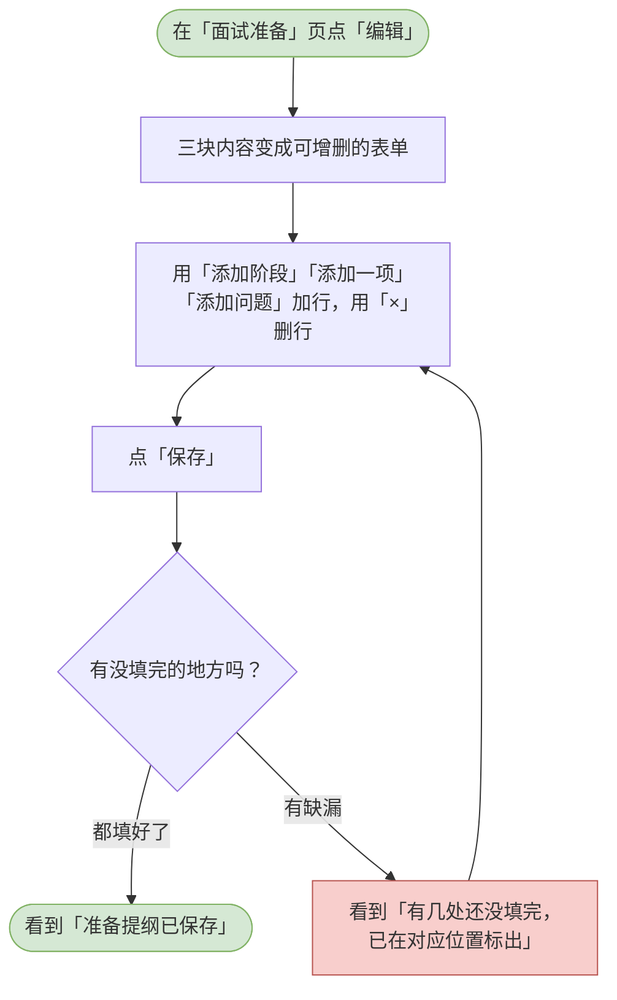

# 07 面试前准备

这一章你会学会做什么：面试开始之前，让系统先替你写一份工作稿 —— 按时间排好的流程、重点要验证什么、以及每个问题该往哪个方向追问。

> 这份提纲**不影响面试的进度**。你可以在面试开始前生成它、随时改它，面试该走到哪一步还是走到哪一步。
> 三块内容分别是：「面试提纲」（按分钟排的阶段）、「考察重点」（按岗位的评估维度）、「问题预案」（直接用这场已经出了的题，而不是另造一批通用问题）。

---

<a id="hr-generate-prep"></a>

## 生成面试前准备提纲

让系统读岗位的 JD、这场已经出了的题（如果候选人关联了简历，也一起读），写出一份面试提纲。

**什么时候用 / 前提**：这场面试还没完成。面试的进度一旦走到「已完成」或更后面，提纲就定稿了 —— 页面上会写着「面试已完成，准备提纲随之定稿；如需修改，请先回退到进行中。」

**怎么做**：

1. 打开一场面试，点页头右上角的「面试准备」。
2. 还没生成过时，页面中间是一块「尚未生成」的面板，写着这份提纲包含什么，下面有「生成准备提纲」按钮。点它。
3. 如果之前已经生成过，页面右上角会有「重新生成」。点它时会先弹一个确认框「重新生成准备提纲？」，正文提醒你：新的提纲会整体覆盖当前这一份，包括你手工改过的内容，这一步无法撤销。
4. 按钮会变成「正在生成…」，这一段要等十几秒。
5. 生成完，页面刷新成三块内容。

> 如果 AI 那一刻不可用，会弹出报错提示，但页面上原来那份还在，可以再点一次。

**流程图**：

```mermaid
flowchart TD
  classDef clsOk fill:#d5e8d4,stroke:#82b366;
  classDef clsBad fill:#f8cecc,stroke:#b85450;
  classDef clsNote fill:#f5f5f5,stroke:#666666;
  s([打开一场面试，<br/>点页头右上角的「面试准备」])
  has{这里已经有提纲了吗？}
  dlg[弹出确认：<br/>「重新生成准备提纲？」]
  click[点「生成准备提纲」]
  confirm{点「重新生成」还是「取消」？}
  gen[按钮变成「正在生成…」，稍等十几秒]
  done{生成成功了吗？}
  ok([看到三块内容：<br/>「面试提纲」「考察重点」「问题预案」])
  fail[看到报错提示（AI 暂时不可用），<br/>原来那份还在，可以再点一次]
  cancel[点「取消」，<br/>保持原来那份]
  s --> has
  has -->|还没有| click
  has -->|已经有了| dlg
  dlg --> confirm
  confirm -->|取消| cancel
  confirm -->|重新生成| gen
  click --> gen
  gen --> done
  done -->|成功| ok
  done -->|失败| fail
  class s clsOk
  class ok clsOk
  class fail clsBad
  class cancel clsNote
```

> 可编辑的流程图源文件：[diagrams/hr-generate-prep.drawio](diagrams/hr-generate-prep.drawio)

**你会看到**：成功时 —— 三块内容一次给全，页头下方写着「生成于 …」；失败时 —— 弹出报错提示，原来那份原封不动。

---

<a id="hr-edit-prep"></a>

## 编辑准备提纲

把系统写的提纲改成你要的样子。

**什么时候用 / 前提**：提纲已经生成过，并且面试还没完成。已完成之后「编辑」按钮是灰的，鼠标停上去写着「面试已完成，准备提纲随之定稿；如需修改，请先回退到进行中。」

**怎么做**：

1. 在「面试准备」页点「编辑」。整页会换成表单。
2. 三个部分分别改：
   - **面试提纲**：每一段有「阶段」名称、「分钟」数和「这一段要做什么」。用「添加阶段」加一段，用那一行的「×」删掉一段。
   - **考察重点**：每一项选一个「维度」，写清「重点验证什么」，还可以填「为什么是这一项（可不填）」。用「添加一项」加，用「×」删。
   - **问题预案**：每一项写「问题」「考察意图」和「可追问 · 每行一条」（追问一行写一个）。用「添加问题」加，用「×」删。
3. 想放弃这次改动，点页头的「取消」，回到只读的样子。
4. 改完点页头的「保存」。

> 三个部分是**一起**提交的：点一次「保存」，三块内容同时覆盖原来的。保存后立刻生效，不会只存一半。
> 保存时页头写着「三个部分会一起提交，保存后立即覆盖原来的内容。」

**流程图**：



> 可编辑的流程图源文件：[diagrams/hr-edit-prep.drawio](diagrams/hr-edit-prep.drawio)

**你会看到**：成功时 —— 提示「准备提纲已保存」，页面回到只读态，页头多出「最后编辑 …」的时间；失败时 —— 提示「有几处还没填完，已在对应位置标出」，并且每一条没填好的地方下面都会写明问题（例如「阶段名称不能为空」「分钟数至少为 1」「请选择维度」「问题不能为空」）。

> 想把提纲带走，点页面上的「导出 PDF」，走的是浏览器打印那条路。
