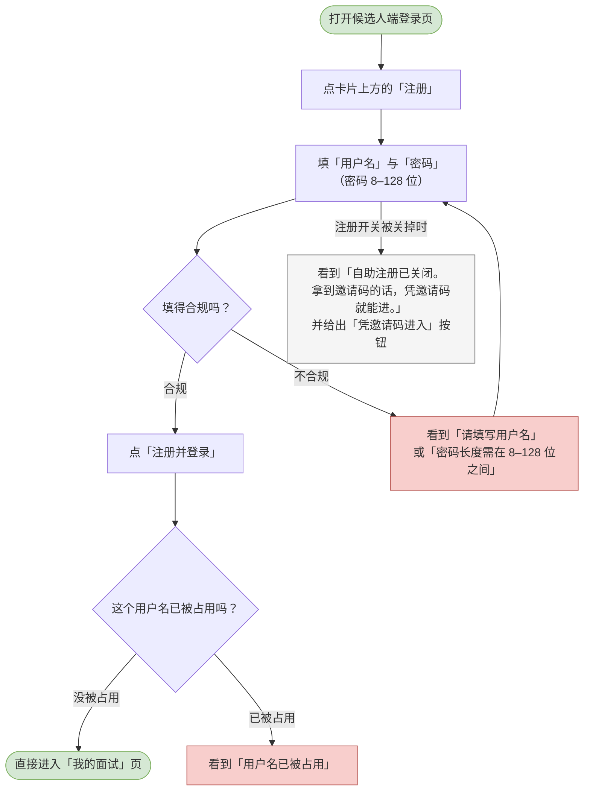
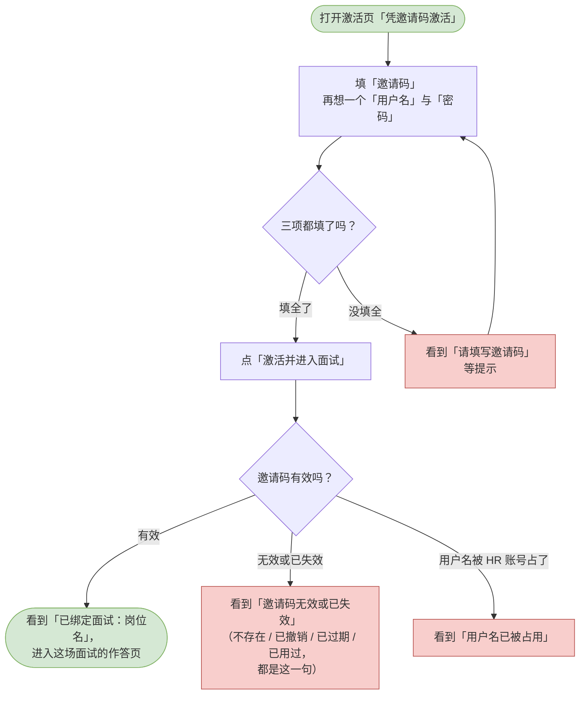
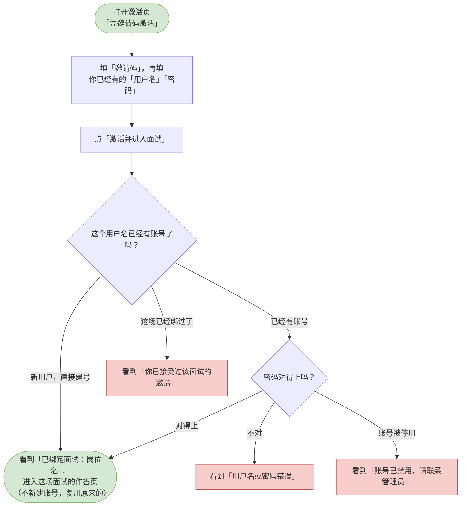
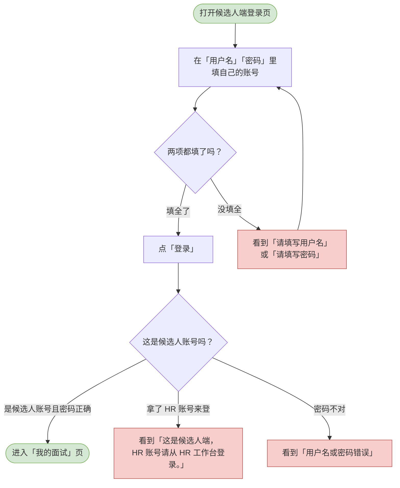
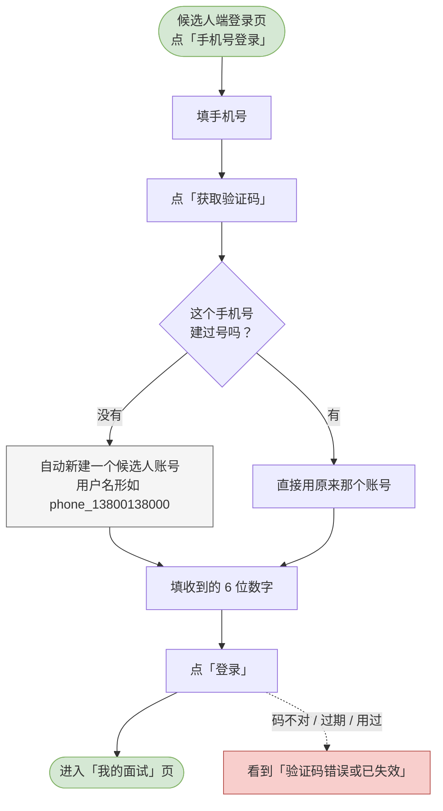

# 08 候选人-账号与激活

这一章你会学会做什么：以候选人的身份进去 —— 自己注册一个账号刷题、用手机号直接登录（连注册都不用）、要么凭招聘方发来的邀请码进入面试；以及怎么退出来。

> 从这一章开始都是候选人这一端的内容。候选人端和 HR 工作台是同一套系统的两个入口：HR 在 <http://127.0.0.1:8000>，候选人从登录页右下角的「去候选人端」过去，地址是 <http://127.0.0.1:8000/#/candidate/login>。

---

<a id="cand-self-register"></a>

## 自助注册（仅刷题）

自己开一个账号，先刷题练手。

**什么时候用 / 前提**：你还没有账号，也不急着面试，只想先做题。招聘方那边的「自助注册」开关是开着的（默认就是开着的）。

**怎么做**：

1. 打开候选人端登录页 <http://127.0.0.1:8000/#/candidate/login>。
2. 点卡片上方的「注册」。
3. 在「用户名」里填一个名字。
4. 在「密码」里填一个 8–128 位的密码。下方写着「密码至少 8 位」。
5. 点「注册并登录」。按钮会变成「注册中…」。
6. 注册成功后会自动帮你登录，直接进入「我的面试」页。

> 这样注册出来的账号只能刷题。要参加面试，还得拿到招聘方的邀请码再去激活（见下一节）。
> 如果招聘方把自助注册关掉了，这个「注册」标签页会换成另一套提示：「自助注册已关闭。拿到邀请码的话，凭邀请码就能进。」并给你一个「凭邀请码进入」按钮。

**流程图**：



> 可编辑的流程图源文件：[diagrams/cand-self-register.drawio](diagrams/cand-self-register.drawio)

**你会看到**：成功时 —— 直接进入「我的面试」页；失败时 —— 没填全看到「请填写用户名」「请填写密码」，密码太短看到「密码长度需在 8–128 位之间」，名字重了看到「用户名已被占用」。

---

<a id="cand-activate-new"></a>

## 凭邀请码激活 —— 新用户建号

拿到招聘方发来的那串码，用它开一个账号并进入这场面试。

**什么时候用 / 前提**：招聘方给了你一张邀请码，而你还没有候选人账号。

**怎么做**：

1. 打开激活页 <http://127.0.0.1:8000/#/candidate/activate>。候选人端登录页上「拿到邀请码了？去激活」那个按钮也是通到这儿的。
2. 在「邀请码」里粘贴招聘方发给你的那串字符。下面写着「招聘方发给你的那串字符，7 天内有效、只能用一次。」
3. 在「用户名」里想一个名字。下面写着「已经注册过就填原来的用户名 —— 会复用那个账号，不会新建。」
4. 在「密码」里填密码。下面写着「账号已存在时用它核对身份；新建账号时它就是新密码。」
5. 点「激活并进入面试」。按钮会变成「激活中…」。
6. 激活成功后，你会看到「已绑定面试：岗位名」，并直接进入这场面试的答题页。

**流程图**：



> 可编辑的流程图源文件：[diagrams/cand-activate-new.drawio](diagrams/cand-activate-new.drawio)

**你会看到**：成功时 —— 提示「已绑定面试：岗位名」，进入答题页；失败时 —— 没填全看到「请填写邀请码」等提示；码不能用（不存在、已撤销、已过期、已经被用过）一律是同一句「邀请码无效或已失效」；用户名被招聘方账号占用会看到「用户名已被占用」。

---

<a id="cand-activate-bind"></a>

## 凭邀请码激活 —— 已有账号绑定

你本来就有账号（比如之前注册了刷题），现在拿邀请码把这场面试接到这个账号上。

**什么时候用 / 前提**：招聘方给了你邀请码，而你已经有一个候选人账号。

**怎么做**：

1. 打开激活页。
2. 在「邀请码」里粘贴那串字符。
3. 在「用户名」里填你**原来那个**账号的名字，在「密码」里填**那个账号的密码**。
   > 这一步很关键：账号已存在时，密码是用来核对身份的，不是换一个新密码。
4. 点「激活并进入面试」。
5. 绑定成功后，页面会写着「已绑定面试：岗位名」，并直接进入这场面试的答题页。账号不会被重建，你原来刷题的记录也都在。

> **如果你已经登录着候选人端**，这一页会认出你：把「用户名」固定成当前账号（旁边写着「已登录，固定为当前账号 —— 无需再输入密码。」），**并且不再显示「密码」这一栏**。你只要填邀请码就行。
>
> 密码栏消失是有道理的：你已经登录着，系统已经知道你是谁，不必再证明一次。**这也是用手机号建的账号能凭邀请码激活的原因** —— 那种账号本来就没有密码。

**流程图**：



> 可编辑的流程图源文件：[diagrams/cand-activate-bind.drawio](diagrams/cand-activate-bind.drawio)

**你会看到**：成功时 —— 提示「已绑定面试：岗位名」，进入答题页；失败时 —— 密码不对看到「用户名或密码错误」（系统刻意不区分「没这个账号」和「密码错了」），账号被停用看到「账号已禁用，请联系管理员」，同一个账号已经绑过这场面试看到「你已接受过该面试的邀请」。

---

<a id="cand-login"></a>

## 登录候选人端

用已经有的账号进候选人端。

**什么时候用 / 前提**：你已经有候选人账号（注册过，或者凭邀请码激活过）。

**怎么做**：

1. 打开 <http://127.0.0.1:8000/#/candidate/login>。这一页的「登录 / 注册 / 手机号登录」是同一张卡片的三个模式，切到「登录」。
2. 在「用户名」「密码」里填你的账号。上面写着「用你的候选人账号登录。」
3. 点「登录」。
4. 登录成功后直接进入「我的面试」页。

> 懒得记密码、或者压根没注册过？看下一节「用手机号直接登录」。

> HR 和面试官的账号不能在这里登录。真填了会看到「这是候选人端，HR 账号请从 HR 工作台登录。」—— 这句话是提醒你去对的入口，不是说你账号有问题。

**流程图**：



> 可编辑的流程图源文件：[diagrams/cand-login.drawio](diagrams/cand-login.drawio)

**你会看到**：成功时 —— 直接进入「我的面试」页；失败时 —— 没填全看到「请填写用户名」「请填写密码」，账号或密码不对看到「用户名或密码错误」，拿 HR 账号来登看到「这是候选人端，HR 账号请从 HR 工作台登录。」。

---

<a id="cand-phone-login"></a>

## 用手机号直接登录（免注册）

一个手机号 + 一条短信就能进，**不用先注册、也不用记密码**。第一次使用时会自动帮你建号。

**什么时候用 / 前提**：你有一个能收短信的手机号。**不需要任何前置准备** —— 这与 HR 端不同，HR 那边必须由管理员先绑号。

**怎么做**：

1. 打开候选人端登录页 <http://127.0.0.1:8000/#/candidate/login>。
2. 点卡片上方的「**手机号登录**」。
3. 在「手机号」里填你的手机号 —— 11 位，不用带 `+86`，中间的空格和横线也认。
4. 点「获取验证码」。
5. 把收到的 6 位数字填进去，点「登录」。

**流程图**：



**你会看到**：

- 成功时 —— 直接进入「我的面试」页。**不会**问你密码，因为你本来就没有。
- 验证码不对或已过期 —— 「验证码错误或已失效」。填错、超时、用过，提示都是这一句（区分开会让这个接口变成「验证码状态」的探测器）。
- 点得太频繁 —— 「发送过于频繁」之类，按钮进入倒计时。
- 手机号格式不对 —— 「请填写 11 位手机号」。

**几条要留意的规则**：

> ℹ️ **演示环境会直接告诉你验证码**。如果系统没接真实短信通道（默认就是这样），验证码不会真的发到手机上，而是**直接显示在按钮下方**并自动填好，写着「演示环境：验证码 xxxxxx」。照着填即可。
>
> ℹ️ **这样建出来的账号没有密码**，所以「登录」那个模式永远登不进它 —— 以后都用手机号进。这是有意的：让一个没人知道的随机值占住密码位，比允许空密码安全。
>
> ⚠️ **一个手机号只对应一个账号**。如果你的号已经被某个 HR 账号绑走了（见 [02 用户管理](02-用户管理.md)），你就拿不到这个自动建的候选人账号了。
>
> ℹ️ **已经凭邀请码激活过的号**，用手机号登录会直接进原来那个账号，不会新建 —— 你的刷题记录和面试都还在。
>
> ℹ️ **用手机号建的账号，凭邀请码激活时不会再问你密码**。你已经登录着，网页认得你；直接填邀请码就能绑定那场面试（见「凭邀请码激活 —— 已有账号绑定」）。

---

<a id="cand-logout"></a>

## 退出登录（候选人端）

把当前这个账号从浏览器里退出来。

**什么时候用 / 前提**：你已经登录了候选人端。

**怎么做**：

1. 看左侧导航条的最底下，那里写着当前账号的名字和「候选人」。
2. 点它下面的「退出登录」。
3. 页面直接回到候选人登录页。

> HR 工作台那边若也登录着，互不影响。

**流程图**：

```mermaid
flowchart TD
  classDef clsOk fill:#d5e8d4,stroke:#82b366;
  classDef clsBad fill:#f8cecc,stroke:#b85450;
  classDef clsNote fill:#f5f5f5,stroke:#666666;
  s([在候选人端左侧导航底部<br/>确认当前登录的账号])
  click[点「退出登录」]
  out[本端的登录状态被清除，<br/>回到候选人登录页]
  note0[HR 工作台那边若也登录着，<br/>互不影响]
  s --> click
  click --> out
  out --> note0
  class s clsOk
  class note0 clsNote
```

> 可编辑的流程图源文件：[diagrams/cand-logout.drawio](diagrams/cand-logout.drawio)

**你会看到**：页面回到候选人登录页，左侧导航和内容都消失。这一步没有二次确认，点了就退出。
