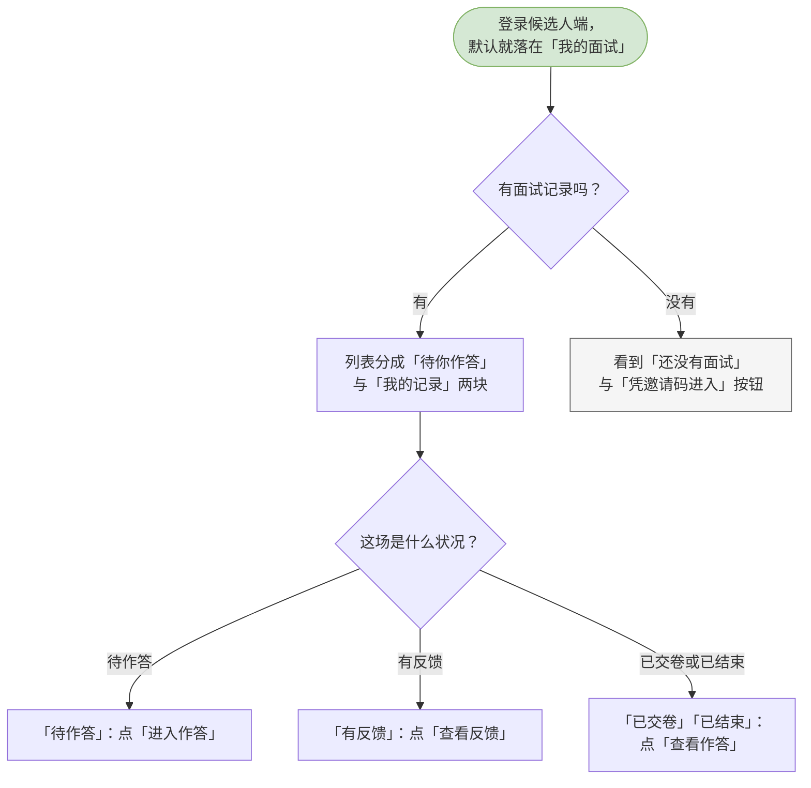
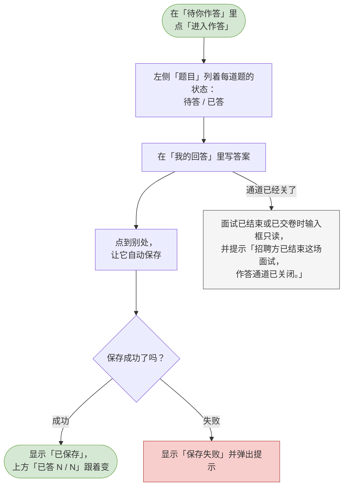
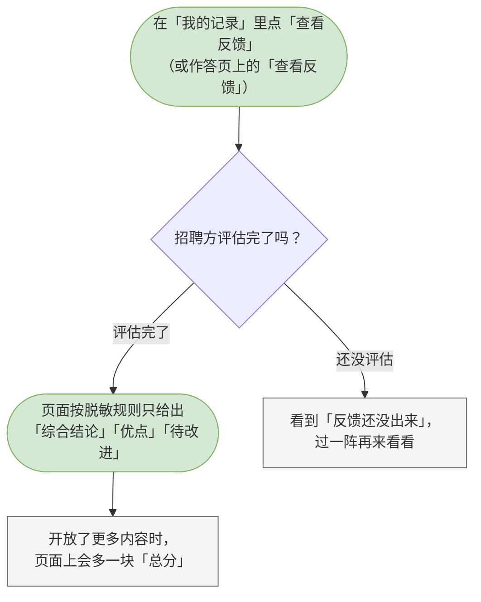

# 09 候选人-我的面试

这一章你会学会做什么：看清自己有哪些面试、在里面一题一题作答、交卷，以及评估完成后回来看反馈。

> 「我的面试」是候选人端的首页。它只回答一件事：我接下来该做什么。所以分了两块 —— 「待你作答」是要动手的，「我的记录」是其余的。

---

<a id="cand-list-interviews"></a>

## 查看我的面试列表

一眼看清哪几场面试在等你、哪几场已经有结果。

**什么时候用 / 前提**：你已经登录候选人端，默认就落在这一页。

**怎么做**：

1. 登录后直接进入「我的面试」。
2. 页面从上到下分两块：
   - **「待你作答」** —— 招聘方在等你交卷的场次。每条都显示岗位名、答题进度（已答几题 / 共几题）、收到邀请的时间，右边是「进入作答」按钮。
   - **「我的记录」** —— 其余的场次。每条显示岗位名、状态、题数、收到邀请的时间，右边按状态给你不同的按钮：
     - 状态是「待作答」不会出现在这里，它在上面的块里；
     - 状态是「有反馈」—— 按钮是「查看反馈」；
     - 状态是「已交卷」或「已结束」—— 按钮是「查看作答」。
3. 想进哪一场，点它右边的按钮。

> 一条记录都没的时候，页面会写着「还没有面试」，并提示你「招聘方发给你的邀请码可以直接进面试；只想先练手的话，去刷题。」下面给一个「凭邀请码进入」按钮。

**流程图**：



> 可编辑的流程图源文件：[diagrams/cand-list-interviews.drawio](diagrams/cand-list-interviews.drawio)

**你会看到**：两块清单，或者一块「还没有面试」的空态。同一场面试只会出现在其中一块。

---

<a id="cand-answer"></a>

## 在线作答（逐题作答并自动保存）

在浏览器里一道一道回答招聘方给你出的题。

**什么时候用 / 前提**：这场面试还在「进行中」，你还没交卷。招聘方已经把面试结束了、或者你已经交过卷，输入框就会变成只读。

**怎么做**：

1. 在「待你作答」里点「进入作答」。
2. 左边是「题目」清单，每题标着「待答」还是「已答」，顶上写着「已答 N / 总题数」。点哪一题就切到哪一题。
3. 在「我的回答」里写答案。提示是「写下你的回答。离开输入框会自动保存。」
4. 把光标点到别处，它会自动保存。保存好时，输入框右上角会出现「已保存」，上方的「已答 N / N」也跟着更新。
5. 写完一题，点「下一题」接着来。中途想改前面的题，点左边清单里的题号就行。

> 中途离开也没关系。换题、按浏览器后退、甚至关掉标签页，系统都会先把当前输入框里还没保存的内容存下来。回来时点「进入作答」接着做。
> 输入框右上角的小字会告诉你状态：没动过时是空的，保存时是「保存中…」，存好了是「已保存」，出问题时会变成「保存失败」并弹出提示。

**流程图**：



> 可编辑的流程图源文件：[diagrams/cand-answer.drawio](diagrams/cand-answer.drawio)

**你会看到**：成功时 —— 出现「已保存」，左侧那一题从「待答」变成「已答」；失败时 —— 出现「保存失败」并弹出提示，你写的内容还在，可以再试一次。面试被招聘方结束之后，这一页会变成回看：输入框只读，页面上写着「招聘方已结束这场面试，作答通道已关闭。下面是题目与你当时的作答。」

---

<a id="cand-submit"></a>

## 交卷

答完（或者决定不再改了），把作答提交出去。

**什么时候用 / 前提**：你还在作答中。交卷这个动作一辈子只有一次有效 —— 交完之后你就不能再改作答了，招聘方会按你提交的内容评估。

**怎么做**：

1. 在作答页上方那条交卷条上，确认「已答 N / N」是你想要的样子。
2. 点「交卷」。
3. 系统会先把当前输入框里还没保存的内容存好。这一步存不下时，它会停下并提示你保存失败，这次交卷不会进行 —— 这是为了保护你刚写的东西。
4. 存好之后弹出确认框「交卷？」。如果还有题没答，正文会告诉你「还有 N 题没有作答。交卷后你不能再修改作答，招聘方会按已提交的内容评估。」；如果都答完了，正文是「全部题目都已作答。交卷后不能再修改。」
5. 点「交卷」确认。按钮会变成「交卷中…」。

> 交卷**不会**自动改变招聘方那边看到的进度 —— 招聘方仍需要自己把这场面试标记为完成，才会开始评估。

**流程图**：

```mermaid
flowchart TD
  classDef clsOk fill:#d5e8d4,stroke:#82b366;
  classDef clsBad fill:#f8cecc,stroke:#b85450;
  classDef clsNote fill:#f5f5f5,stroke:#666666;
  s([答完后，在页面上方的<br/>交卷条上])
  click[点「交卷」]
  flush[系统先把当前输入框里<br/>还没保存的内容存好]
  flushed{存下了吗？}
  dlg[弹出确认「交卷？」<br/>并告诉你还有几题没答]
  flushfail[存不下就停下：<br/>看到「保存失败」，这次交卷不进行]
  confirm{点「交卷」还是「取消」？}
  ok([看到「已交卷，提交了 N 题作答」，<br/>页面变成「已于 … 交卷」，作答锁定])
  cancel[点「取消」，继续作答]
  s --> click
  click --> flush
  flush --> flushed
  flushed -->|存下了| dlg
  flushed -->|没存下| flushfail
  dlg --> confirm
  confirm -->|交卷| ok
  confirm -->|取消| cancel
  class s clsOk
  class flushfail clsBad
  class ok clsOk
  class cancel clsNote
```

> 可编辑的流程图源文件：[diagrams/cand-submit.drawio](diagrams/cand-submit.drawio)

**你会看到**：成功时 —— 提示「已交卷，提交了 N 题作答」，页面顶部变成「已于 … 交卷」，输入框全部只读；点「取消」则什么都不变，继续作答。

---

<a id="cand-view-feedback"></a>

## 查看面试反馈

招聘方评估完之后，看看他对这场面试的评价。

**什么时候用 / 前提**：招聘方已经把这场面试评估完了。在「我的记录」里，那条的按钮会从「查看作答」变成「查看反馈」。

**怎么做**：

1. 在「我的记录」里点「查看反馈」。如果这场面试已经评估完，作答页上的交卷条里也会出现「查看反馈」按钮。
2. 页面打开后，读这几块：「综合结论」「优点」「待改进」。
3. 页面最上面有一条说明，写清这份反馈包含什么。

> 反馈是按脱敏规则给你看的：默认只含综合结论与建议，不含分数、逐题评价与维度明细。如果招聘方开放了更多内容，页面上会多一块「总分」，说明那句话也会跟着变得不一样。
> 反馈里**没有**「建议进入下一轮 / 不建议继续推进」这类去留判断 —— 那是招聘方的决定，该由他另外跟你沟通。

**流程图**：



> 可编辑的流程图源文件：[diagrams/cand-view-feedback.drawio](diagrams/cand-view-feedback.drawio)

**你会看到**：评估完了 —— 一份从结论读到建议的反馈；还没评估 —— 看到「反馈还没出来」，并有一句「招聘方评估完成后才能生成反馈，过一阵再来看看。」，这不是出错。
