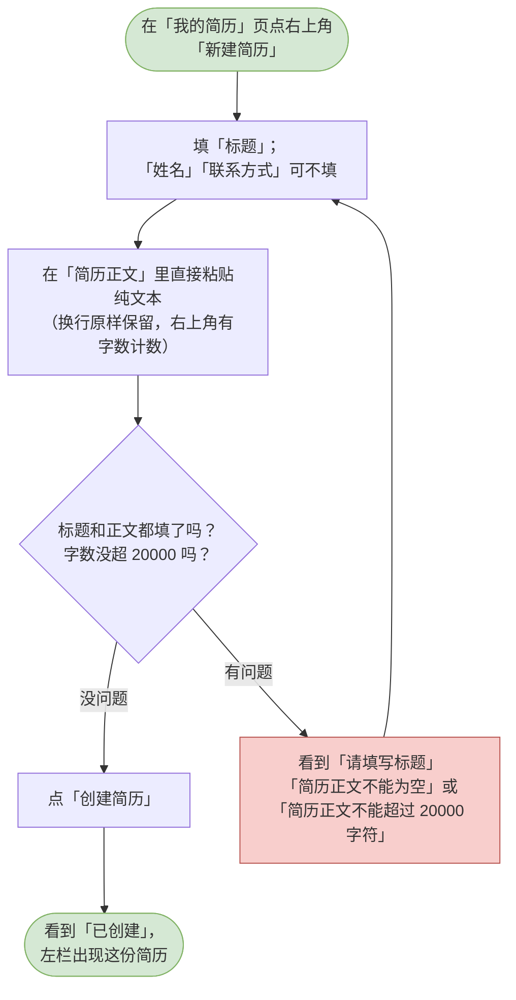
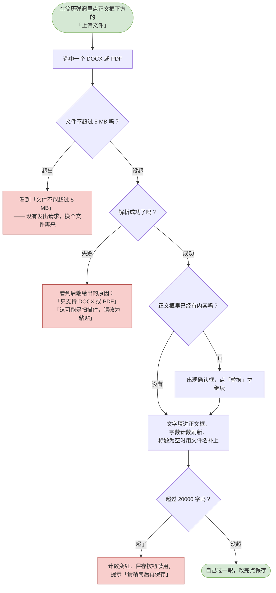
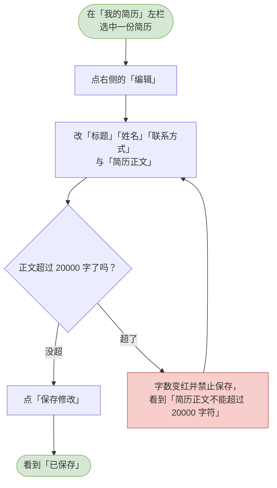
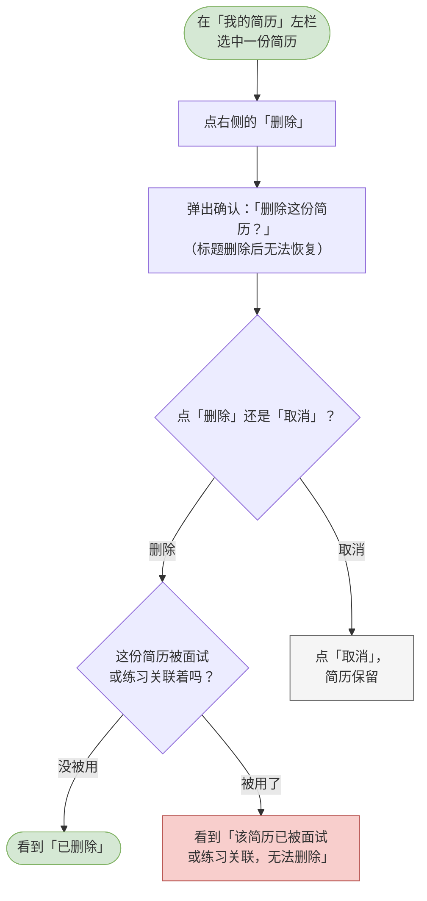
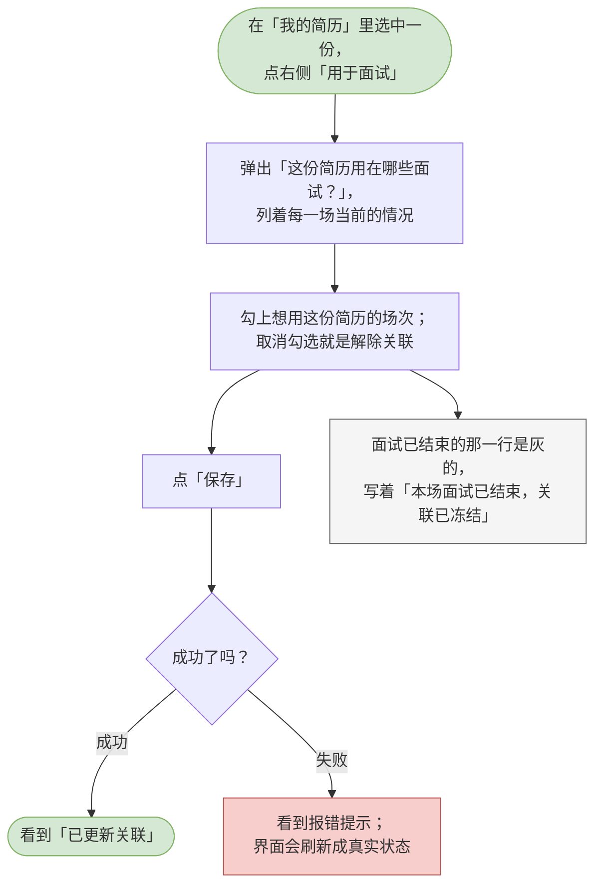

# 10 候选人-我的简历

这一章你会学会做什么：把自己的一份简历录进系统、需要时改它、删掉不要的，以及决定哪一份用在哪些面试上。

> 简历只由你自己录入。**招聘方看不到任何简历**，除非你把某一份关联到那场面试 —— 关联之后，对方才能按它给这场面试补题。
> 正文有两种录法：**直接粘贴纯文本**，或者**上传 DOCX / PDF 由系统解析出文字**再确认。系统只取文字，**不保存你上传的那个文件**。

---

<a id="cand-create-resume"></a>

## 新增简历（粘贴或上传文件）

录第一份简历。

**什么时候用 / 前提**：你已经在候选人端。「我的简历」在左侧导航里。

**怎么做**：

1. 在左侧导航点「我的简历」，再点页面右上角的「新建简历」。
2. 在「标题」里给自己认的名字。下面有一句提示：这是给自己认的，可以按投递方向加个版本号，方便区分多份简历。
3. 「姓名（可选）」和「联系方式（可选）」可以不填；填了的话，招聘方关联这场面试后也能看到。
4. 在「简历正文」里直接粘贴纯文本。换行会原样保留。右上角有一个字数计数，显示成「当前字数 / 20000」（比如「1234 / 20000」）。
5. 点「创建简历」。

> 正文那一栏**没有**字数上限的硬截断 —— 超过 20000 字时，字数计数会变红并禁止保存，你能明确看到是自己超了，而不是内容被悄悄剪掉。

**流程图**：



> 可编辑的流程图源文件：[diagrams/cand-create-resume.drawio](diagrams/cand-create-resume.drawio)

**你会看到**：成功时 —— 提示「已创建」，左栏出现这份简历，右侧显示它的正文；失败时 —— 标题或正文空着会看到「请填写标题」「简历正文不能为空」，正文超长会看到「简历正文不能超过 20000 字符」。

---

<a id="cand-import-resume-file"></a>

## 从文件导入正文（DOCX / PDF）

手边已经有一份排好版的简历文件时，不用照着重打一遍。

**什么时候用 / 前提**：你正在「新建简历」或「编辑简历」的弹窗里。两种弹窗都有这个入口。

**怎么做**：

1. 在弹窗的「简历正文」框下面，找到「上传文件」按钮，点它。
2. 选中一个 `.docx` 或 `.pdf` 文件。
3. 按钮会变成「解析中…」，稍等片刻。
4. 解析成功后，**文字会被填进上面的正文框**，右上角的字数计数跟着刷新；如果标题还空着，会用文件名（去掉扩展名）自动填上。
5. **自己过一眼正文**，该改的改掉，然后点「创建简历」或「保存修改」。

> **上传只是把文字填进框里，不会替你建简历。** 只有你点了保存，它才真的存下来。
> **系统不保存你上传的那个文件** —— 解析完就丢弃，事后没有「回看原件」的地方。要留原件请自己在本地存好。
>
> 支持的格式是 `.docx` 和 `.pdf`，**单个文件不超过 5 MB**。`.doc`（Word 97-2003 那种老格式）不支持，请先另存为 `.docx`。
>
> **扫描件（拍照/截图做成的 PDF）解析不出文字** —— 它没有文字层。这种情况系统会明确告诉你，请改用直接粘贴。

**流程图**：



> 可编辑的流程图源文件：[diagrams/cand-import-resume-file.drawio](diagrams/cand-import-resume-file.drawio)

**你会看到**：成功时 —— 「已从文件解析出 1234 字，请确认后保存」，正文框里出现解析出的文字，字数计数跟着变成 `1234 / 20000`；失败时 —— 超过 5 MB 会看到「文件不能超过 5 MB」而且**不会发出请求**；格式不对、文件损坏、扫描件都会看到后端给出的原因，原样显示；正文框里本来有内容时会先问一句「替换当前正文」，点「取消」就一个字都不会动。

> **超过 20000 字时内容不会被剪掉**：计数变红、保存按钮变灰，提示你精简 —— 剪掉一部分再存进去，你根本不会发现丢了什么。

---

<a id="cand-edit-resume"></a>

## 编辑简历

改一份已经录好的简历。

**什么时候用 / 前提**：你已经在「我的简历」里录过至少一份。

**怎么做**：

1. 在「我的简历」左栏选中要改的那一份。
2. 点右侧的「编辑」。
3. 按需改「标题」「姓名」「联系方式」「简历正文」。字数计数会跟着走。
4. 点「保存修改」。

> 改完之后，如果这份简历已经关联到了某场面试，招聘方那边要重新点一次「按简历补题」才会用上新版本 —— 他那边显示的是「最后更新 …」的时间，方便他自己判断是不是最新的。

**流程图**：



> 可编辑的流程图源文件：[diagrams/cand-edit-resume.drawio](diagrams/cand-edit-resume.drawio)

**你会看到**：成功时 —— 提示「已保存」，左栏那一份的「更新于 …」时间跟着变；失败时 —— 字数超限时保存按钮直接禁用，字数计数变红。

---

<a id="cand-delete-resume"></a>

## 删除简历

把一份不再需要的简历去掉。

**什么时候用 / 前提**：这份简历没有被任何面试或练习关联着。

**怎么做**：

1. 在「我的简历」左栏选中要删的那一份。
2. 点右侧的「删除」。
3. 弹出确认框，标题是「删除这份简历？」，正文写着「《某某》删除后无法恢复。它如果已经被面试或练习关联，删除会被拒绝。」
4. 在确认框里点「删除」。

**流程图**：



> 可编辑的流程图源文件：[diagrams/cand-delete-resume.drawio](diagrams/cand-delete-resume.drawio)

**你会看到**：成功时 —— 提示「已删除」，左栏少了这一条；失败时 —— 如果它已经被某场面试或某次练习用着，会看到「该简历已被面试或练习关联，无法删除」。这不是出错：先把那些关联解开，再回来删。

---

<a id="cand-link-resume"></a>

## 关联简历到某场面试 / 解除关联

决定哪一份简历用在哪几场面试上。

**什么时候用 / 前提**：你已经被邀请并接受了至少一场面试（那场面试才会出现在可选的清单里）。

**怎么做**：

1. 在「我的简历」里选中要用出去的那一份。
2. 点右侧的「用于面试」。
3. 弹出「这份简历用在哪些面试？」，把每一场都列出来，并且写清它现在的状况：
   - 「本场现在用的就是这份简历」—— 已经是这一份，勾是选上的；
   - 「本场现在用的是《另一份》」—— 用的是别的简历；
   - 「本场还没有关联简历」；
   - 「本场面试已结束，关联已冻结」—— 这一行是灰的，勾不动。
4. 勾上想用这份简历的场次。**取消勾选就是解除关联** —— 不过只有在这一场当前用的确实是这份时，取消才有意义；用着别的简历时，改由那一份的「用于面试」去换。
5. 点「保存」。

> 一场面试只挂一份简历。所以这一步是「一场一次」地改：你勾选的每一场，都会把它的关联换成这一份。
> 提交过程中如果中途出错，页面会关掉弹窗并重新读一遍，让界面上显示的跟实际一致 —— 免得你看着勾选状态以为已经生效了。

**流程图**：



> 可编辑的流程图源文件：[diagrams/cand-link-resume.drawio](diagrams/cand-link-resume.drawio)

**你会看到**：成功时 —— 提示「已更新关联」（这句话刻意不带方向，因为勾上和取消勾都是它）；失败时 —— 弹出报错提示，界面重新读一遍。改完之后，左栏那一份下面会显示「用于 N 场面试」或「尚未用于面试」。

---

<a id="cand-resume-review"></a>

## 查看简历与岗位的匹配度评估

想知道这份简历投这个岗位「对得上多少」，可以让 AI 评一次。

**什么时候用 / 前提**：你已经把这份简历关联到了某场面试（见上一节）。**评估是按「这一场面试的岗位」来评的**，所以入口在「用于面试」里那一行上，而不是整个简历页上。

**怎么做**：

1. 在「我的简历」页左栏选中一份简历。
2. 右栏「用于面试」那一段，每一场面试旁边都有一颗「评估匹配度」，点它。
3. 按钮变成「评估中…」，弹窗先显示「AI 正在评估简历与岗位的匹配度…」。
4. 稍等片刻，结果出现在弹窗里：

| 弹窗里的内容 | 说明 |
|---|---|
| 综合结论 | 一段话，说明简历与岗位要求的重合情况 |
| 亮点 | 简历里对得上岗位要求的地方 |
| 差距 | 简历里还缺、建议补充的地方；确实没什么差距时会写「未发现明显差距」 |
| 匹配度分 | **可能没有这一块**，取决于系统怎么配置（见下面的说明） |

5. 看完点「关闭」。

> **结果不会被保存。** 关掉弹窗就没了 —— 想再看就再点一次，**每次点都会重新评估一遍**（每次都真的调用一次 AI）。
>
> **分数不一定给你看。** 有些部署只把结论、亮点、差距给你，不显示匹配度分 —— 此时弹窗里**不会有分数那一块**（也不会显示 0 或「暂无」占位，就是没有）。这不是坏了，是刻意的：分数属于评估结果，可见性由系统配置统一管着。
>
> **结论里不会出现「建议进入下一轮」「不建议继续推进」这类话。** 它只讲简历与岗位的重合情况，不替招聘方下结论。

**流程图**：

```mermaid
flowchart TD
  classDef clsOk fill:#d5e8d4,stroke:#82b366;
  classDef clsBad fill:#f8cecc,stroke:#b85450;
  classDef clsNote fill:#f5f5f5,stroke:#666666;
  s([在「我的简历」页选中一份简历])
  row[右栏「用于面试」里<br/>每一场旁边都有「评估匹配度」]
  click[点那一场的「评估匹配度」]
  wait[弹窗先显示「AI 正在评估…」，<br/>按钮变「评估中…」]
  done{评估成功了吗？}
  fail[看到后端给出的原因，<br/>就显示在弹窗里；关掉可以重试]
  three[弹窗里能看到三块：<br/>综合结论 / 亮点 / 差距]
  score{这次开放分数了吗？}
  no[看不到分数（默认如此）：<br/>整块分数区不出现]
  yes[看得到匹配度分，<br/>旁边跟一句档位说法]
  end([关掉弹窗。<br/>结果不保存，想再看就再点一次])
  s --> row
  row --> click
  click --> wait
  wait --> done
  done -->|失败| fail
  done -->|成功| three
  three --> score
  score -->|没开放| no
  score -->|开放了| yes
  no --> end
  yes --> end
  class s clsOk
  class end clsOk
  class fail clsBad
```

> 可编辑的流程图源文件：[diagrams/cand-resume-review.drawio](diagrams/cand-resume-review.drawio)

**你会看到**：成功时 —— 弹窗里出现综合结论、亮点、差距（以及可能的匹配度分与档位说法，例如「重合度较好」）；失败时 —— 后端给的文案直接显示在**弹窗里**（不是角落一闪而过的提示），关掉弹窗后按钮恢复成「评估匹配度」，可以再试。

> **为什么入口在这里而不是面试页**：这一页才是你管理简历、决定它用在哪几场面试的地方。评估是「这份简历用在那场岗位」的属性，跟关联放一起最省事。
