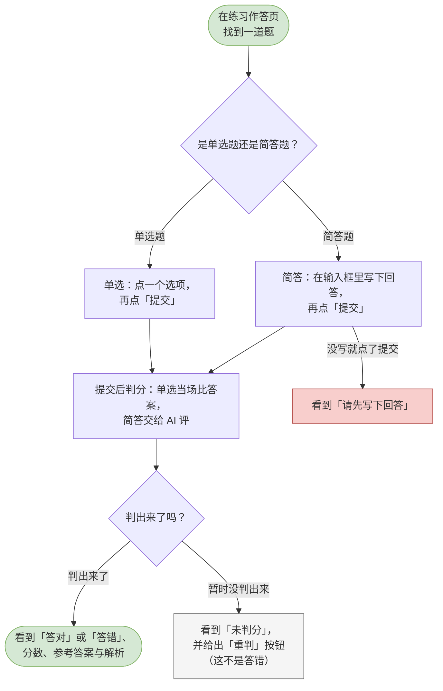
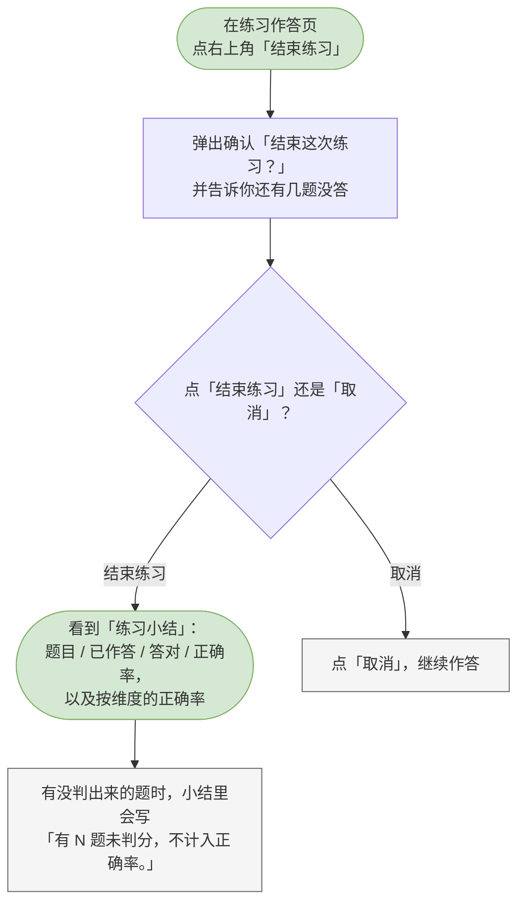

# 11 候选人-刷题练习

这一章你会学会做什么：自己给自己出一套题来练，交一题看一题的对错和解析，练完看小结，以及中途离开后回来接着做。

> 刷题是候选人端自己的功能，不需要招聘方参与。和正式面试不同，刷题是**整卷铺开**的：所有题同时列在一页上，你可以来回跳、先挑没做的做。

---

<a id="cand-start-practice"></a>

## 开始一次练习（选条件，可关联简历）

按自己的条件挑一套题开始练。

**什么时候用 / 前提**：你已经在候选人端。「刷题」在左侧导航里。

**怎么做**：

1. 在左侧导航点「刷题」。
2. 在筛选栏里挑条件，不挑就是「不限」：
   - 「不限岗位」—— 只从某个岗位的题里出；
   - 「不限分类」「不限维度」「不限难度」「不限题型」—— 按分类、考察维度、难度（简单 / 中等 / 困难）、题型（单选 / 简答）过滤。
3. 在「题量」里选这次要练几题（5 / 10 / 15 / 20，默认 5 题）。
4. 看筛选栏右边那句话。它会实时告诉你「符合条件 N 题」；如果没有符合的，它会写「没有符合条件的题目，换一组筛选条件」，并且「开始练习」是灰的。
5. 想按简历推荐题目，在下面那一行「取题方式」里选一份自己的简历。选了之后，系统会按跟这份简历的相关度从符合条件的题里挑并排序；不选就按原有筛选取题。
   > 还没录过简历时，这个下拉是灰的，旁边直接写着「录入简历后可按简历推荐题目 —— 」和一个「去录入」按钮。
6. 点「开始练习」。按钮会变成「正在取题…」。
7. 取到题就进入练习页，可以开始做了。

> 「取题方式」和上面的筛选条件是**两回事**：上面的条件决定「从哪些题里挑」，这一行决定「怎么挑」。它不会让题目池变小。

**流程图**：

```mermaid
flowchart TD
  classDef clsOk fill:#d5e8d4,stroke:#82b366;
  classDef clsBad fill:#f8cecc,stroke:#b85450;
  classDef clsNote fill:#f5f5f5,stroke:#666666;
  s([在左侧导航点「刷题」])
  filters[挑「不限岗位」「不限分类」<br/>「不限维度」「不限难度」「不限题型」<br/>再选「题量」]
  count[先看右边提示<br/>「符合条件 N 题」]
  resume[想按简历推荐：在下面一行<br/>「取题方式」里选一份简历]
  has{有符合条件的题吗？}
  click[点「开始练习」<br/>（按钮变成「正在取题…」）]
  none[看到「没有符合条件的题目，<br/>换一组筛选条件」，<br/>「开始练习」是灰的]
  done{取到题了吗？}
  ok([进入练习作答页])
  fail[看到「操作过于频繁，请稍后再试」<br/>等提示，筛选条件会保留]
  s --> filters
  filters --> count
  count --> resume
  resume --> has
  has -->|有| click
  has -->|没有| none
  click --> done
  done -->|取到了| ok
  done -->|没取到| fail
  class s clsOk
  class none clsNote
  class ok clsOk
  class fail clsBad
```

> 可编辑的流程图源文件：[diagrams/cand-start-practice.drawio](diagrams/cand-start-practice.drawio)

**你会看到**：成功时 —— 直接进入练习页；失败时 —— 没有符合条件的题会看到「没有符合条件的题目，换一组筛选条件」（此时按钮是灰的）；取题太快太密会看到「操作过于频繁，请稍后再试」，而且你选的筛选条件会原样保留。

---

<a id="cand-submit-practice-item"></a>

## 提交一道题并看判分与解析

做完一题就交一题，当场看对错。

**什么时候用 / 前提**：这次练习还在进行中。

**怎么做**：

1. 在练习页里找到一道还没做的题。
2. 按题型作答：
   - **单选题**：点一个选项。选定之后「提交」按钮才会变亮。
   - **简答题**：在输入框里写下你的回答（提示是「写下你的回答。提交后会给出得分、参考答案与解析。」），再点「提交」。空着点提交会提示「请先写下回答」。
3. 点「提交」。单选题会当场比对答案，简答题会交给 AI 评。
4. 判分结果直接显示在这道题下面，包含三样东西：
   - 一个结论标签：「答对」「答错」，或者「未判分」；
   - 分数（答对 / 答错时给，形如「8 / 10」）；
   - 解析（如果有的话）。
5. 单选的复盘会把选项整个列出来，正确答案标成「正确答案」，你自己选错的那一项标成「你选的」。简答题会把「我的作答」和「参考答案」对着显示。
6. 看到「未判分」时，那道题下面会给一个「重判」按钮。

> 「未判分」不是「答错」。它有两种来由：这道题还没有参考答案，或者 AI 那一刻不可用。这两种情况都不该算在你头上，所以它不计入正确率，也不会进错题本。

**流程图**：



> 可编辑的流程图源文件：[diagrams/cand-submit-practice-item.drawio](diagrams/cand-submit-practice-item.drawio)

**你会看到**：判出来了 —— 结论标签、分数、解析，以及单选的双色选项复盘；暂时没判出来 —— 「未判分」加一个「重判」按钮，点它能再试一次；简答空着点提交 —— 提示「请先写下回答」。

> 删掉一题的作答是做不到的；交过的题就是交过了。做得不满意，可以在小结里看到结果之后，重新开始一次新的练习。

---

<a id="cand-finish-practice"></a>

## 结束练习

把这次练习收口，看小结。

**什么时候用 / 前提**：这次练习还在进行中。想结束时随时可以结束，不用把题做完。

**怎么做**：

1. 在练习页点右上角的「结束练习」。
2. 弹出确认框「结束这次练习？」。如果还有题没答，正文会告诉你「还有 N 题没有作答。结束后本次练习不能再作答，小结会按已回答的部分给出。」；如果都答完了，正文是「结束后本次练习不能再作答，会给出这次小结。」
3. 点「结束练习」确认。
4. 页面顶部出现「练习小结」，里面是四个数：题目、已作答、答对、正确率。下面还有一组按考察维度的正确率条。
5. 想另开一套，点「返回刷题」回到刷题页。

> 没判出来的题会被单独说清：小结里写着「有 N 题未判分，不计入正确率。」—— 它们同样不进正确率的分母，免得你的成绩被系统的问题连累。

**流程图**：



> 可编辑的流程图源文件：[diagrams/cand-finish-practice.drawio](diagrams/cand-finish-practice.drawio)

**你会看到**：成功时 —— 出现「练习小结」，页面上的题变成回看状态（没答的题下方写着「未作答（本次练习已结束）」），左上的「结束练习」按钮消失；点「取消」则继续作答。

---

<a id="cand-resume-practice"></a>

## 继续未完成的练习

中途走了之后，回来接着做。

**什么时候用 / 前提**：你之前开始过一次练习，没有结束它。

**怎么做**：

1. 在左侧导航点「刷题」。
2. 页面中间有一块「继续练习」，注解写着「没做完的都在这里」。里面列着所有没做完的练习，每条显示岗位名、筛选条件、进度、答对几题、开始时间。
3. 点那一行的「继续」。
4. 回到练习页，之前判过分的题还在，没答的题还等着你。

> 已经结束的练习在下面那块「历史记录」里，按钮是「查看」。点进去只看得到结果，不能再作答 —— 页面会提示「本次练习已结束，不可继续作答」。

**流程图**：

```mermaid
flowchart TD
  classDef clsOk fill:#d5e8d4,stroke:#82b366;
  classDef clsBad fill:#f8cecc,stroke:#b85450;
  classDef clsNote fill:#f5f5f5,stroke:#666666;
  s([回到「刷题」页])
  look[「继续练习」那一块<br/>列着没做完的练习]
  click[点「继续」]
  open{这场还开着吗？}
  ok([回到练习页，<br/>已判分与未作答的题都在，接着做])
  closed[看到「本次练习已结束，<br/>不可继续作答」]
  s --> look
  look --> click
  click --> open
  open -->|还开着| ok
  open -->|已经结束了| closed
  class s clsOk
  class ok clsOk
  class closed clsNote
```

> 可编辑的流程图源文件：[diagrams/cand-resume-practice.drawio](diagrams/cand-resume-practice.drawio)

**你会看到**：还开着 —— 回到练习页接着做，之前的结果都在；已经结束 —— 看到「本次练习已结束，不可继续作答」，只能回看。
