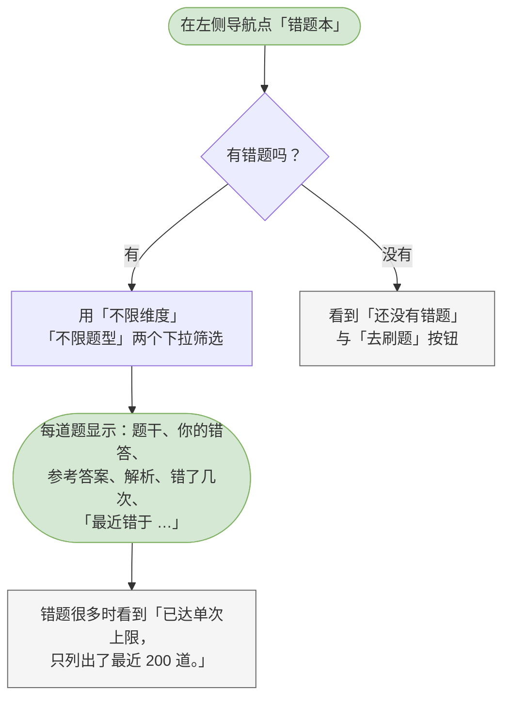
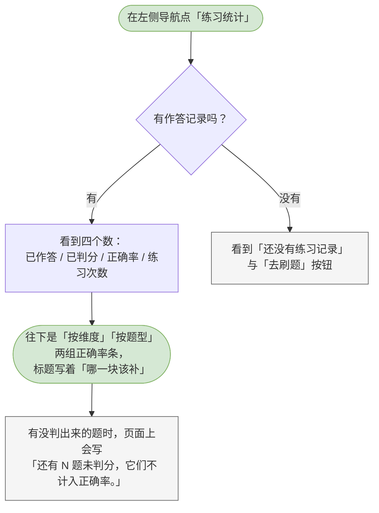

# 12 候选人-错题本与练习统计

这一章你会学会做什么：把做错的题集中起来复习，以及从数字上看清自己哪一块该补。

> 这两页都只是给你自己看的，不参与面试，也不影响招聘方那边的任何东西。

---

## 查看错题本（按维度 / 题型筛选）

把练错的题收在一处，附上正确答案和解析。

**什么时候用 / 前提**：你在刷题时答错过题。答错是唯一进错题本的方式，不需要你手动收藏。

**怎么做**：

1. 在左侧导航点「错题本」。
2. 页面上一句说明写着「答错的题都会收在这里。同一道题错几次就记几次，错得多的排在上面。」
3. 用筛选栏里的两个下拉收窄范围：
   - 「不限维度」—— 按考察维度筛；
   - 「不限题型」—— 按单选 / 简答筛。
4. 每一道错题显示这些内容：题号、考察维度、题型、错了几次（例如「错 2 次」）、题干、你的错答、参考答案、解析，以及「最近错于 …」的时间。
5. 单选题会把选项整个列出来，正确答案标成「正确答案」，你当时选错的那一项标成「你选的」。

> 同一道题错两次也只占一条，但次数会累加 —— 「错得多的排在上面」正是「该重点补哪一块」的信号。
> 没有判分的题（那一类会显示「未判分」）**不算答错**，不会进错题本。

**流程图**：

> 可编辑的流程图源文件：[diagrams/cand-wrong-book.drawio](diagrams/cand-wrong-book.drawio)

**你会看到**：有错题 —— 一串带答案和解析的卡片，顶上写着「共 N 道」；一道都没有 —— 看到「还没有错题」和一句「答错的题会自动进这里，附上参考答案与解析。」，下面给你一个「去刷题」按钮；错题攒得很多时 —— 会看到「已达单次上限，只列出了最近 200 道。」，这是在如实告诉你清单没有列出全部。

---

## 查看练习统计

从数字上看清自己哪一块该补。

**什么时候用 / 前提**：你至少做过一道题。

**怎么做**：

1. 在左侧导航点「练习统计」。
2. 最上面一行是四个数：已作答、已判分、正确率、练习次数。
3. 往下是两组正确率条：
   - **「按维度」**，注解写着「哪一块该补」—— 按考察维度横向对比；
   - **「按题型」**—— 按单选 / 简答分开看。
4. 对着最短的那几根条，去「错题本」里查对应的题。

> 页面上写着「正确率只按已判分的作答算。」没判出来的题不算在分母里 —— 那些题跟你的水平无关，是系统那边暂时没判出来，放进去会系统性压低你的成绩。它们会被单独报出来，例如「还有 N 题未判分，它们不计入正确率。」
> 某一项如果没有可判分的题，那一条会写「未判分」而不是「0%」—— 0% 会被读成「全错」。

**流程图**：

> 可编辑的流程图源文件：[diagrams/cand-practice-stats.drawio](diagrams/cand-practice-stats.drawio)

**你会看到**：有记录 —— 四个数字加两组正确率条，页面上写着「正确率只按已判分的作答算。」；一条记录都没有 —— 看到「还没有练习记录」和一句「开始刷题之后，正确率与薄弱维度会显示在这里。」，下面给你一个「去刷题」按钮。
