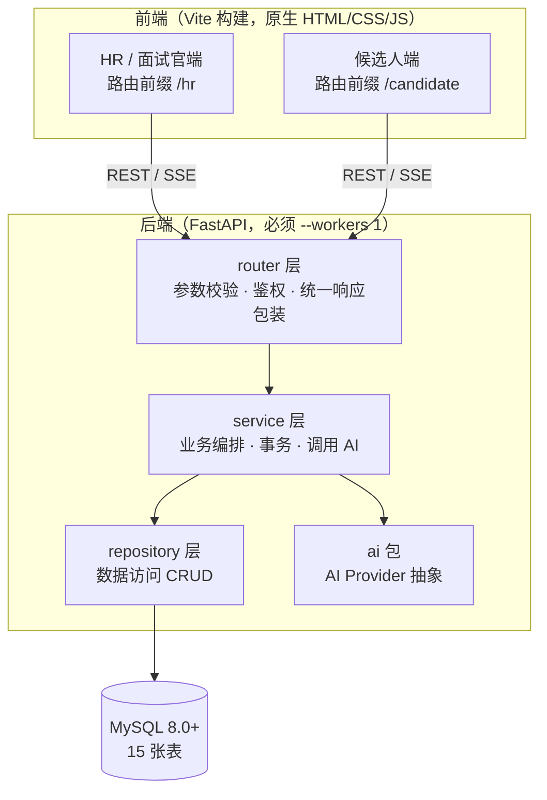
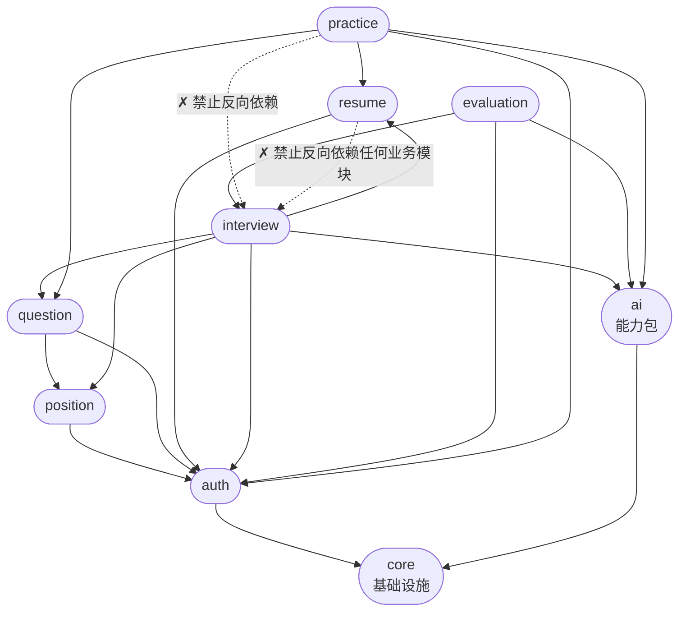
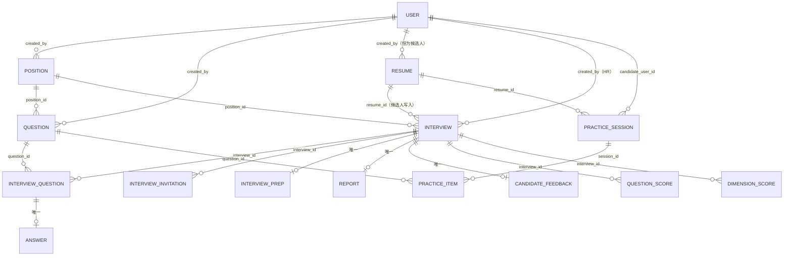
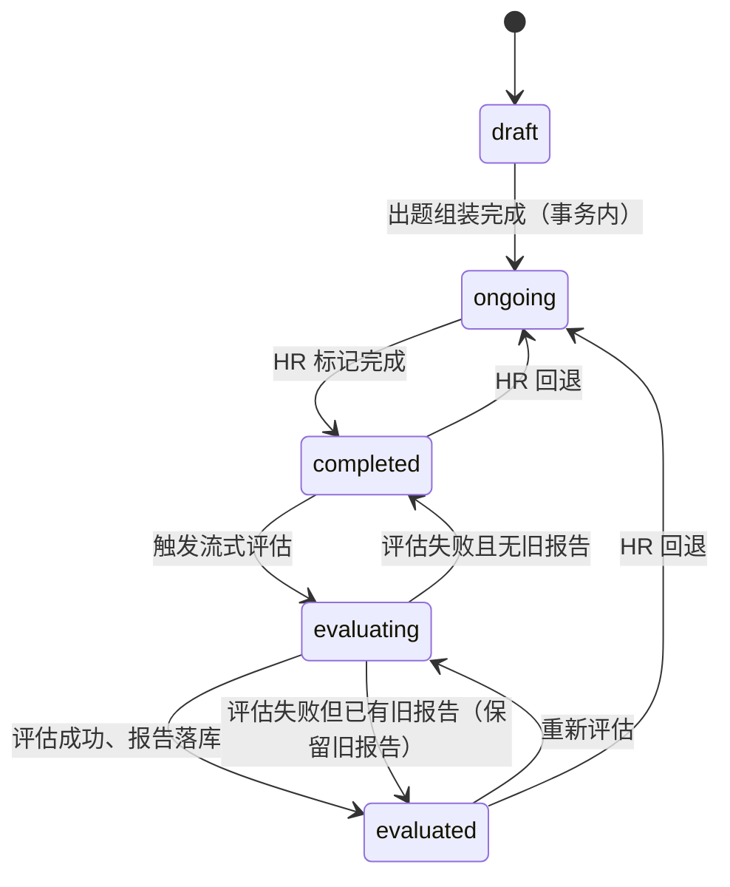
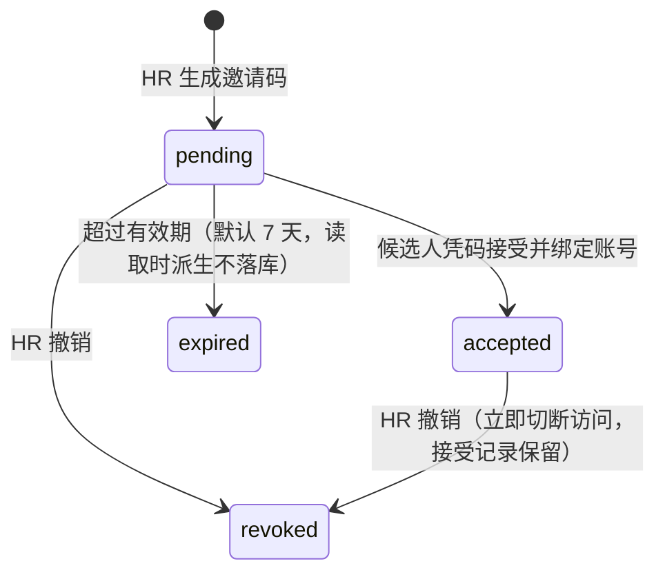
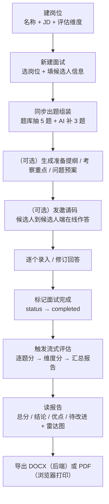
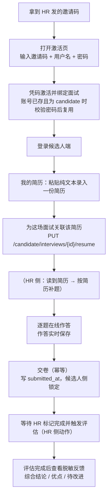
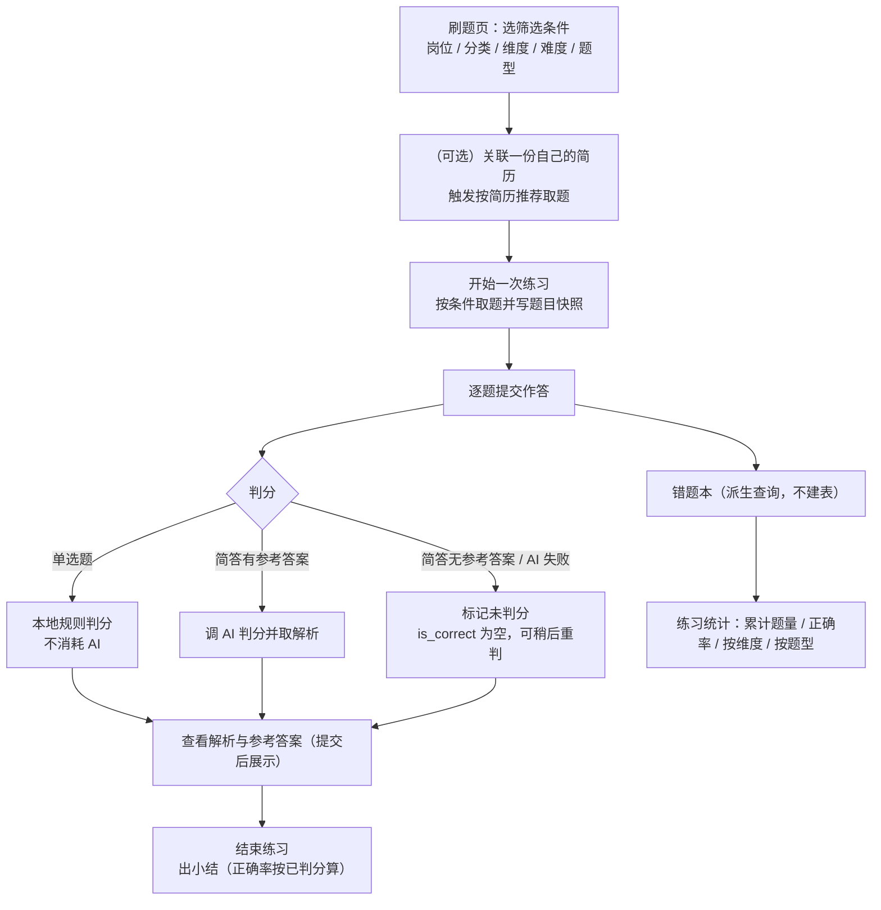

# AI 智能面试助手 —— 产品说明书

> **面向对象：接手这个项目的人、以及评审 / 展示场景。** 本文回答「这个产品是什么、
> 有哪些能力、按什么规则运转、架构如何组织」，用于建立整体认知，而不是手把手教操作。
>
> 逐步的界面操作请看操作手册：[`docs/manual/README.md`](../manual/README.md)。
> 逐接口的字段与示例请看接口文档：[`docs/apis/API接口文档.md`](../apis/API接口文档.md)。

| 项 | 内容 |
|---|---|
| 产品名 | AI 智能面试助手 |
| 形态 | 单机部署的**双端** Web 应用（HR / 面试官端 + 候选人端） |
| 技术栈 | FastAPI（Python 3.11+）+ MySQL 8.0+ + 原生 HTML/CSS/JS（Vite 构建） |
| 角色 | `admin` · `hr` · `candidate` |
| 接口规模 | 43 条路径 / 59 个 method-route（取自 `docs/apis/API接口文档.md`） |
| 数据表 | 15 张（取自 `backend/script.sql`） |
| 后端模块 | 8 个业务 package：`auth` / `position` / `question` / `resume` / `interview` / `evaluation` / `practice` / `ai` |

**本文的可信度基础**（如实说明，便于判断每一句该按什么力度采信）：

| 部分 | 依据 |
|---|---|
| 全部功能的实现事实 | `backend/app/**` 与 `frontend/src/**` 的实际代码 —— 与本文冲突时**以代码为准** |
| 全部默认值 / 配置项 | `backend/.env.example` 与 `backend/app/core/config.py` |
| 接口的字段与类型 | `docs/apis/API接口文档.md`（其来源为 `GET /openapi.json`） |
| 设计意图（做与不做的边界） | `docs/superpowers/mvp/2026-09-15-ai-interview-assistant-mvp-design.md`（PRD） |

> PRD 描述的是**设计意图**，代码描述的是**实现事实**。两者不一致处以代码为准；
> 本文出现的每一个数字、字段名、状态码、配置项、启动命令，都能在仓库中指出出处。

---

## 目录

- [第一章 产品介绍](#第一章-产品介绍)
- [第二章 功能说明](#第二章-功能说明)
- [第三章 架构设计](#第三章-架构设计)
- [第四章 用户操作说明](#第四章-用户操作说明)
- [第五章 常见问题](#第五章-常见问题)
- [附录 A 数字类默认值核对表](#附录-a-数字类默认值核对表)
- [附录 B 配置项清单](#附录-b-配置项清单)

---

## 第一章 产品介绍

### 1.1 这是什么产品

**AI 智能面试助手**是一个跑在单机上的 Web 应用，用 AI 辅助真人面试官完成面试全流程，
并让候选人自己完成「录简历、在线作答、刷题练习、查看反馈」。AI 在其中扮演**辅助角色**：
出题、按简历补题、按简历推荐刷题、评估打分、生成准备提纲与候选人反馈。

它解决的核心问题是：**面试组织过程里的重复劳动与信息断层**。

| 痛点 | 本产品的应对 |
|---|---|
| 出题靠人肉翻题库、题意与岗位 JD 脱节 | 从题库按岗位维度抽取，并由 AI 按 JD 补充；候选人提交简历后可按简历**追加**更贴合的题 |
| 面试过程记录散落、面完想不起答了什么 | 作答（HR 手工录入或候选人在线作答）统一落库并附**题目快照**，事后可复看 |
| 面完写评估报告耗时且口径不一 | 三阶段流式评估：逐题评分 → 多维评分 → 汇总报告，同一套 0–10 分制 |
| 候选人面完杳无音信 | 评估完成后候选人可自助查看**脱敏反馈**（不含去留判断） |
| 候选人想练手却无题可练 | 复用同一套题库提供刷题闭环：取题 → 判分 → 解析 → 错题本 → 统计 |

### 1.2 面向哪三类角色

| 角色 | 取值 | 定位 | 账号来源 |
|---|---|---|---|
| 管理员 | `admin` | 系统管理：创建 / 管理用户、改角色与启停；可见**全部**业务数据 | 由 seed 脚本创建（`backend/scripts/seed_admin.py`） |
| 面试官 | `hr` | 日常使用者：岗位、题库、面试、评估、报告；默认只可见**自己创建**的数据 | 由 admin 创建；**不可自助注册** |
| 候选人 | `candidate` | 终端用户：简历、刷题、在线作答、查看反馈；只可见**自己的**数据 | 凭邀请码激活，或自助注册（仅刷题权限） |

> **权限守卫是精确匹配、无继承。** 不存在「admin 通吃」：`admin` **不能**调用候选人端接口，
> `candidate` **不能**调用 HR 端接口，两个方向都返回 `403 FORBIDDEN`。实现见
> `backend/app/core/deps.py` 的 `require_roles`（集合精确匹配）。

### 1.3 两条业务线与简历驱动链路

**HR / 面试官端 ——「出题 → 记录 → 评估 → 报告」闭环。**

```
建岗位（JD + 评估维度）
   → 建面试并同步出题（题库抽 N 题 + AI 按 JD 补 M 题，写题目快照）
   → 面试前生成准备提纲 / 考察重点 / 问题预案
   → 记录回答（HR 手工录入，或由候选人在线作答后 HR 修订）
   → 标记完成
   → 流式评估（逐题分 → 维度分 → 汇总报告）
   → 生成结构化报告，导出 DOCX / PDF
```

**候选人端 ——「激活 / 注册 → 简历 → 作答 / 刷题 → 反馈」闭环。**

```
凭邀请码激活（或自助注册，仅刷题）
   → 录入自己的简历（粘贴纯文本）
   → 在线作答 HR 发起的真实面试，交卷
   → 评估完成后查看脱敏反馈
   ── 另一条支线：用同一套题库自主刷题、看解析、复习错题、看统计
```

**把两条缝起来的是「简历驱动链路」。** 简历由候选人单侧提交，同时被两个方向消费：
HR 侧据此**按简历补题**（追加更贴合经历的题），候选人侧据此**按简历推荐刷题**。
这条链路把原本互不相干的两端串成一个闭环，也是本产品区别于「出题工具 + 刷题 App」
简单拼装的地方：

```
HR 建面试 → 发邀请码 → 候选人激活 → 候选人录简历 → 候选人关联简历到面试
   → HR 看到简历 → HR 按简历补题（追加）→ HR 准备 → 面试 → 评估 → 报告 → 导出
```

> **简历关联由候选人发起**，不是 HR 创建面试时填写 —— 简历出现的时间晚于面试创建。
> 因此 `interview.resume_id` 的**写入方是候选人**（`PUT /candidate/interviews/{id}/resume`），
> 而这也是 **HR 能看到候选人简历的唯一通路**。

### 1.4 产品定位与边界

| 维度 | 定位 | 约束来源 |
|---|---|---|
| 部署 | **单机部署**，前后端同源（`127.0.0.1:8000`） | PRD §2；`如何打开项目.md` |
| 终端 | **仅 PC 端**，不做移动端适配 | PRD §1.3 |
| 前端 | HR 端与候选人端是**同一个 Vite 工程内**的两组路由 | `frontend/src/router.js` |
| 后端 | 纯 API，不渲染页面；`router → service → repository → MySQL` 严格单向分层 | PRD §3.2；`backend/tests/test_architecture.py` |
| 数据 | 单一 MySQL 库，15 张表；不引入 Redis / 消息队列等中间件 | PRD §2；`backend/script.sql` |
| 单进程 | 必须 `--workers 1`：评估的 SSE 运行注册表与刷题限流计数都是**进程内**的 | `README.md`；`backend/app/evaluation/stream.py` |

> **单机约束带来两条实现事实**：
> ① 限流类能力用**进程内计数**实现（`backend/app/practice/service.py` 的 `_rate_windows`）；
> ② 同一 origin 下两端登录态必须**按端分 key** 存储（`hr.*` / `candidate.*`），
> 保证一个浏览器能**同时**保持 HR 与候选人登录（`frontend/src/session.js`）。

### 1.5 MVP 明确不做的能力

下面每一条都是**刻意的边界**，不是尚未完成。逐条给出「不做，但什么是可以的」。

| 不做的能力 | 边界说明 |
|---|---|
| 报告分享 | 不生成对外分享链接。**导出成文件是允许的**：DOCX 走后端、PDF 走浏览器打印 |
| 语音 / 视频面试、录音转写 | 全程纯文本；题目、作答都是文字，不涉及音视频通道 |
| 简历文件上传与解析 | 简历**只支持粘贴纯文本**，不存原文件、不存解析产物。因此不存在「解析失败」分支 |
| 多候选人横向对比 | 一次评估只针对一场面试，没有把多个候选人并排比较的视图 |
| 后端生成 PDF | 没有后端 PDF 接口。**PDF 由浏览器打印生成为允许路径**（`window.print()`），代价是不支持脱离浏览器的批量 / 后台导出 |
| 邮件 / 通知 | 邀请码在**系统内展示与复制**，不发送邮件；候选人需要 HR 把码给他 |
| 流式出题 | **出题是同步的**；只有评估环节是 SSE 流式。准备助手的生成也是整批返回 |
| 移动端 | 仅 PC，不做响应式与移动端交互 |
| 候选人社交能力 | 无排行榜、积分、成就、讨论区 |
| 在线编程判题 | 无代码沙箱与测试用例运行；刷题**只做文本问答**（单选 / 简答） |
| 候选人修改已交卷作答 | 交卷后**候选人侧锁定**，**没有**把面试交还候选人的办法。需要补答时由 HR 在自己那边代为修订 |
| 候选人查看逐题分与雷达图 | 默认**脱敏**：逐题分、维度分、雷达图不下发；由配置项 `CANDIDATE_FEEDBACK_LEVEL` 控制是否放开总分 |
| 候选人收藏题目、笔记 | 无收藏、无笔记；错题本是派生查询，不是「收藏」功能 |

> 参考 PRD §1.3「非目标」与 §11「V1.1（规划）」。

### 1.6 一条端到端主线叙事

HR 先建好带评估维度的岗位，点「新建面试」时系统从题库按维度抽 5 道题、再让 AI 按 JD 补 3 道，
合并成这一场的题目；HR 可以随时生成面试前的准备提纲与问题预案。面试进行时，HR 要么自己逐题
录入候选人的回答，要么发一个邀请码让候选人到候选人端自己作答——两种通道写的是**同一份数据**。
候选人拿码激活账号后，可以粘贴一份自己的简历并把它关联到这场面试，HR 于是在面试详情页读到
这份简历，并能点「按简历补题」往这一场里追加更贴合的题目。面试结束，HR 标记完成、触发流式评估，
系统推完逐题分、维度分与汇总报告后，报告页可导出 DOCX 或打印成 PDF。若候选人也想看看结果，
他在候选人端读到的是一份**重写过的脱敏反馈**——只讲本场表现，不带 HR 的去留判断。

---

## 第二章 功能说明

本章按**后端 8 个模块**成章。每个模块给出：模块职责、核心功能点、**关键业务规则与约束**、
对外接口清单（方法 / 路径 / 权限）并链接到接口文档对应章节。

> 接口的完整字段、请求体、响应示例不在本文展开，见
> [`docs/apis/API接口文档.md`](../apis/API接口文档.md)。

### 2.1 auth —— 用户、鉴权与数据隔离

**模块职责。** 承载三类角色的账号体系（登录、JWT 签发与校验、用户管理）、密码哈希，
以及**全项目数据隔离的判据基座**。所有业务模块都依赖它做鉴权与归属判定。

**核心功能点。**

- 登录（返回 JWT）、查询当前登录用户（`/auth/me`）。
- 候选人自助注册（仅刷题权限，由配置开关控制）。
- admin 创建用户、列出用户、改角色 / 启用禁用。
- 数据隔离判据的统一实现：`scope_owner_id` / `ensure_resource_visible`（HR 侧，按 `created_by`）
  与 `ensure_owner_match`（候选人侧，按资源归属）。

**关键业务规则与约束。**

- **三种角色与数据隔离**：
  - `admin` 可见**全部**数据。
  - 普通 `hr` **只见自己创建**的 `position` / `question` / `interview`，外加
    「与某场**自己名下**面试关联的候选人简历」（只读）。
  - `candidate` **只见自己的** `practice_*`、自己的简历，以及自己被邀请**且已接受**的面试的
    题目与自己提交的作答。
- **权限守卫是精确匹配、无继承**：`require_roles(...)` 用集合判定，不做层级包含。候选人 token
  调 HR 接口 → `403`；HR（含 admin）token 调候选人接口 → `403`。守卫**先于请求体校验** ——
  即使 body 是空的，角色不符仍返回 403 而不是 400。
- **JWT 载荷中不放角色**：角色每次请求从数据库回读，因此「改角色 / 禁用账号」**立即生效**，
  不必等 token 过期。前端若缓存了 `user.role`，必须靠 `/auth/me` 刷新。
- **账号不做物理删除**，只置 `is_active=false`（因为 `position` / `question` / `interview` 等
  通过外键关联 `user` 表，物理删除会造成外键悬空）。
- **普通 HR 不可自行注册**；候选人账号只有两条来源：邀请码激活、自助注册（受
  `CANDIDATE_SELF_REGISTER` 控制，默认开启）。
- **凭邀请码建号（`accept`）与自助注册的区别**：`accept` **不校验**自助注册开关
  —— 关闭自助注册后，邀请码仍是候选人的唯一入口，必须可用。
- **复用已有候选人账号必须校验密码**：用户名已被 `candidate` 占用时，密码不符即拒绝
  （`401`「用户名或密码错误」）；用户名已被 `hr` / `admin` 占用时硬拒绝（`409`，沿用
  「用户名已被占用」语义）。**被禁用的账号不得被复用绑定**（`401`）—— 否则会白白消耗掉
  一次性邀请码，而候选人永远打不开这场面试。
- **登录失败文案统一**：用户不存在与密码错误返回完全相同的响应（防用户名枚举），
  并对「用户不存在」分支做一次哈希比对以拉平响应时间。
- `POST /auth/register` **不返回 token**（注册与登录是两个动作，JWT 签发只有一条路径）。

**对外接口清单**（详见接口文档 [§2.2 认证](../apis/API接口文档.md#22-认证)）：

| 方法 | 路径 | 权限 | 文档 |
|---|---|---|---|
| GET | `/api/health` | 公开 | [§4.1](../apis/API接口文档.md#41-健康检查) |
| POST | `/api/auth/login` | 公开 | [§5.1](../apis/API接口文档.md#51-登录) |
| POST | `/api/auth/register` | 公开 | [§5.6](../apis/API接口文档.md#56-候选人自助注册) |
| GET | `/api/auth/me` | 任意登录 | [§5.2](../apis/API接口文档.md#52-当前登录用户) |
| POST | `/api/users` | `admin` | [§5.3](../apis/API接口文档.md#53-创建用户仅-admin) |
| GET | `/api/users` | `admin` | [§5.4](../apis/API接口文档.md#54-用户列表仅-admin) |
| PATCH | `/api/users/{user_id}` | `admin` | [§5.5](../apis/API接口文档.md#55-修改角色--启用禁用仅-admin) |

> **全项目只有 4 个公开端点**（不需要 JWT）：`GET /api/health`、`POST /api/auth/login`、
> `POST /api/auth/register`、`POST /api/candidate/invitations/{code}/accept`。其余全部需要
> `Authorization: Bearer <token>`。

### 2.2 position —— 岗位与评估维度

**模块职责。** 管理岗位（名称、JD、评估维度列表）。评估维度是多维评分的归集口径，
也是 AI 出题与补题的输入。

**核心功能点。**

- 岗位增删改查（列表支持按岗位名模糊匹配）。
- 评估维度以 JSON 数组存储，与 `dimension_score.dimension` 保持同一命名空间
  （评估打分时可直接按维度名归集，无需联表）。

**关键业务规则与约束。**

- **同一 HR 下岗位名唯一**（唯一索引 `(created_by, name)`）；不同 HR 可各自维护同名岗位。
- **删除前校验是否被引用**：被题库题目或面试引用时拒绝删除（`409`）。
- 数据隔离：普通 HR 只见自己创建的岗位（判据 `created_by`）。
- 岗位未定义评估维度时，后续的出题、补题、准备助手都会以业务错误拒绝。

**对外接口清单**（详见 [§六 岗位](../apis/API接口文档.md#六岗位)）：

| 方法 | 路径 | 权限 | 文档 |
|---|---|---|---|
| POST | `/api/positions` | `admin` · `hr` | [§6.1](../apis/API接口文档.md#61-创建岗位) |
| GET | `/api/positions` | `admin` · `hr` | [§6.2](../apis/API接口文档.md#62-岗位列表) |
| GET | `/api/positions/{position_id}` | `admin` · `hr` | [§6.3](../apis/API接口文档.md#63-岗位详情) |
| PUT | `/api/positions/{position_id}` | `admin` · `hr` | [§6.4](../apis/API接口文档.md#64-更新岗位) |
| DELETE | `/api/positions/{position_id}` | `admin` · `hr` | [§6.5](../apis/API接口文档.md#65-删除岗位) |

### 2.3 question —— 题库

**模块职责。** 管理题库题目。**同一张表同时服务两条业务线**：HR 出题抽取与候选人刷题取题，
因此字段同时覆盖「面试用」与「刷题判分用」两类需求。

**核心功能点。**

- 题目增删改查，支持按岗位 / 分类 / 维度 / 难度 / 题型 / 来源 / 关键词筛选（AND 关系）。
- 题型支持单选（`single_choice`）与简答（`short_answer`）；单选带选项列表，简答带参考答案与解析。
- 调 AI 为题目生成参考答案与解析并落库（生成后 HR 可编辑）。
- 候选人侧提供**刷题岗位筛选项**（`GET /candidate/positions`，只下发有题目的岗位）。

**关键业务规则与约束。**

- **维度的精确匹配**：题目的 `dimension` 必须属于其岗位的评估维度，否则 `400`（`detail` 带上
  允许的维度列表）。
- **按题型的跨字段校验**（在 service 层，报错文案可直接展示）：
  - 单选：选项**至少 2 个、最多 10 个**，单个选项 ≤ 200 字符，选项不得重复；
    **必须提供参考答案，且答案必须是选项之一**（这是单选可判分的前提）。
  - 简答：不得带选项；参考答案可为空（存量题目与 AI 出题链路都只产出题干）。
- **来源（`source`）由服务端决定**：HR 手工建的是 `bank`，AI 出题链路产出的是 `ai`，
  请求体无法指定。
- **四个刷题字段的「缺省 = 保持不变」语义**：`question_type` / `options` / `reference_answer` /
  `explanation` 在更新时若未提供，则保持原值 —— 否则 HR 改一个错别字就会把单选题的选项与
  答案一并抹掉。这是对全量替换语义的一处**有意例外**。
- **AI 补答案不一致时不静默改写**：单选题若 AI 给出的答案不在选项内，返回 `409` 且**不落库**
  （不做「吸附到最接近的选项」，那等于伪造正确答案）。
- 数据隔离：普通 HR 只见自己创建的题目。
- **候选人取题时不按 `created_by` 过滤**（取全库题目）—— 这是本项目**唯一**一处对数据隔离的
  放宽，显式记录在案：题库是共享资源，候选人不该只看到某个 HR 的题。

**对外接口清单**（详见 [§七 题库](../apis/API接口文档.md#七题库)）：

| 方法 | 路径 | 权限 | 文档 |
|---|---|---|---|
| POST | `/api/questions` | `admin` · `hr` | [§7.1](../apis/API接口文档.md#71-创建题目) |
| GET | `/api/questions` | `admin` · `hr` | [§7.2](../apis/API接口文档.md#72-题目列表) |
| GET | `/api/questions/{question_id}` | `admin` · `hr` | [§7.3](../apis/API接口文档.md#73-题目详情) |
| PUT | `/api/questions/{question_id}` | `admin` · `hr` | [§7.4](../apis/API接口文档.md#74-更新题目) |
| DELETE | `/api/questions/{question_id}` | `admin` · `hr` | [§7.5](../apis/API接口文档.md#75-删除题目) |
| POST | `/api/questions/{question_id}/reference-answer` | `admin` · `hr` | [§7.6](../apis/API接口文档.md#76-生成参考答案与解析) |
| GET | `/api/candidate/positions` | `candidate` | [§10.1](../apis/API接口文档.md#101-刷题岗位筛选项) |

### 2.4 resume —— 简历

**模块职责。** 管理候选人简历（纯文本）。**写入方只有候选人**，HR 侧只读且只经面试关联读到。

**核心功能点。**

- 候选人侧简历 CRUD（`/candidate/resumes`）。
- 候选人把简历关联 / 解除关联到本人已接受的面试。
- HR 经 `GET /interviews/{id}/resume` 只读本场关联的简历。

**关键业务规则与约束。**

- **简历只有候选人一个写入方**：`created_by` 恒为候选人用户 id。**HR 不提供任何简历 CRUD**。
- **纯文本粘贴，不做文件上传与解析**：不存原文件、不存解析产物，因此不存在解析失败分支。
- **正文上限 20000 字符（`RESUME_CONTENT_MAX_LENGTH`）→ `422`**。这是**全项目唯一一处 422**：
  该校验绕开 Pydantic（否则会被 `main.py` 统一改写为 400），由 service 层抛业务异常实现。
- **HR 只能经「该简历关联到自己名下某场面试」这条通路读到简历**（判据复用邀请链，
  **不引入新机制**）。HR 读他人面试的简历 → `403`。
- **HR 拿不到简历的删除 / 修改入口**；简历的增删改只有候选人自己做。
- **同一份简历可被多场面试与多次练习复用**（`interview.resume_id` 与 `practice_session.resume_id`
  只记录引用、不复制内容）。
- **删除被引用的简历 → `409`**（由外键 `RESTRICT` 兜底）：被面试或练习关联时拒绝删除，
  因此不存在悬空引用。
- **简历更新后不影响已补的题**：题目内容与匹配理由已快照在 `interview_question` 中。
- 简历标题**刻意不做唯一约束**（候选人保留两份都叫「通用简历」是无害用法）。
- **`updated_at` 必须下发**：HR 据此判断手上这份是不是最新的（候选人改了简历需重新触发补题）。

**对外接口清单**（详见 [§十一 简历管理](../apis/API接口文档.md#十一简历管理候选人端)）：

| 方法 | 路径 | 权限 | 文档 |
|---|---|---|---|
| POST | `/api/candidate/resumes` | `candidate` | [§11.1](../apis/API接口文档.md#111-新建简历) |
| GET | `/api/candidate/resumes` | `candidate` | [§11.2](../apis/API接口文档.md#112-我的简历列表) |
| GET | `/api/candidate/resumes/{resume_id}` | `candidate` | [§11.3](../apis/API接口文档.md#113-简历详情) |
| PUT | `/api/candidate/resumes/{resume_id}` | `candidate` | [§11.4](../apis/API接口文档.md#114-更新我的简历) |
| DELETE | `/api/candidate/resumes/{resume_id}` | `candidate` | [§11.5](../apis/API接口文档.md#115-删除我的简历) |
| GET | `/api/interviews/{interview_id}/resume` | `admin` · `hr` | [§8.16](../apis/API接口文档.md#816-读取面试关联的简历) |
| PUT | `/api/candidate/interviews/{interview_id}/resume` | `candidate` | [§10.7](../apis/API接口文档.md#107-关联--解除关联简历) |

### 2.5 interview —— 面试、出题装配、状态机、作答邀请、准备助手

**模块职责。** 本产品**最重**的模块：面试实例的生命周期（创建、出题组装、记录回答、状态迁移）、
作答邀请（生成 / 接受 / 撤销 / 过期）、候选人在线作答通道与交卷，以及面试前准备助手。

**核心功能点。**

- 创建面试（**含同步出题组装**）、列表、详情、更新候选人信息。
- 出题组装：题库按维度轮询抽 N 题 + AI 按 JD 补 M 题，合并写内容快照。
- 回答记录：HR 手工录入 / 覆盖，与候选人在线作答**共用同一份数据**。
- 状态迁移：标记完成、回退到进行中。
- 作答邀请：生成（返回**明文** code 供 HR 复制）、列表与状态、撤销。
- 按简历补题（追加、幂等）、读取本场关联的简历（只读）。
- 面试前准备助手：生成 / 查看 / 编辑准备提纲（`interview_prep`，一场唯一）。

**关键业务规则与约束。**

**① 面试状态机**：`draft → ongoing → completed → evaluating → evaluated`。

| 迁移 | 触发者 | 说明 |
|---|---|---|
| `draft → ongoing` | 系统（事务内） | 出题组装完成，与建面试同一事务 |
| `ongoing → completed` | HR | `POST /interviews/{id}/complete` |
| `completed → evaluating` | HR | 触发流式评估 |
| `evaluating → evaluated` | 系统 | 评估成功、报告落库 |
| `evaluating → completed` | 系统 | **评估失败且库里无旧报告**时回退 |
| `evaluating → evaluated` | 系统 | **评估失败但库里已有旧报告**时回退（保留旧报告） |
| `completed → ongoing` | HR | `POST /interviews/{id}/rollback`，回退以补充 / 修改回答 |
| `evaluated → evaluating` | HR | 重新评估 |
| `evaluated → ongoing` | HR | 回退 |

  **表中未列出的迁移一律拒绝**（`409`，`detail` 给出 `{from, to}`）。所有状态变更都经
  `_assert_transition` 这一个入口，不允许任何地方直接赋值 `status`。

**② 作答邀请状态机**（与面试状态**解耦**）：`pending → accepted / revoked / expired`。

| 迁移 | 触发者 | 说明 |
|---|---|---|
| `pending → accepted` | 候选人 | 凭码激活并绑定账号，写入 `candidate_user_id` 与 `accepted_at` |
| `pending → revoked` | HR | 撤销邀请 |
| `pending → expired` | **时间** | 超过有效期（默认 **7 天**）—— **读取时派生，不落库** |
| `accepted → revoked` | HR | **有意允许**：这是切断已接受候选人访问的唯一手段，`accepted_at` / `candidate_user_id` 保留 |

  邀请码的**安全属性**：一次性接受、**高熵不可枚举**（`secrets.token_urlsafe(16)` → 22 个
  URL-safe 字符、约 128 位熵）、有效期默认 7 天（`INVITATION_EXPIRE_DAYS`）、可随时撤销。
  **四种失效原因**（码不存在 / 已撤销 / 已接受 / 已过期）返回**同一文案**，且响应不出现任何
  面试信息 —— 避免成为邀请码探测接口。

  **`POST /api/candidate/invitations/{code}/accept` 是公开端点**：拿码的人往往**还没有账号**，
  要求他先登录才能激活会让邀请链自相矛盾（没账号→没 token→激活不了）。它是继 `/auth/login`、
  `/auth/register` 之后的**第三个业务公开端点**；另有系统级的健康检查 `GET /api/health`，
  全项目合计 **4 个**无需 JWT 的端点。它挂在 `/candidate` 前缀下只是因为路径同属一段，
  **守卫是逐个端点挂的，不是按文件挂的**。

  **并发接受只能产生一条绑定**：实现上用**面试行锁**（`SELECT … FOR UPDATE`）串行化同一场
  面试的接受，并在锁内以**当前读**复查（快照读会读不到并发事务刚提交的那一行）。

**③ 候选人作答不进入面试状态机**（明确的设计取舍）。状态机描述的是 **HR 侧**的推进流程；
**交卷只写 `answer.submitted_at` 并锁定候选人侧通道**，面试是否完成仍由 **HR 决定**
（仍需手动 `/complete`）。把候选人作答做成状态会让 `draft` / `ongoing` / `completed` 的语义
分裂（「HR 还没开始面」与「候选人已交卷」相互正交）。作答来源与交卷事实由
`answer.source` / `answer.answered_by` / `answer.submitted_at` 表达。

  **HR 侧不受交卷锁影响**：交卷锁定只约束候选人通道，**HR 始终可以修订作答**
  （覆盖后 `source` 仍是 `candidate`，仅更新 `answered_by`，两个事实并存）。

**④ 面试前准备助手与状态机正交**。准备助手是面试开始前的**工作稿**，其「已生成 / 已编辑」
与面试推进阶段相互正交。要点：

- `interview_prep` **一场面试唯一**（`interview_id` 加唯一约束），
- **重新生成整体覆盖**既有内容（三个 JSON 字段整体替换，不做字段级合并）；重新生成时
  `edited_at` **置回 `null`**（否则界面会显示「已手工编辑」而内容其实是 AI 的）。
- **不进入 `interview.status`**，只用 `generated_at` / `edited_at` 记录事实。
- **`completed` 及之后拒绝生成与编辑**（`409`）；`draft` / `ongoing` 可生成与编辑。
- **未生成时读取返回 `404`**（而非空对象）—— 前端据此显示「生成准备提纲」按钮。
- **未生成就编辑返回 `404`，不自动创建**（先 POST 生成、再 PUT 编辑是显式且唯一的顺序）。
- 生成**一次整批落库，不做流式**；AI 调用失败时数据库零改动（已有提纲自然保留）。

**⑤ 按简历补题**（`POST /interviews/{id}/questions/match`，PRD §4.14）。

- **前置条件**：面试处于 `ongoing`（否则 `409`）；`interview.resume_id` 非空（否则 `409`
  「该面试尚未关联简历」）。
- **只追加、不改动既有题目**：追加为新 `interview_question`，`seq` 续接本场最大值，
  `source_snapshot='resume_match'`，`match_reason` 写入 AI 给出的理由。
- **幂等**：本场已有的 `question_id` 从候选池剔除，因此**重复调用不会产生重复题目**；
  但**每次调用都会再加 count 题**（池子变小后 AI 挑的是下一批），这是有意允许的累加。
  响应回 `added_count` / `total_questions` 供界面显示本场总数。
- **只挑不生成**：AI 只从传入的题库候选中挑，因此匹配到的题都有参考答案与解析，不引入新题
  质量风险。
- **AI 失败降级**：本次补题不生效，**不动既有题目、不改面试状态**（`502` 由 HR 重试）。
- **无撤销接口**：补题完成后追加的题目与既有题目一样不可删 —— 补题是**唯一的加题例外**。
- **出题组装后无换题 / 删题接口**（沿用既有约束）。

**⑥ 简历关联由候选人发起**（`PUT /candidate/interviews/{id}/resume`，body `{resume_id}`）。

- **一场面试只关联一份简历**；传 `null` 表示**解除关联**。
- **仅 `ongoing` 允许变更**（`409` 拒绝：`draft` 对候选人不可达，`completed` 及之后冻结）。
- 只能关联**属于本人**的简历（否则 `403`）、存在的简历（否则 `404`）。
- **候选人能读到自己每场的 `resume_id`**（`GET /candidate/interviews` 与详情都下发，
  未关联为 `null`）—— 关联状态是他自己的数据，**能写就必须能读**。

**⑦「已作答」的唯一判定口径**（全项目统一）。作答内容**去除首尾空白后非空**才算已作答；
只敲空格的作答与空串一样视为**未作答**。判据统一在**读取侧**（`_is_answered`），
**不改写入侧原文**（作答可能是代码片段，需保留缩进与换行）。

> 为什么必须统一：此前该事实有三套写法（`strip()`、SQL 的 `content != ""`、评估入口的
> `strip()`），候选人只敲空格时，交卷响应报 0 题、HR 列表报 1 题、AI 那侧按未作答打分 ——
> 同一份数据三个结论。

**⑧ 出题数量**：题库抽 **N 题**（`QUESTION_COUNT_FROM_BANK`，默认 **5**）+ AI 补 **M 题**
（`QUESTION_COUNT_FROM_AI`，默认 **3**），**总题数恒为 N + M = 8**；题库不足时由 AI 补足差额
（`need_ai = M + (N - K)`，K 为实际抽到的题库题数）。抽取用 round-robin（按维度轮询、
组内按 id 升序），因此相同数据状态下出题结果完全可预测。AI 出题与建面试在**同一事务**，
失败整体回滚。

**⑨ 作答以 `interview_question_id` 为唯一键**（而非 `interview_id + question_id`）：
这支撑「同一道题库题在一次面试中出现两次」的扩展。作答**不做历史版本**，只保留最新内容与
最后修改者。

**对外接口清单**（详见 [§八 面试](../apis/API接口文档.md#八面试) 与
[§十 候选人端 —— 在线作答](../apis/API接口文档.md#十候选人端--在线作答)）：

| 方法 | 路径 | 权限 | 文档 |
|---|---|---|---|
| POST | `/api/interviews` | `admin` · `hr` | [§8.2](../apis/API接口文档.md#82-创建面试同步出题) |
| GET | `/api/interviews` | `admin` · `hr` | [§8.3](../apis/API接口文档.md#83-面试列表) |
| GET | `/api/interviews/{interview_id}` | `admin` · `hr` | [§8.4](../apis/API接口文档.md#84-面试详情) |
| PATCH | `/api/interviews/{interview_id}` | `admin` · `hr` | [§8.5](../apis/API接口文档.md#85-更新候选人信息) |
| POST | `/api/interviews/{interview_id}/answers` | `admin` · `hr` | [§8.6](../apis/API接口文档.md#86-录入--修改回答) |
| POST | `/api/interviews/{interview_id}/complete` | `admin` · `hr` | [§8.7](../apis/API接口文档.md#87-标记完成) |
| POST | `/api/interviews/{interview_id}/rollback` | `admin` · `hr` | [§8.8](../apis/API接口文档.md#88-回退到进行中) |
| POST | `/api/interviews/{interview_id}/invitations` | `admin` · `hr` | [§8.9](../apis/API接口文档.md#89-生成作答邀请码) |
| GET | `/api/interviews/{interview_id}/invitations` | `admin` · `hr` | [§8.10](../apis/API接口文档.md#810-邀请列表与状态) |
| DELETE | `/api/interviews/{interview_id}/invitations/{invitation_id}` | `admin` · `hr` | [§8.11](../apis/API接口文档.md#811-撤销邀请) |
| POST | `/api/interviews/{interview_id}/prep` | `admin` · `hr` | [§8.12](../apis/API接口文档.md#812-生成--重新生成准备提纲) |
| GET | `/api/interviews/{interview_id}/prep` | `admin` · `hr` | [§8.13](../apis/API接口文档.md#813-查看准备提纲) |
| PUT | `/api/interviews/{interview_id}/prep` | `admin` · `hr` | [§8.14](../apis/API接口文档.md#814-编辑准备提纲) |
| POST | `/api/interviews/{interview_id}/questions/match` | `admin` · `hr` | [§8.15](../apis/API接口文档.md#815-按简历补题) |
| GET | `/api/interviews/{interview_id}/resume` | `admin` · `hr` | [§8.16](../apis/API接口文档.md#816-读取面试关联的简历) |
| POST | `/api/candidate/invitations/{code}/accept` | **公开** | [§10.2](../apis/API接口文档.md#102-接受邀请码) |
| GET | `/api/candidate/interviews` | `candidate` | [§10.3](../apis/API接口文档.md#103-我的面试列表) |
| GET | `/api/candidate/interviews/{interview_id}` | `candidate` | [§10.4](../apis/API接口文档.md#104-面试详情候选人视图) |
| POST | `/api/candidate/interviews/{interview_id}/answers` | `candidate` | [§10.5](../apis/API接口文档.md#105-保存--更新我的作答) |
| POST | `/api/candidate/interviews/{interview_id}/submit` | `candidate` | [§10.6](../apis/API接口文档.md#106-交卷) |
| PUT | `/api/candidate/interviews/{interview_id}/resume` | `candidate` | [§10.7](../apis/API接口文档.md#107-关联--解除关联简历) |

### 2.6 evaluation —— 评估、报告、候选人反馈、导出

**模块职责。** 把一场面试的作答数据变成评估结果：三阶段流式评估（逐题评分 → 多维评分 →
汇总报告）、报告读取、面向候选人的脱敏反馈、报告的 DOCX 导出。业务编排是**同步**的
（`service.py`），SSE 只是传输适配（`stream.py`），两者分开以便业务逻辑能脱离异步设施单测。

**核心功能点。**

- 触发评估（幂等，返回 SSE 地址）、SSE 流式推送三阶段。
- 读取完整报告（逐题 + 多维 + 汇总）。
- 候选人查看脱敏反馈（懒生成 + 缓存 + 档位裁剪）。
- 导出报告为 DOCX（后端生成文件流）。

**关键业务规则与约束。**

- **评分统一 0–10 分制**（`SCORE_MIN=0.0` / `SCORE_MAX=10.0`）：**逐题分、维度分、总分都是**
  0–10。分数精度 `DECIMAL(3,1)`（定点类型避免浮点误差累积到总分平均值里）。
- **及格线 6.5**（`PASS_THRESHOLD`）是**全项目唯一**的阈值，`practice` 与 `evaluation` 共用
  同一把尺（前端两处独立的 JS 实现也用 6.5，改后端常量必须同步改前端）。
- **三阶段评估**：逐题评分（`question` 事件）→ 多维评分（`dimension` 事件）→ 汇总报告
  （`report` 事件）→ 终结事件 `done` 或 `error`。**结果最后一次性落库**（先推后写）——
  数据库要么是上一次的完整结果、要么是这一次的完整结果，永不存在混合态。
- **SSE 契约**：`question`（按 seq 升序）→ `dimension` → `report` → `done` / `error`；
  `done` 与 `error` **互斥且必居其一**；每 **15 秒**有 `: ping` 心跳。
- **SSE 断连后后台继续**：客户端断开只是移除订阅者，**后台评估线程继续运行**；
  重连会**从头重放**已推事件（因此前端累加进度必须按 id 覆盖而非追加）。
- **重新评估会整体替换报告，并作废旧的候选人反馈**（在同一事务内删除缓存，否则候选人会看到
  上一轮的反馈）。
- **候选人反馈脱敏**（本模块最重要的安全设计）：
  - 默认只下发**综合结论 / 优点 / 待改进**；**总分、逐题分、维度分、雷达图默认不下发**。
  - 由配置项 **`CANDIDATE_FEEDBACK_LEVEL`** 控制：`summary`（默认，不下发总分）/ `full`
    （额外下发总分）。**逐题分与维度分在任何档位都不下发**。
  - **档位只来自服务端配置**，不接受客户端指定（否则候选人传一个 `?level=full` 就能拿到总分）。
  - 响应由**白名单模型** `CandidateFeedbackOut` 序列化，**结构上不可能**包含逐题分、维度分或
    雷达图数据。靠「前端不渲染」实现脱敏等于把分数发给浏览器再要求它别看。
- **候选人「综合结论」不带招聘方的去留判断**：只讲这一场的表现（强在哪、弱在哪），
  不出现「建议进入下一轮 / 不建议继续推进」这类结论。**它不是报告结论的复述，而是面向本人的
  重写** —— 实现上干脆**不把报告结论传给 AI**，这是结构上的保证，而不是靠一句「不要复述」的
  提示。该口径与档位无关：放开总分（`full`）也不放开去留判断。
- **优点 / 待改进的条目内不得出现分数**：条目下发给候选人时是**原样透传**的，若条目本身写着
  「沟通能力（7.5）」就等于从这条路径把维度分漏出去。分数只存在于 `dimension_score` 表
  （供 HR 雷达图使用）；生成条目时只描述维度名与表现。
- **反馈懒生成**：不在评估落库时生成，而是候选人**首次查看时**生成并缓存。理由：避免评估事务
  多一次 AI 调用（会拖累评估成功率）、避免违反「AI 失败不阻塞其他功能」、避免无人查看时白花
  调用。**档位不影响缓存内容**（缓存的是中性文案，不含总分），因此切换配置**立即生效、
  无需失效**。AI 生成失败时 `502` 且不落库，下次读取可重试。
- **未评估时读取报告 / 反馈 → `409`**（「评估尚未完成」）。
- **报告导出**：
  - **DOCX 走后端**（`python-docx`，`GET /interviews/{id}/report/export?format=docx`），
    一键下载文件。内容：基本信息 + 总分 + 综合结论 + 优点 + 待改进 + 逐题评分表 + 多维评分表。
  - **PDF 走浏览器打印**（`window.print()` + `@media print`），雷达图所见即所得。
    因此**不支持脱离浏览器的批量 / 后台导出**（没有后端 PDF 接口）。
  - **导出对象仅限 HR 侧报告**；**候选人脱敏反馈不提供导出**。
  - **DOCX 不含雷达图**（Python 侧重画成本不划算；需要图形走 PDF）。
  - 文件名含用户输入，做了危险字符剔除与限长（防 `Content-Disposition` 头部注入）。
- **错误处理策略**：
  - AI 调用失败**重试 1 次**（`AI_MAX_RETRIES`）→ 仍失败则按**库里有无旧报告**决定回退目标：
    - **无报告**（首次评估就失败）→ 回退 `completed`，HR 可立即重新触发；
    - **有报告**（重新评估失败）→ 回退 `evaluated`。旧报告、逐题分、维度分与候选人反馈都仍在
      库里；一律退到 `completed` 会让报告、导出与候选人反馈全部 `409`，报告没丢却像丢了。
  - **SSE 断连**：后台继续，可重连。
  - **进程重启遗留的孤儿评估自愈**：状态卡在 `evaluating` 但运行注册表为空 → 判定为孤儿，
    按同一规则（有无旧报告）回退。

**对外接口清单**（详见 [§九 评估](../apis/API接口文档.md#九评估)）：

| 方法 | 路径 | 权限 | 文档 |
|---|---|---|---|
| POST | `/api/interviews/{interview_id}/evaluate` | `admin` · `hr` | [§9.1](../apis/API接口文档.md#91-触发评估) |
| GET | `/api/interviews/{interview_id}/evaluation/stream` | `admin` · `hr` | [§9.2](../apis/API接口文档.md#92-sse-流式评估进度) |
| GET | `/api/interviews/{interview_id}/report` | `admin` · `hr` | [§9.3](../apis/API接口文档.md#93-获取报告) |
| GET | `/api/interviews/{interview_id}/report/export` | `admin` · `hr` | [§9.4](../apis/API接口文档.md#94-导出报告为-docx) |
| GET | `/api/candidate/interviews/{interview_id}/feedback` | `candidate` | [§9.5](../apis/API接口文档.md#95-候选人脱敏反馈) |

### 2.7 practice —— 刷题练习

**模块职责。** 候选人侧的独立业务线：练习会话、逐题判分与解析、错题本、练习统计、按简历推荐。
**本模块不依赖 `interview`** —— 刷题与真实面试完全解耦。

**核心功能点。**

- 取题预览（不创建会话，返回真实题量与题目预览，不含答案）。
- 开始一次练习（取题并写题目快照）、我的会话列表（含进行中）、练习详情与进度。
- 逐题提交作答 → 即时判分 + 解析；对**未判分**的题重新判分。
- 结束练习出小结；错题本；练习统计。

**关键业务规则与约束。**

- **判分分两条路径**（`_grade` 的四条分支）：
  - **空作答** → 判 0 分，**不调 AI**（省一次无意义调用）。
  - **单选题** → **本地规则判分，不消耗 AI**（比较候选人所选与参考答案文本是否一致）；
    解析取题库的 `explanation`（单选不消耗 AI，因此没有 AI 生成的解析可返回）；
    分数非对即错（`SCORE_MAX` / `SCORE_MIN`）。
  - **简答题且有参考答案** → 调 AI 判分（`grade_practice_answer`）并取解析。
  - **简答题但无参考答案** → **不调 AI**，标记为未判分（provider 对空答案会抛错）。
- **AI 判分失败时 `is_correct` 为空（未判分），不阻塞作答**：作答本身已成功保存，因此返回
  **`200`** 而非 5xx（报 5xx 会让前端以为提交失败而重试，与实际事实不符）。未判分的题**可后续
  重判**（`POST /practice/items/{item_id}/rescore`）。
- **重判仅对未判分的项生效**：已判分的项幂等返回既有结果，**不重复调用 AI** —— 已判分项重判会
  改变正确答案与分数，等于允许「刷分」。
- **错题本不建表**：由 `practice_item.is_correct=false` **派生查询**；按 `question_id` 去重并给出
  `wrong_count`；**未判分的题不算错题**。条目**带维度与题型**（取自快照列
  `dimension_snapshot` / `question_type`，与两个筛选参数读的是**同一列**，因此「筛出来的」与
  「标出来的」必然自洽）。
- **正确率的分母是「已判分」数，不是「已作答」数**：未判分的题与候选人水平无关（是 AI 没判出来），
  放进分母会系统性低估正确率。分母为 0 时正确率为 `null`（不是除零、也不是 0.0）。
- **按简历推荐取题**（开始练习时可传 `resume_id`）：
  - 关联了简历时，候选池大小 = `min(size × 4, 100)`，由 AI 从池中按简历相关度挑选排序；
    池为什么要放大：若只取 `size` 题再让 AI 排序，AI 只能重排、不能改选，推荐就退化成
    「同一批题换个顺序」。
  - **AI 失败 / 未命中 / 结果无效 → 降级为原筛选取题**，**不阻塞开始练习**。
  - 会话上有两个字段：`resume_id`（候选人**想用哪份**）与 `resume_match_applied`
    （系统**实际做到了没有**）。两者不可合并，否则降级会变成**静默**（关联了简历却拿到一堆
    通用题，界面上没有任何解释）。
- **「提交后展示」规则**：未提交的题**不下发**解析与参考答案（不是靠前端不显示 —— 不下发就是
  不下发）。判分结果为未判分时也**不透露答案**。
- **题目快照**：会话开始时即按筛选条件取题并写满快照（题干 / 选项 / 参考答案 / 维度 / 题型），
  题库后续删改不影响进行中与历史练习的复看与判分。
- **无符合题时不建空会话**（`409`）：空会话对候选人毫无价值，且会污染「练习次数」统计。
- **题的硬上限**：单次练习题量默认 **10**（`PRACTICE_SESSION_SIZE_DEFAULT`），硬上限 **20**
  （`PRACTICE_SESSION_SIZE_MAX`），超限**直接报错不静默截断**；会话列表 `limit` 硬上限 **100**
  （`PRACTICE_SESSION_LIST_MAX`）；错题本默认 50、上限 200。
- **进程内限流**：每用户每分钟的**计分动作**（开始练习 / 提交作答 / 重判）上限默认 **60**
  （`PRACTICE_RATE_LIMIT_PER_MINUTE`），滑动窗口。**读接口不计**（浏览题目与历史不该消耗配额）。
  操作失败时**退还配额**（否则反复重试一个注定失败的请求会把真实原因耗成「操作过于频繁」）。
  进程内计数意味着**必须单进程部署**（`--workers 1`）。

**对外接口清单**（详见 [§十二 刷题练习](../apis/API接口文档.md#十二刷题练习候选人端)）：

| 方法 | 路径 | 权限 | 文档 |
|---|---|---|---|
| GET | `/api/practice/questions` | `candidate` | [§12.1](../apis/API接口文档.md#121-刷题取题预览) |
| GET | `/api/practice/sessions` | `candidate` | [§12.2](../apis/API接口文档.md#122-我的练习会话列表) |
| POST | `/api/practice/sessions` | `candidate` | [§12.3](../apis/API接口文档.md#123-开始一次练习) |
| GET | `/api/practice/sessions/{session_id}` | `candidate` | [§12.4](../apis/API接口文档.md#124-练习详情与进度) |
| POST | `/api/practice/sessions/{session_id}/items` | `candidate` | [§12.5](../apis/API接口文档.md#125-提交作答即时判分) |
| POST | `/api/practice/items/{item_id}/rescore` | `candidate` | [§12.6](../apis/API接口文档.md#126-重新判分) |
| POST | `/api/practice/sessions/{session_id}/finish` | `candidate` | [§12.7](../apis/API接口文档.md#127-结束练习) |
| GET | `/api/practice/wrong-book` | `candidate` | [§12.8](../apis/API接口文档.md#128-错题本) |
| GET | `/api/practice/stats` | `candidate` | [§12.9](../apis/API接口文档.md#129-练习统计) |

### 2.8 ai —— AI Provider 抽象

**模块职责。** 对外暴露 AI 能力的**抽象接口**，被 `interview`（出题 / 准备提纲）、
`evaluation`（评估 / 反馈）、`practice`（判分 / 推荐）调用。**不注册任何对外路由** —— 它是被
调用的能力包。抽象层**只接收原始值**（字符串、列表、本模块的 dataclass），**不接收任何 ORM 对象**，
这保证 `ai` 不依赖任何业务模块，也让 Mock 实现可以在完全不起数据库的情况下被单测。

**核心功能点。**

- 九个能力方法（见下表）+ 真实 / Mock 两个实现 + 工厂（按配置切换、缓存单例）。
- 启动期校验 Provider 配置（fail fast）。

**关键业务规则与约束。**

- **无大模型 Key 也能以 Mock 完整演示与测试**：默认 `PROVIDER_NAME=mock`，规则生成**确定性**
  结果（相同输入必得相同输出，无随机 / 时间戳 / 字典序依赖）。
- **真实 Provider 调用失败时不自动降级到 Mock**，而是返回 `502 AI_PROVIDER_ERROR` 并允许重试
  —— 静默降级会把规则模板的输出伪装成 AI 评估结果，既误导用户又掩盖故障。
- **启动期即校验配置**：`PROVIDER_NAME` 取值非法、或选了 `openai` 却没配 Key，服务**直接启动
  失败**，而不是等到第一次调用 AI 才报错。
- **`match_questions_by_resume` 只挑不生成**：返回的 `question_id` **恒来自传入的候选池**，
  池外 id 一律丢弃。数据结构上「只有 id 与理由、没有题面字段」，让「编造一道题库外的新题」在
  **结构上无从表达**，而不只是靠 prompt 与解析两层检查。
- **两个简历驱动方法的 `resume_text` 行为相反**（不可混淆）：
  `match_questions_by_resume` 的 `resume_text` 为空时**抛错**（调用方本应先判出「未关联简历」
  并整条路都不调用）；`generate_interview_prep` 的 `resume_text` 为空时**正常运行**
  （未关联简历也能生成提纲）。
- **`generate_candidate_feedback` 刻意不接收报告的综合结论**（见 §2.6）—— 结构上保证去留判断
  漏不出去；`strengths` / `weaknesses` 的条目与顺序保持与报告一致，便于两处逐条对照。

**九个能力方法与调用方：**

| 接口方法 | 用途 | 调用方 |
|---|---|---|
| `generate_questions` | 按 JD + 维度 + 已有题库题补充生成题目 | `interview`（出题） |
| `evaluate_answer` | 单题打分 + 评语 | `evaluation`（逐题评分） |
| `evaluate_dimensions` | 综合多维打分 + 评语 | `evaluation`（多维评分） |
| `summarize_report` | 汇总总分 / 结论 / 优点 / 待改进 | `evaluation`（报告） |
| `generate_reference_answer` | 为缺参考答案的题目生成参考答案与解析 | `question` / `practice` |
| `grade_practice_answer` | 刷题作答判分 + 解析（简答题） | `practice` |
| `generate_candidate_feedback` | 由评分事实**重写**面向候选人的脱敏反馈 | `evaluation` |
| `match_questions_by_resume` | 按简历从题库候选中挑选排序（**只挑不生成**） | `interview`（补题）/ `practice`（推荐） |
| `generate_interview_prep` | 生成面试提纲 / 考察重点 / 问题预案 | `interview`（准备助手） |

**两个实现：**

| 实现 | 选择 | 说明 |
|---|---|---|
| `MockProvider` | `PROVIDER_NAME=mock`（默认） | 规则生成确定性结果，无需任何 API Key；用于无 Key 演示与自动化测试 |
| `OpenAIProvider` | `PROVIDER_NAME=openai` | 调用真实大模型；需配 `OPENAI_API_KEY` + `OPENAI_BASE_URL` + `OPENAI_MODEL` |

> `ai` 模块**无对外 HTTP 端点**，因此不在 `/api` 路由表中；它的行为通过上述调用方的接口体现。

---

## 第三章 架构设计

### 3.1 总体架构

前后端分离：后端是纯 API（FastAPI，不渲染页面），前端是原生 HTML/CSS/JS 经 Vite 构建。
**单机同源部署** —— 前端构建产物 `frontend/dist` 存在时由后端一并托管，于是**一个进程、
一个端口**（`127.0.0.1:8000`）就能打开完整应用（`一键启动.bat` 依赖这一点）。开发期也可以只跑
Vite 开发服务器（`5173`），它把 `/api` 代理到 `8000`。两种模式下**前端代码一律写相对路径
`/api/...`**，都不需要处理 CORS。

**技术栈：**

| 层 | 选型 | 约束 |
|---|---|---|
| 前端 | 原生 HTML + CSS + JavaScript + Vite 构建 | **无 UI 框架、无图表库、无状态管理库** |
| 后端 | Python 3.11+ / FastAPI | 纯 API，不渲染页面 |
| 数据库 | MySQL 8.0+（JSON 列与 ENUM 需 8.0+） | 单一库，15 张表 |
| 分层 | `router → service → repository → MySQL` | **严格单向依赖** |
| 模块 | 每个业务模块一个独立 Python package | — |
| AI | 抽象 Provider 接口，`mock` / `openai` 可配置切换 | 无 Key 也能完整演示 |
| 部署 | 单机、同源（`127.0.0.1:8000`） | 不引入 Redis / 消息队列等中间件 |

**分层架构图（图 1）：**



### 3.2 后端严格分层

每个模块内部统一遵循三层，**依赖方向只允许自上而下：`router → service → repository`**，
不跨层、不反向。

| 层 | 职责 |
|---|---|
| `router` | HTTP 端点：参数校验、鉴权（角色守卫）、统一响应包装。**不做数据访问** |
| `service` | 业务逻辑：流程编排、事务、调用 AI Provider。**不直接执行 SQL** |
| `repository` | 数据访问：CRUD，对接 MySQL。**是最底层，不依赖上层** |

**这些约束由测试钉住**（`backend/tests/test_architecture.py`）：

- `router.py` 不得直接引用 `repository`（数据访问一律经 service）。
- `repository.py` 不得依赖 `service` / `router`（不许向上够）。
- `models.py` 只承载表结构，不依赖同模块任何其他层。
- `service.py` 不出现 `db.execute` / `session.execute`（不直接执行 SQL）。
- `ai` 不依赖任何业务模块；`core` 对业务模块只有函数体内延迟导入（无顶层导入）。

> `core.deps` 对 `auth.models.User` 采用**函数体内延迟导入**，`core.deps` 的类型标注走
> `if TYPE_CHECKING`，都是为了保持 `core` 不反向依赖任何业务模块。

### 3.3 模块划分与依赖方向

**模块划分表：**

| 包名 | 职责 | 依赖 |
|---|---|---|
| `core` | 配置、数据库会话、安全原语（密码哈希 / JWT）、异常体系、依赖注入 | — |
| `auth` | 用户、登录、JWT、角色、数据隔离、候选人注册 | core |
| `position` | 岗位：名称、JD、评估维度 | core, auth |
| `question` | 题库：题目 CRUD、分类、标签、关联岗位、题型与参考答案 | core, auth, position |
| `resume` | 简历：候选人侧纯文本增删改查，HR 侧经面试只读 | core, auth |
| `interview` | 面试：实例、候选人信息、出题组装、回答记录、状态机、作答邀请、准备助手 | core, auth, position, question, resume, ai |
| `evaluation` | 评估：逐题评分、多维评分、报告、流式评估、候选人反馈、报告导出 | core, auth, interview, ai |
| `practice` | 刷题：练习会话、逐题作答、判分与解析、错题本、统计、按简历推荐 | core, auth, question, resume, ai |
| `ai` | AI Provider 抽象 + 真实 / Mock 实现 + 工厂 | core |

**两条最关键的依赖方向（必须写清）：**

- **`resume` 只被依赖、不反向依赖任何业务模块。** 简历由候选人单侧写入，被 `interview`
  （HR 读取 + 按简历补题）与 `practice`（刷题推荐）**单向依赖**。若让 `resume` 反向引用
  面试或练习，会把 **`practice ↔ interview` 的循环依赖**引进来。删除保护交给外键 `RESTRICT`，
  因此 `resume` 零跨表查询、零业务模块依赖。
- **`practice` 不依赖 `interview`。** 刷题与真实面试**完全解耦**（`FORBIDDEN_DEPENDENCIES["practice"]`
  含 `interview`）。刷题既不读面试的数据，也不该被面试反向依赖。

**其余依赖方向：** `ai` 是被调用的基础设施（`interview` 出题 / 准备提纲、`evaluation` 评估、
`practice` 判分 / 推荐都调用它）；`evaluation` 读取 `interview` 的回答数据生成报告；
`practice` 依赖 `question` 取题、依赖 `resume` 取简历；各业务模块均依赖 `auth` 做鉴权与数据隔离。

**模块依赖图（图 2）：**



> 图中实线是**允许**的依赖方向；两条虚线标出被架构测试**明确禁止**的反向依赖。
> `resume` 的「不反向依赖」是防止引入 `practice ↔ interview` 循环的关键。
> 为可读性，图中省略了各业务模块到 `core` 的边（只画了 `auth → core` 与 `ai → core`
> 两条作为代表）；完整依赖集合见上表。

### 3.4 前端

**同一个 Vite 工程内的两组路由**（`/hr` 与 `/candidate`），用 **hash 路由** + **导航守卫**。
路由表每条带 `side`（`hr` / `candidate`）字段，端的解析与守卫决策都由 `router.js` 负责，
页面本身不关心自己属于哪一端。

| 端 | 默认落地页 | 说明 |
|---|---|---|
| HR 端 | `#/interviews` | 「面试」是第一屏（HR 每天打开要看的那一屏）；岗位与题库是备料 |
| 候选人端 | `#/candidate/interviews` | 「我的面试」排第一；刷题是次一级的自主行为 |

**守卫决策是纯函数**（`decide` / `defaultRoute` / `entryRoute`）：它们不碰 `location`、不碰
`localStorage`，因此能被 Vitest 直接测（`src/__tests__/router.test.js`）。副作用集中在 `guard()`
这一个薄壳里。守卫行为：

- 未登录访问受保护页 → 重定向到**本端**登录页。
- 已登录访问登录页 → 送回本端默认页。
- `adminOnly` 页（仅 `/users`）对非 admin → 提示「无权限访问该页面」后改道。
- **角色守卫精确匹配、无继承**：admin 不因为「权限大」就被放行到本端以外的页面。
- **未知 hash 先看前缀**：`#/candidate/xxx` 不会被弹到 HR 登录页。

**按端分 key 的登录态存储**（`frontend/src/session.js`）：存储键按端分命名空间
（`hr.token` / `hr.user` 与 `candidate.token` / `candidate.user`），当前活动端由 router 在每次
路由解析时用 `setSide` 设置。**同一 origin 下两端可以同时保持登录、互不顶号**。

- 登录端点是三个角色共用的：页面按返回的 `role` 决定 token 存进哪一端的 key
  （`saveTokenOn`），因此 HR 登录页收到一个 `candidate` 账号时不会存错地方。
- 裸入口（`#/`、未知 hash）「谁登录了去谁那端」；两端都登录时**优先候选人**。
- **退出只清当前端**，不影响另一端。

**前端请求与流式**（`frontend/src/api.js`）：路径一律 `/api/...`；非 2xx 的响应体是
`{code, message, detail}` 就原样抛出（文案来自后端，前端不重新编造）；`204` 返回 `null`。
**SSE 不能用浏览器原生 `EventSource`**（它带不了 `Authorization` 头），必须用
`fetch` + `ReadableStream` 手动解析分帧。下载 DOCX 也必须先 `fetch` 再 `blob`
（`<a href>` 带不上 JWT）。

### 3.5 数据模型

**以 `backend/app/**/models.py` 与 `backend/script.sql` 为准**（当前 schema 的事实来源就是这两处，
`alembic` 刻意停在 `b7f1c2a4d8e6`，MVP-2 / MVP-3 的 6 张表与 9 个列按项目约定**没有写迁移**）。
共 **15 张表**。

| 实体 | 所在模块 | 关键字段 |
|---|---|---|
| `user` | auth | id, username, password_hash, role(admin/hr/candidate), is_active, created_at |
| `position` | position | id, name, jd, evaluation_dimensions(JSON), created_by, created_at |
| `question` | question | id, position_id, category, dimension, content, question_type, options(JSON), reference_answer, explanation, difficulty, tags(JSON), source, created_by |
| `resume` | resume | id, title, content, candidate_name, candidate_contact, created_by, created_at, **updated_at** |
| `interview` | interview | id, position_id, **resume_id**, candidate_name, candidate_contact, status, created_by, created_at, completed_at |
| `interview_question` | interview | id, interview_id, question_id, seq, content_snapshot, dimension_snapshot, source_snapshot, **match_reason** |
| `answer` | interview | id, interview_question_id(唯一), content, source(hr/candidate), answered_by, submitted_at, recorded_at |
| `interview_invitation` | interview | id, interview_id, code, candidate_user_id, status, expires_at, accepted_at, created_by |
| `interview_prep` | interview | id, interview_id(**唯一**), outline(JSON), focus_points(JSON), question_plan(JSON), generated_at, edited_at |
| `question_score` | evaluation | id, interview_id, interview_question_id, score, comment |
| `dimension_score` | evaluation | id, interview_id, dimension, score, comment |
| `report` | evaluation | id, interview_id(**唯一**), overall_score, conclusion, strengths(JSON), weaknesses(JSON), created_at, updated_at |
| `candidate_feedback` | evaluation | id, interview_id(**唯一**), conclusion, strengths(JSON), weaknesses(JSON), generated_at |
| `practice_session` | practice | id, candidate_user_id, position_id, **resume_id**, **resume_match_applied**, category, dimension, difficulty, question_type, status, total, answered_count, correct_count, started_at, finished_at |
| `practice_item` | practice | id, session_id, question_id, seq, content_snapshot, options_snapshot(JSON), reference_answer_snapshot, dimension_snapshot, question_type, user_answer, is_correct, score, explanation, answered_at |

**快照字段的作用** —— 它们是「题库删改不影响历史面试与历史练习」的前提：

| 快照字段 | 所在表 | 冻结的事实 |
|---|---|---|
| `content_snapshot` | `interview_question` / `practice_item` | 题干；题库改题后历史不受影响 |
| `dimension_snapshot` | `interview_question` / `practice_item` | 考察维度；岗位维度改名后评估归集不错位 |
| `source_snapshot` | `interview_question` | 来源（`bank` / `ai` / `resume_match`）；题目被面试 / 练习引用期间无法删除，来源标签随快照永久保留 |
| `options_snapshot` | `practice_item` | 选项；会话开始后题库改选项不影响判分 |
| `reference_answer_snapshot` | `practice_item` | 参考答案；判分依据不被题库改动漂移 |

> 两个快照是**刻意补充**的（PRD 未列）：`practice_item.dimension_snapshot`（不加则按维度统计
> 只能联表，题库改维度后历史统计会漂移）、`practice_item.question_type`（不加则判分分支要联表读
> 当前值，若 HR 在会话开始后把题从简答改成单选，已有的空 `options_snapshot` 会与「单选」分支
> 冲突，判分直接崩）。

**`candidate_feedback` 为什么独立成表，而不是给 `report` 加列**：两份文本**受众不同、可见性
规则不同**。混在一张表里，`report` 的任何读取路径（含 HR 报告接口）都可能不小心把候选人字段
带出去；独立成表让可见性边界落在**表**这一层 —— HR 报告接口**结构上读不到**候选人字段，
`report` 的 schema 也完全不动，直接满足「HR 端报告视图保持不变」。

另有两处刻意的缺失：**不设 `updated_at`**（反馈的输入就是报告，报告重评即整行重建；支持
「更新」就必须回答「哪部分过期了」）；**不存总分**（总分属「评估结果」而非「候选人文案」，
存储层与可见性层解耦后，改 `CANDIDATE_FEEDBACK_LEVEL` **不需要重新生成反馈**）。

**实体关系概览（图 3，简化 ER）：**



> 图中连接 `USER`/`INTERVIEW`/`PRACTICE_SESSION` 的 `resume` 引用是**只记引用、不复制内容**；
> 删除被引用的简历由外键 `RESTRICT` 拦成 `409`。

### 3.6 AI Provider 抽象

见 [§2.8](#28-ai--ai-provider-抽象)：九个能力方法、真实 / Mock 两个实现、按配置切换、
启动期校验。**无大模型 Key 也能以 Mock 完整演示与测试**是这一层的核心不变量 —— 全部自动化测试
都走 Mock，不需要网络也不需要任何 API Key。

### 3.7 鉴权与安全

| 机制 | 实现 |
|---|---|
| 密码哈希 | **bcrypt**，代价因子 `BCRYPT_ROUNDS`（默认 **12**）；盐由 bcrypt 内嵌在哈希串中，不单独存储；只使用前 72 字节（超出显式截断） |
| JWT 签发 | `create_access_token`：载荷 `sub`（用户 id）/ `iat` / `exp`；算法 `JWT_ALGORITHM`（默认 HS256）；有效期 `JWT_EXPIRE_MINUTES`（默认 720 分钟 = 12 小时） |
| JWT 校验 | `decode_token`：过期 / 签名错误 / 格式错误 / `sub` 非法一律 `401 INVALID_TOKEN`；**显式要求 `exp` 声明存在**（否则同一密钥签一个无过期时间的 token 即可永久使用） |
| 角色守卫 | `require_roles(*roles)` 集合**精确匹配、无继承**；守卫先于请求体校验 |
| 账号状态 | 每次请求回查 `is_active`，**禁用后旧 token 立即失效**；角色不缓存于 JWT，改角色立即生效 |
| 数据隔离判据 | HR 侧按 `created_by`（`scope_owner_id` / `ensure_resource_visible`）；候选人侧按资源归属（`ensure_owner_match`）与「持有该面试的有效邀请」（`get_interview_for_candidate`） |
| 邀请码安全属性 | 高熵（`token_urlsafe(16)`，约 128 位）、一次性接受、默认 7 天有效期、可撤销、四种失效原因同文案、不泄露面试是否存在 |
| 头部注入防护 | DOCX 导出文件名剔除危险字符（`"` / `\` / `/` / CR / LF / 控制字符）并限长 |
| 存储层加固 | 密码哈希与 token 不进前端存储以外的日志；未预期异常对外只给通用文案，**不泄漏堆栈** |

**数据隔离判据一览**（三条隔离路径）：

| 角色 | 判据 | 函数 |
|---|---|---|
| admin | 不过滤（可见全部） | `scope_owner_id` 返回 `None` |
| hr | `created_by == 自己` | `scope_owner_id` / `ensure_resource_visible` |
| candidate | 资源归属为本人（练习 / 简历） | `ensure_owner_match` |
| candidate | **持有该面试的有效邀请**（而非 `created_by`） | `get_interview_for_candidate` |

> 候选人数据隔离**不能复用 `created_by` 判据**：候选人不是面试的创建者（那是 HR），
> 按 `created_by` 过滤会让候选人看不到自己的任何面试。因此候选人侧走「持有有效邀请」这条路径。

### 3.8 配置项清单

驱动运行行为的配置项（取自 `backend/.env.example` 与 `backend/app/core/config.py`）。
**分类**：必填项缺失会导致启动失败；可选项均有默认值。

| 配置项 | 作用 | 默认值 |
|---|---|---|
| `DATABASE_URL` | MySQL 连接串（含库名与字符集） | **必填**（样例占位 `CHANGE_ME`） |
| `JWT_SECRET` | JWT 签名密钥 | **必填**（样例占位 `CHANGE_ME…`） |
| `JWT_ALGORITHM` | JWT 签名算法 | `HS256` |
| `JWT_EXPIRE_MINUTES` | JWT 有效期（分钟），720 = 12 小时 | `720` |
| `BCRYPT_ROUNDS` | bcrypt 代价因子 | `12` |
| `PROVIDER_NAME` | AI Provider 选择：`mock` / `openai` | `mock` |
| `OPENAI_API_KEY` | 真实大模型 Key（`openai` 模式下必填） | 无（注释示例） |
| `OPENAI_BASE_URL` | 真实大模型基址（同上） | 无（注释示例） |
| `OPENAI_MODEL` | 真实大模型名（同上） | 无（注释示例） |
| `AI_TIMEOUT_SECONDS` | AI 调用超时（秒） | `30` |
| `AI_MAX_RETRIES` | AI 调用失败重试次数 | `1` |
| `QUESTION_COUNT_FROM_BANK` | 出题：题库抽取题数 N | `5` |
| `QUESTION_COUNT_FROM_AI` | 出题：AI 补充题数 M | `3` |
| `CANDIDATE_SELF_REGISTER` | 候选人自助注册开关（不影响凭邀请建号） | `true` |
| `INVITATION_EXPIRE_DAYS` | 作答邀请码有效期（天） | `7` |
| `PRACTICE_SESSION_SIZE_DEFAULT` | 开始练习未指定题数时的默认题量 | `10` |
| `PRACTICE_SESSION_SIZE_MAX` | 单次练习题量硬上限（防一次拉全库） | `20` |
| `PRACTICE_SESSION_LIST_MAX` | 会话列表 limit 硬上限 | `100` |
| `PRACTICE_RATE_LIMIT_PER_MINUTE` | 每用户每分钟的计分动作上限（**进程内**计数） | `60` |
| `RESUME_MATCH_COUNT` | 单次按简历补题的默认追加题数（请求体可覆盖，上限 20） | `3` |
| `RESUME_CONTENT_MAX_LENGTH` | 简历正文长度上限（字符），超限返回 422 | `20000` |
| `CANDIDATE_FEEDBACK_LEVEL` | 候选人可见反馈档位：`summary` / `full`；**取值非法会导致启动失败** | `summary` |
| `CORS_ORIGINS` | 允许的前端来源（JSON 数组） | `["http://127.0.0.1:5173","http://localhost:5173"]`（`.env.example` 的样例值；`config.py` 的代码兜底仅为 `["http://localhost:5173"]`） |
| `SQL_ECHO` | 是否打印 SQL（调试用） | `false` |
| `ADMIN_USERNAME` | 初始管理员用户名（供 seed 脚本使用） | `admin` |
| `ADMIN_PASSWORD` | 初始管理员密码（供 seed 脚本使用） | `admin12345` |

> **不进配置、写死在代码里的常量**（实现内部的比例，不是运维旋钮）：
> 及格线 `PASS_THRESHOLD = 6.5`、刷题推荐候选池 `min(size × 4, 100)`、准备助手问题预案上限
> `4`、单次补题上限 `MATCH_COUNT_MAX = 20`、SSE 心跳 15 秒、评估运行注册表保留 300 秒。
>
> ⚠️ `ADMIN_PASSWORD` 的默认值仅供本地开发，**生产环境必须在 `.env` 中修改后重建账号**。

### 3.9 关键流程的状态图

**面试状态机（图 4）：**



**作答邀请状态机（图 5，与面试状态解耦）：**



---

## 第四章 用户操作说明

> **定位：概览与规则，不是手把手教程。** 逐步的界面操作（点哪个按钮、填哪个框）在操作手册里。
> 本章只做三件事：说明**能做什么**、**怎么串起来**、**有什么坑**。
> 逐步操作请看：[`docs/manual/README.md`](../manual/README.md)。

### 4.1 角色 × 能做什么

| 模块 / 能力 | `admin` | `hr` | `candidate` |
|---|---|---|---|
| 用户管理（创建、改角色、启停） | ✅ 全部 | ✗ | ✗ |
| 岗位管理（增删改查） | ✅ | ✅ 仅自己创建的 | ✗ |
| 题库管理（增删改查、AI 补答案） | ✅ | ✅ 仅自己创建的 | ✗ |
| 简历（增删改查） | ✗（无 CRUD 入口） | ✗（无 CRUD 入口） | ✅ 仅自己的 |
| 简历（只读） | ✅ 全部（经任意面试） | ✅ 仅「关联到自己名下面试」的 | ✅ 自己的全部 |
| 面试（建、出题、记录、状态迁移） | ✅ | ✅ 仅自己创建的 | ✗ |
| 作答邀请（生成 / 查看 / 撤销） | ✅ | ✅ 仅自己名下面试 | ✗ |
| 按简历补题 | ✅ | ✅ 仅自己名下面试 | ✗ |
| 面试前准备助手（生成 / 查看 / 编辑） | ✅ | ✅ 仅自己名下 | ✗ |
| 触发评估 / 读报告 / 导出 DOCX | ✅ | ✅ 仅自己名下 | ✗ |
| 候选人脱敏反馈 | ✗ | ✗ | ✅ 仅自己的、且已接受邀请的 |
| 刷题（取题 / 会话 / 判分 / 错题本 / 统计） | ✗ | ✗ | ✅ 仅自己的 |
| 刷题岗位筛选项 | ✗ | ✗ | ✅ |
| 候选人自主任务（激活、关联简历、在线作答、交卷） | ✗ | ✗ | ✅ 仅自己的、已接受邀请的面试 |
| 导出 PDF（浏览器打印） | ✅ 报告页 / 准备助手页 | ✅ 报告页 / 准备助手页 | ✗ |

> ✅ = 可做；✗ = 被角色守卫拒绝（`403`）；「仅自己的 / 仅自己创建的」= 数据隔离口径。
> **精确匹配、无继承**：admin 在候选人端页面一事无成（进不去），candidate 也碰不到任何 HR 端接口。

### 4.2 HR 主线：建岗 → 出题 → 记录 → 评估 → 报告



**这条线上容易踩的规则点：**

- **出题后不能换题 / 删题**：出题组装完成即写死题目列表，没有换题 / 删题接口。
  **补题（按简历补题）是唯一的加题例外**，且只追加、不改动既有题目。
- **发邀请码只在面试处于 `ongoing` 时可行**：`completed` 及之后作答通道本就不接受写入，
  此时发码已无意义，会提前被拦（`409`）。
- **邀请码是一次性的、有 7 天有效期、可撤销**：四种失效原因（不存在 / 已撤销 / 已接受 /
  已过期）返回**同一文案** —— 不要试图从错误文案里区分它们。
- **评估是流式（SSE）的，浏览器直接开 `GET /evaluation/stream` 会 401**：它需要
  `Authorization` 头，前端必须用 `fetch` + 流式读取，不能用 `EventSource`。
- **重新评估失败会退回「已评估」状态，旧报告不会丢**（因为只看「库里有没有旧报告」来决定
  回退目标）；首次评估失败才退回 `completed`。
- **`completed → ongoing` 回退会清空 `completed_at`**；回退用于补答 / 改答，回退后可重新评估。
- **DOCX 不含雷达图**（需要图形就走 PDF 浏览器打印）。
- **报告导出仅限 HR 侧报告**，候选人脱敏反馈不提供导出。
- 重新评估会**作废旧的候选人反馈**（同一事务内删除缓存），避免候选人看到上一轮的反馈。

### 4.3 候选人主线：激活 → 关联简历 → 在线作答 → 交卷 → 查看反馈



**这条线上容易踩的规则点：**

- **激活是公开端点，不需要先登录**：拿码的人可能还没有账号。激活成功**不返回 token**，
  登录态由 `/auth/login` 单独获取。
- **复用已有候选人账号必须密码一致**：用户名已被 `candidate` 占用时，密码不符即 `401`
  「用户名或密码错误」；被禁用的账号**不得被复用绑定**（`401`）。用户名已被 `hr` / `admin`
  占用时 `409`「用户名已被占用」。
- **简历由候选人自己录、自己关联**：HR 没有简历 CRUD 入口，也**没有**「HR 帮候选人挂简历」的
  操作。**这是 HR 能看到简历的唯一通路**。
- **一场面试只关联一份简历；传 `null` 解除关联**；**只有 `ongoing` 能改关联**，`completed` 及
  之后变更会 `409`（简历是面试的输入，面试结束即冻结）。
- **候选人换了简历后 HR 需重新触发补题才会生效**（已补的题不会变 —— 题面与理由已快照）。
- **交卷后候选人侧锁定**：不能再改作答，且**没有**把面试重新交还给候选人的办法。需要补答时由 HR 在自己那边代为修订。
- **候选人作答不自动推进面试状态**：交卷只写 `submitted_at`，**面试是否完成仍由 HR 决定**。
- **候选人能读到自己每场的 `resume_id`**（未关联为 `null`）—— 关联状态是候选人自己的数据，
  能写就能读。
- **候选人看不到逐题分、维度分、雷达图**；默认也看不到总分（`summary` 档）。
  **反馈里没有去留判断**（不是报告结论的复述）。

### 4.4 刷题主线：关联简历 → 开始练习 → 逐题判分 → 错题本 → 统计



**这条线上容易踩的规则点：**

- **刷题用同一套题库，但不与面试共用记录**：`practice` **不依赖** `interview`，两条业务线
  各自独立。面试里的作答与刷题的作答是两套数据。
- **单选题本地判分、不消耗 AI**；**简答题才调 AI**。AI 失败时 `is_correct` 为空（**未判分**，
  与「判错」不同），作答照常保存，可稍后用「重判」补判。
- **重判只对未判分的题生效**：已判分的题幂等返回既有结果，不重复调用 AI（防「刷分」）。
- **错题本不建表**：由 `practice_item.is_correct = false` 派生，按题目去重并给出错误次数；
  **未判分的题不算错题**。
- **正确率的分母是「已判分」数**，不是「已作答」数 —— 未判分的题不计入分母。
- **按简历推荐失败会降级为原筛选取题**：会话上 `resume_id` 仍保留（你想用的那份），
  但 `resume_match_applied` 为 `false`（系统实际没做到）；界面据此解释降级，而非静默。
- **未提交的题不下发解析与参考答案**（不是靠前端不显示，是根本不下发）。
- **计分动作有频率限制**（默认每用户每分钟 60 次）：开始练习 / 提交作答 / 重判会占用配额；
  浏览题目与历史不占。超限返回业务错误。
- **单次练习题量默认 10、上限 20**；超上限直接报错，**不静默截断**。

---

## 第五章 常见问题

> **定位：设计类问答**（「为什么会这样 / 边界在哪」），**不是排障**。
> 运行 / 启动 / 报错的排查在操作手册与 [`如何打开项目.md`](../../如何打开项目.md) 里。

### Q1. 为什么候选人交卷不自动推进面试状态？

面试状态机描述的是 **HR 侧**的推进流程（`draft → ongoing → completed → …`）。若把候选人作答
做成状态，会让 `draft` / `ongoing` / `completed` 的语义分裂 ——「HR 还没开始面」与「候选人已交卷」
本就是两个**正交**的事实。因此交卷只写 `answer.submitted_at` 并**锁定候选人侧通道**，
`interview.status` 不动，**面试是否完成仍由 HR 手动 `/complete` 决定**。作答来源与交卷事实由
`answer.source` / `answered_by` / `submitted_at` 表达。见 [§2.5](#25-interview--面试出题装配状态机作答邀请准备助手) ③。

### Q2. 为什么同一个浏览器里 HR 和候选人可以同时登录？

因为登录态**按端分 key 存储**：HR 端用 `hr.token` / `hr.user`，候选人端用
`candidate.token` / `candidate.user`。后端不区分，是前端的存储键隔离保证了两端互不顶号。
当前活动端由 router 在每次路由解析时设置，取 token 时按活动端读对应 key。
若误用同一个 localStorage key，就会互相顶掉。见 [§3.4](#34-前端)。

### Q3. 为什么简历只能粘贴文字、不能上传文件？

这是**刻意的边界**：不做文件上传与格式解析，简历只存纯文本，不存原文件、不存解析产物。
好处是**根本不存在「解析失败」这一分支** —— 简历内容完全由用户粘贴，系统不需要判断一份 PDF /
DOCX 能不能解析出来。代价是用户要自己把简历文字复制过来。见 [§1.5](#15-mvp-明确不做的能力) 与 [§2.4](#24-resume--简历)。

### Q4. 为什么导 PDF 要「打印」而不是直接下载文件？

PDF 走**浏览器打印**（`window.print()` + `@media print`），因此**没有后端 PDF 生成接口**。
这样做的好处是雷达图**所见即所得**（直接沿用页面上已渲染的图形），且**不引入任何 PDF 生成库**。
代价是它**不支持脱离浏览器的批量 / 后台导出** —— 必须有人在浏览器里点。需要留档 / 转发的报告
则走 DOCX（后端生成，一键下载）。见 [§2.6](#26-evaluation--评估报告候选人反馈导出)。

### Q5. 为什么按简历补的题不能撤销？

补题追加的题目与既有题目一样**不可删**。全项目的约束是「出题组装后不提供换题 / 删题接口」，
**补题是唯一的加题例外**，且只追加、不改动既有题目。若给补题开一个撤销口子，等于给「删题」
开了一个后门，破坏「题目列表出题后冻结」这条约束。需要减少题量时，只能通过控制补题次数
（补题**幂等**：本场已有的题不会重复追加）。见 [§2.5](#25-interview--面试出题装配状态机作答邀请准备助手) ⑤。

### Q6. 为什么候选人看不到自己的逐题分和雷达图？

脱敏是**默认且结构上成立**的：响应用白名单模型 `CandidateFeedbackOut` 序列化，
**未定义的字段不可能出现在响应里**。逐题分、维度分、雷达图都不在这个模型里，因此不是「前端
不渲染」，而是**根本没发给浏览器**。靠「前端不显示」实现脱敏等于把分数发给浏览器再要求它别看，
一个开发者工具就能看到。是否放开**总分**由配置项 `CANDIDATE_FEEDBACK_LEVEL` 控制
（`summary` 默认不下发 / `full` 额外下发总分），但**逐题分与维度分在任何档位都不下发**。
见 [§2.6](#26-evaluation--评估报告候选人反馈导出)。

### Q7. 为什么给候选人看的「综合结论」和 HR 报告里的结论不一样？

因为两者**受众不同**。报告里那句结论是 HR 的决策（可能含「建议进入下一轮 / 不建议继续推进」），
应由 HR 另行沟通；给候选人看的那句**只讲本场表现**（强在哪、弱在哪），**不带去留判断**。
实现上是**面向本人的重写**，而不是报告结论的复述 —— 代码干脆**不把报告结论传给 AI**，
从结构上保证它漏不出去，而不是靠一句「不要复述」的提示约束模型。该口径与档位无关：
放开总分也不放开去留判断。见 [§2.6](#26-evaluation--评估报告候选人反馈导出)。

### Q8. 为什么邀请码用过一次就作废？

邀请码是**一次性接受**的：接受后状态从 `pending` 变为 `accepted`，再次接受会因状态不是
`pending` 而被拒（四种失效原因共用同一文案）。这是邀请码安全属性的一部分 —— 高熵、一次性、
默认 7 天、可撤销。此外并发接受也被串行化：实现上用**面试行锁**并做当前读复查，
保证**同一候选人并发接受同一面试只产生一条绑定**，候选人列表里不会出现重复项。
见 [§2.5](#25-interview--面试出题装配状态机作答邀请准备助手) ②。

### Q9. 为什么 admin 也进不了候选人端的页面？

角色守卫是**精确匹配、无继承**，不存在「admin 通吃」。候选人端接口的守卫是
`require_roles("candidate")`，admin 不在集合内 → `403`。前端侧，候选人端页面要求**候选人端的
登录态**（每个账号只有一个角色，因此这等价于要求 candidate 账号）。这是**有意收紧**，不是漏配 ——
若 admin 一旦放行就会污染候选人的练习数据与作答归属。同理 candidate 调 HR 端接口也是 `403`，
两个方向相同。见 [§1.2](#12-面向哪三类角色) 与 [§2.1](#21-auth--用户鉴权与数据隔离)。

### Q10. 为什么从题库删掉一道题，历史面试里那道题还在？

先分清**改**和**删**两件事。**改**：面试题写的是**快照**（`interview_question.content_snapshot` /
`dimension_snapshot` / `source_snapshot`），不联表读题库当前值；同样，`practice_item` 也带题目快照
（题干 / 选项 / 参考答案 / 维度 / 题型）。因此题库改题**不影响历史面试与历史练习的复看与判分**。

**删**：被面试或练习引用过的题根本删不掉 —— `interview_question.question_id` 与
`practice_item.question_id` 都是 `ON DELETE RESTRICT` 外键，删除会被拦成 `409`
（「该题目已被面试引用，无法删除」）。既然引用中的题删不掉，「删了题、历史里却还在」这种情形
就不会发生；来源标签（`source_snapshot`）则随快照永久保留。见 [§3.5](#35-数据模型)。

### Q11. 为什么刷题用的是同一套题库，却不和面试共用记录？

因为 `question` 表被**复用**为刷题题源（不另建练习题库表，单一题库同时服务 HR 出题与候选人刷题），
但**记录是两套**：`practice` 模块**不依赖** `interview`，刷题会话写 `practice_session` /
`practice_item`，面试作答写 `answer`。这是架构上的刻意解耦 —— 刷题与真实面试是两条独立业务线，
互不干扰。若让 `practice` 依赖 `interview`，还会引入 `practice ↔ interview` 的循环依赖。
见 [§2.7](#27-practice--刷题练习) 与 [§3.3](#33-模块划分与依赖方向)。

### Q12. 为什么重新评估失败后报告还在？

因为失败回退目标由**库里有没有旧报告**决定：**有报告**（这是重新评估失败）→ 回退到
`evaluated`，旧报告、逐题分、维度分与候选人反馈都仍在库里；**无报告**（首次评估就失败）→ 回退到
`completed`，HR 可立即重新触发。一律退到 `completed` 会让报告、导出与候选人反馈全部 `409`
「评估尚未完成」—— 报告没丢却像丢了，与「失败也不损失既有数据」自相矛盾。
进程重启遗留的孤儿评估按同一规则自愈。见 [§2.6](#26-evaluation--评估报告候选人反馈导出)。

### Q13. 为什么重复点「按简历补题」不会产生重复题目？

因为补题的候选池会**剔除本场已有的 `question_id`**。本场已有的题不会再被 AI 挑中，因此
**重复调用不会产生重复题目** —— 这就是「幂等」的准确含义。但要注意它**不等于「重复调用无效果」**：
池子变小后 AI 会挑下一批，所以**每次调用都会再加 count 题**（这是有意允许的累加）。
响应里的 `added_count` / `total_questions` 就是给界面显示「本次新增 N 题，本场共 M 题」用的 ——
不显示总数，HR 连点几次会以为界面卡了。见 [§2.5](#25-interview--面试出题装配状态机作答邀请准备助手) ⑤。

### Q14. 为什么本机服务一律要写 `127.0.0.1` 而不是 `localhost`？

因为在这台机器上，`localhost` 会被解析成 IPv6 的 `::1`，而本机服务显式绑在 IPv4 的
`127.0.0.1` 上，且注册表里有一个走 `127.0.0.1:7890` 的系统代理会被某些 HTTP 客户端读到 ——
用 `localhost` 会导致连不上或拿到 502。因此：Vite 被**显式绑到 `127.0.0.1`**
（`frontend/vite.config.js` 的 `server.host`），启动命令写
`--host 127.0.0.1`，接口基址写 `http://127.0.0.1:8000/api`。
见 [`如何打开项目.md`](../../如何打开项目.md) 与 [`README.md`](../../README.md)。

---

## 附录 A 数字类默认值核对表

本文出现的每一个数字类默认值，逐个回代码核对。**出处**列给出可核对的仓库文件。

| 数字 / 默认值 | 含义 | 出处 |
|---|---|---|
| 5 | 出题：题库抽取题数 N（`QUESTION_COUNT_FROM_BANK`） | `backend/.env.example`；`backend/app/core/config.py` |
| 3 | 出题：AI 补充题数 M（`QUESTION_COUNT_FROM_AI`） | `backend/.env.example`；`backend/app/core/config.py` |
| 8 | 出题总题数（N + M，恒为 8） | `README.md`；`backend/app/interview/service.py`（`need_ai = M + (N - K)`） |
| 3 | 单次按简历补题的默认追加题数（`RESUME_MATCH_COUNT`） | `backend/.env.example`；`backend/app/core/config.py` |
| 20 | 单次补题的题数上限（`MATCH_COUNT_MAX`） | `backend/app/interview/schemas.py` |
| 7 | 作答邀请码有效期（天，`INVITATION_EXPIRE_DAYS`） | `backend/.env.example`；`backend/app/core/config.py` |
| 128 | 邀请码熵（位）；`token_urlsafe(16)` → 22 字符 | `backend/app/interview/service.py`（`_generate_code`） |
| 20000 | 简历正文长度上限（字符，`RESUME_CONTENT_MAX_LENGTH`）；超限 422 | `backend/.env.example`；`backend/app/core/config.py` |
| 0–10 | 评分区间（逐题分 / 维度分 / 总分，`SCORE_MIN`=0.0，`SCORE_MAX`=10.0） | `backend/app/ai/base.py` |
| 6.5 | 及格线（`PASS_THRESHOLD`，practice 与 evaluation 共用） | `backend/app/ai/base.py` |
| 60 | 刷题每用户每分钟的计分动作上限（`PRACTICE_RATE_LIMIT_PER_MINUTE`） | `backend/.env.example`；`backend/app/core/config.py` |
| 10 | 开始练习未指定题数时的默认题量（`PRACTICE_SESSION_SIZE_DEFAULT`） | `backend/.env.example`；`backend/app/core/config.py` |
| 20 | 单次练习题量硬上限（`PRACTICE_SESSION_SIZE_MAX`） | `backend/.env.example`；`backend/app/core/config.py` |
| 100 | 会话列表 limit 硬上限（`PRACTICE_SESSION_LIST_MAX`） | `backend/.env.example`；`backend/app/core/config.py` |
| 50 / 200 | 错题本默认 limit / 硬上限 | `backend/app/practice/service.py`（`WRONG_BOOK_DEFAULT_LIMIT` / `WRONG_BOOK_MAX_LIMIT`） |
| 20 | 会话列表查询默认 limit | `backend/app/practice/service.py`（`SESSION_LIST_DEFAULT_LIMIT`） |
| 4 / 100 | 按简历推荐候选池倍数 / 上限（`min(size×4, 100)`） | `backend/app/practice/service.py`（`_RESUME_POOL_FACTOR` / `_RESUME_POOL_MAX`） |
| 4 | 准备助手问题预案上限 | `backend/app/ai/mock_provider.py`（`_PREP_MAX_QUESTIONS`） |
| 720 | JWT 有效期（分钟，= 12 小时，`JWT_EXPIRE_MINUTES`） | `backend/.env.example`；`backend/app/core/config.py` |
| 12 | bcrypt 代价因子（`BCRYPT_ROUNDS`） | `backend/.env.example`；`backend/app/core/config.py` |
| 30 | AI 调用超时（秒，`AI_TIMEOUT_SECONDS`） | `backend/.env.example`；`backend/app/core/config.py` |
| 1 | AI 调用失败重试次数（`AI_MAX_RETRIES`） | `backend/.env.example`；`backend/app/core/config.py` |
| 15 | SSE 心跳间隔（秒） | `backend/app/evaluation/stream.py`（`PING_INTERVAL_SECONDS`） |
| 300 | 评估运行注册表保留时长（秒） | `backend/app/evaluation/stream.py`（`REGISTRY_TTL_SECONDS`） |
| 2 / 10 | 单选题选项数量下限 / 上限 | `backend/app/question/service.py`（`MIN_CHOICE_OPTIONS` / `MAX_CHOICE_OPTIONS`） |
| 200 | 单个选项字符上限 | `backend/app/question/service.py`（`MAX_OPTION_LENGTH`） |
| 10 / 20 | 标签数量上限 / 单个标签字符上限 | `backend/app/question/schemas.py`（`MAX_TAGS` / `MAX_TAG_LENGTH`） |
| 5 / 2000 | 题目正文字符下限 / 上限 | `backend/app/question/schemas.py` |
| 2000 | 参考答案 / 解析字符上限 | `backend/app/question/schemas.py` |
| 10000 | 面试作答（HR / 候选人）字符上限 | `backend/app/interview/schemas.py`（`MAX_ANSWER_LENGTH`） |
| 5000 | 刷题作答字符上限 | `backend/app/practice/schemas.py`（`MAX_PRACTICE_ANSWER_LENGTH`） |
| 50 / 128 | 用户名 / 密码字符上限 | `backend/app/auth/schemas.py` |
| 8 | 密码字符下限 | `backend/app/auth/schemas.py` |
| 100 / 100 / 200 | 简历标题 / 姓名 / 联系方式字符上限 | `backend/app/resume/schemas.py` |
| 50 / 200 | 简历列表默认 limit / 上限 | `backend/app/resume/schemas.py` |
| 15 | 数据表总数（张） | `backend/script.sql` |
| 43 / 59 | 接口路径数 / method-route 数 | `docs/apis/API接口文档.md` §三 |
| 4 | 全项目公开端点总数（`accept` 是继 login / register 之后的第三个**业务**公开端点） | `docs/apis/API接口文档.md` §1.3；`backend/app/interview/candidate_router.py` |

## 附录 B 配置项清单

见 [§3.8 配置项清单](#38-配置项清单)。全部配置项（含默认值）在该表的「名称 + 作用 + 默认值」
三列中逐项列出，**来源为 `backend/.env.example` 与 `backend/app/core/config.py`**。

**错误码 ↔ HTTP 状态码对照**（便于评审时核对；来源 `backend/app/core/exceptions.py`）：

| code | HTTP | 场景 |
|---|---|---|
| `VALIDATION_ERROR` | 400 | 参数非法（**不是 422**）；**唯一例外**：简历正文超长保留 422 |
| `UNAUTHORIZED` | 401 | 未认证 / 凭据错误 |
| `INVALID_TOKEN` | 401 | token 过期或篡改 |
| `FORBIDDEN` | 403 | 角色不符 / 访问他人数据 |
| `NOT_FOUND` | 404 | 资源不存在 |
| `BUSINESS_ERROR` | 409 | 业务规则冲突 / 非法状态迁移 |
| `AI_PROVIDER_ERROR` | 502 | AI 调用失败（重试后仍失败） |
| `INTERNAL_ERROR` | 500 | 未预期异常（**不泄漏堆栈**） |

